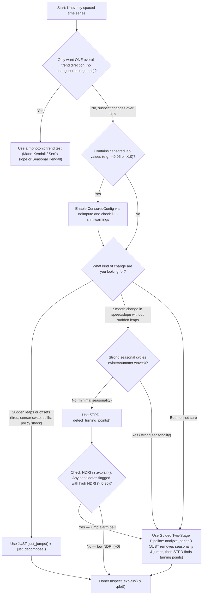

# Implementation Plan: Unevenly Sampled Time-Series Change Detection & Spectral Decomposition (`JUST` + `STPD` + `ndimpute`)

> **Document Status:** Approved Architecture & Implementation Plan (Ready for Phase 0 Scaffolding)  
> **Mode:** Design specification only — no production source code has been written yet.  
> **Target Repository:** `LukeAFullard/tspec`  
> **Approved Package Name:** `tspec`  
> **Upstream Audit Baselines:**
> - `Ghaderpour/LSWAVE-SignalProcessing` @ `bd15923b1d4880b799b14fe016de4c1252259013` (branch `master`)
> - `LukeAFullard/ndimpute` @ `94d2be0f37e30256af36d87273f0793b256d00b` (branch `main`, v0.1.1)

---

## Table of Contents

1. [Executive Summary, Package Name Candidates & v1 vs. v2 Scope](#1-executive-summary-package-name-candidates--v1-vs-v2-scope)
2. [License & Clean-Room Audit Findings](#2-license--clean-room-audit-findings)
3. [Greenfield Repository Layout & Public API Design](#3-greenfield-repository-layout--public-api-design)
4. [Mathematical, Numerical & `ndimpute` Censored-Data Blueprint](#4-mathematical-numerical--ndimpute-censored-data-blueprint)
5. [Non-Statistician Documentation Plan](#5-non-statistician-documentation-plan)
6. [Phased Implementation Roadmap](#6-phased-implementation-roadmap)
7. [4-Tier Validation & Verification Plan](#7-4-tier-validation--verification-plan)
8. [Risks, Trade-Offs & Open Questions for Approval](#8-risks-trade-offs--open-questions-for-approval)
9. [Authoritative Literature & Citation Registry](#9-authoritative-literature--citation-registry)

---

## 1. Executive Summary, Package Name Candidates & v1 vs. v2 Scope

### 1.1 Vision & Dual-Audience Design Philosophy

This package implements a standalone, clean-room, numerically stable Python library unifying two complementary unevenly sampled time-series change-detection and decomposition frameworks—**JUST** (*Jumps Upon Spectrum and Trend*; Ghaderpour & Vujadinovic, 2020a; Ghaderpour, 2021) and **STPD** (*Sequential Turning Point Detection*; Ghaderpour et al., 2024)—with first-class, statistically honest support for **censored observations** (`<LOD`, `>UL`, mixed, and interval censoring) via [`ndimpute`](https://github.com/LukeAFullard/ndimpute).

Every API, default, diagnostic, and documentation page is designed around two audiences simultaneously:

| Audience | Core Needs | How This Package Delivers |
| :--- | :--- | :--- |
| **Applied Practitioners & Domain Scientists** (hydrology, water quality, ecology, GIS/RS, geotechnical monitoring) | Plain-English guidance on *which method to use when*, safe defaults, zero-boilerplate `datetime` / `"<0.05"` inputs, clear caveats, interpretable outputs | Guided `analyze_series()` pipeline, decision flowchart in docs, scale-aware guardrails, automated red-flag diagnostics (shifting detection limits, red noise, high NDRI), `.explain()` plain-English narrative, and publication-ready `.plot()` |
| **Quantitative Analysts & Researchers** | Exact mathematical fidelity to published algorithms, zero interpolation of gappy series, weighted inverse-covariance modeling (`P`), transparent uncertainty propagation, reproducible parity benchmarks | Clean-room QR/Cholesky Schur-complement linear algebra, exact Beta/$F$-test & $t$-test statistics, full provenance objects, explicit parity preset against Ghaderpour's MATLAB/Python reference outputs, and a 4-tier validation suite |

### 1.2 Package Name Candidates

The target GitHub repository is provisionally named `tspec`. Before scaffolding `src/<package_name>/` and publishing to PyPI, the following 5 PyPI-friendly candidates (checked via web/PyPI search; note `pyjust` is already taken on PyPI by a wrapper for the Rust `just` task runner) are proposed for final approval:

| Candidate | Meaning / Mnemonic | PyPI Status | Strengths | Trade-Offs |
| :--- | :--- | :--- | :--- | :--- |
| **`tspec`** *(Recommended — matches repo)* | **T**ime-**S**eries **Spec**tral & Change-Point Analysis | Appears available (verify live at publish time) | Very short (`import tspec`); already matches `LukeAFullard/tspec`; expands cleanly to v2 wavelet/cross-spectral tools | Slight conceptual overlap with telecom "TSpec" or astronomy spectroscopy; emphasizes "spectrum" slightly more than "turning points" |
| **`spectrend`** | **Spec**trum + **Trend** | Appears available | Memorable, readable by non-statisticians; captures LSSA/ALLSSA + JUST + STPD naturally | Does not explicitly mention jumps/breakpoints in the name |
| **`lsbreaks`** | **L**east-**S**quares **Breaks** | Appears available | Accurately names the shared statistical foundation (weighted least-squares) and primary user goal (breaks: jumps & turning points) | Mildly technical (`ls`) for non-statisticians; narrower if v2 leans heavily into spectrograms |
| **`tsbreaks`** | **T**ime-**S**eries **Breaks** | Appears available | Immediately clear to applied environmental/geoscience practitioners | Generic; does not distinguish uneven-sampling / spectral decomposition from generic changepoint libraries (`ruptures`) |
| **`juststpd`** | **JUST** + **STPD** | Appears available | Maximum search discoverability for researchers specifically looking for Ghaderpour's JUST and STPD in Python | Acronym-heavy for non-statisticians; awkward when v2 adds LSWA/LSCWA |

> Throughout this plan, `tspec` is used as the provisional working package name; all module paths and imports are agnostic and trivially parameterized once approved.

### 1.3 Release Scope: v1.0 vs. v1.1 vs. v2.0

| Version | Modules & Capabilities | Rationale |
| :--- | :--- | :--- |
| **v1.0 (Core Release)** | - Weighted spectral engine: `lssa`, `allssa`<br>- JUST core: `just_jumps`, `just_decompose`<br>- STPD core: `detect_turning_points` (`stpd`), `fit_piecewise_trend` (`tptr`)<br>- Two-stage guided workflow: `analyze_series` (JUST → STPD)<br>- `ndimpute` censored-data workflow (parsing, temporal-order-safe imputation, shifting-DL detection, censoring guardrails, stability sweeps, provenance)<br>- Time-coordinate adapter, transparent `NaN` handling, red-noise diagnostics ($\hat{\phi}_1$, $n_{\text{eff}}$)<br>- Result dataclasses with `.summary()`, `.explain()`, `.to_dataframe()`, `.plot()`<br>- Full non-statistician MkDocs site + 4-tier validation suite | Delivers the complete retrospective change-detection, decomposition, turning-point, and censored-data workflow with full numerical parity and high documentation polish without scope creep. |
| **v1.1 (NRT Monitoring)** | - `just_monitor` (Near-Real-Time disturbance detection & abrupt vs. phenological classification; Ghaderpour & Vujadinovic, 2020b)<br>- Generalized monitoring frequency band (removing upstream's hardcoded `0.1–3.5 c/yr` assumption) + incremental/streaming update ergonomics<br>- **Repeated-testing / sequential-peeking $p$-value control:** multi-frequency Šidák/Bonferroni correction, alpha-spending / $\text{ARL}_0$-calibrated boundaries, and optional consecutive-confirmation gating (with `parity_mode=True` for unadjusted upstream behavior) | Small incremental footprint (~150–250 LOC reusing `lssa`/`allssa`), but has distinct operational semantics (history/monitoring split, streaming state, and repeated-testing false-alarm run-length validation). |
| **v2.0 (Wavelets & Cross-Series)** | - `lswa` (Least-Squares Wavelet Analysis; Ghaderpour & Pagiatakis, 2017, 2019)<br>- `lscsa` & `lscwa` (Cross-Spectral & Cross-Wavelet Analysis for paired irregular series, e.g., rainfall vs. streamflow; Ghaderpour et al., 2021)<br>- Optional batch parallelization / Numba acceleration for large InSAR/satellite stacks (10,000+ series) | Time-frequency spectrograms and bivariate cross-wavelet coherence are distinct analytical paradigms with heavy plotting and memory requirements; cleanly deferred so v1.0 stays lean and rock-solid. |

---

## 2. License & Clean-Room Audit Findings

### 2.1 Repository Licensing & Clean-Room Gate Verdict

Both upstream repositories were cloned and audited directly across all files, headers, and metadata:

| Repository | Inspected Commit | License File / GitHub Metadata | File Headers | Legal Determination |
| :--- | :--- | :--- | :--- | :--- |
| `Ghaderpour/LSWAVE-SignalProcessing` | `bd15923b` (`master`, 2023-12-02) | **None** (`licenseInfo: null`; no `LICENSE` or `COPYING` file) | Explicit `Copyright (c) 2019`, `Copyright (c) 2021`, `Copyright (c) 2023` by Ebrahim Ghaderpour across all 22 MATLAB and Python source files; **no permissive grant** | **All Rights Reserved.** Incompatible with code copying, translation, or vendoring. |
| `LukeAFullard/ndimpute` | `94d2be0f` (`main`, v0.1.1, 2026-11-07) | **`MIT License`** (`Copyright (c) 2026 LukeAFullard`) | Consistent MIT packaging metadata in `pyproject.toml` | **Permissive OSI license.** Safe to declare as a Python dependency. |

#### Mandatory Clean-Room Compliance Policy (TRIGGERED)

Because `Ghaderpour/LSWAVE-SignalProcessing` has no open-source license:

1. **Strict Clean-Room Implementation:** Every module in `src/` MUST be authored independently from the mathematical equations and algorithmic definitions in the peer-reviewed publications (Section 9). Zero lines of code, docstrings, comments, or control-flow translations may be copied from `Ghaderpour/LSWAVE-SignalProcessing`.
2. **No Vendored Upstream Datasets:** The `.dat`, `.csv`, and `.txt` example files inside `Ghaderpour/LSWAVE-SignalProcessing` also carry no permissive redistribution license. They MUST NOT be committed to `tests/`, `docs/`, or release archives. All unit tests, docs, and cookbooks will use newly generated synthetic benchmarks or explicitly open-licensed datasets.
3. **Isolated Validation Oracle Only:** `validation/upstream_ref/` is strictly `.gitignore`d and excluded from `pyproject.toml` sdist/wheel builds. An opt-in helper script (`validation/fetch_upstream.py`) clones `Ghaderpour/LSWAVE-SignalProcessing` pinned to `bd15923b` locally on developer/validation machines solely to run automated black-box numerical parity checks (Tier 1).
4. **Target Package License Recommendation:** **MIT License** (`LICENSE` at repo root) — directly aligned with `LukeAFullard/ndimpute` (MIT) and fully compatible with `numpy`, `scipy`, `pandas`, and `matplotlib` (all BSD-3-Clause / PSF-compatible).
5. **Academic Attribution:** Include a standard `CITATION.cff` file and complete bibliographic citations (with DOIs) in module docstrings, README, and documentation citing Ghaderpour et al. (2017–2024), Helsel (2012), Turnbull (1976), and `ndimpute`.

---

### 2.2 Forensic Audit of `Ghaderpour/LSWAVE-SignalProcessing`

#### A. Upstream Public Functions, Signatures, Defaults & Statistical Mechanics

| Upstream File & Function | Signature & Defaults | Core Mathematical & Statistical Formulation | Selection / Tie-Breaking Semantics |
| :--- | :--- | :--- | :--- |
| `LSSA.py` → `LSSA` | `(t, f, P=1, Omega=[], ind=[], level=0.01, trend='linear', slope=False, freq=[], saveto=0)` | Weighted OLS on design matrix $D$ (piecewise intercepts, piecewise or shared slopes, global $t^2$/$t^3$, known `freq` cos/sin). Normalized LSS via Schur complement $s(\omega) = \frac{r^T P \Phi S^{-1} \Phi^T P r}{r^T P r}$, $S = \Phi^T P \Phi - \Phi^T P D (D^T P D)^{-1} D^T P \Phi$. Critical value from $\text{Beta}(1, (n - n_c - 2)/2)$: $s_{\text{crit}} = 1 - \alpha^{2/(n - n_c - 2)}$. | `Omega` sorted ascending; frequencies already in `freq` get `spec=0.0`; `spec` clamped to `[0, 1]`. |
| `ALLSSA.py` → `ALLSSA` | `(t, f, P=1, Omega=[], ind=[], level=0.01, trend='linear', slope=False, decimal=1)` | Iterative anti-leakage search calling `LSSA`. Picks argmax on coarse `Omega`, rounds to integer `Om = round_half_up(Omega[idx])`, drops the last previously selected frequency rounding to `Om`, refines on `[Om - 0.5, Om + 0.5]` at step $10^{-\text{decimal}}$, accepts if $s(\omega_{\text{new}}) > s_{\text{crit}}$. Default `Omega = range(1, ceil(M/2))` where $M = (n-1)/(t_{n-1}-t_0)$. | `argwhere(spec == max(spec))[0][0]` picks smallest frequency on exact ties; terminates when sorted `freq` list stabilizes (`freq1 == freq2`). |
| `JUSTjumps.py` → `JumpDetect` | `(t, f, P=1, season='ALLSSA', Omega=[], level=0.01)` | Scans `Ind in range(3, n - 2)`. Fits 2-piece discontinuous linear trend (`slope=False`) + `ALLSSA` / fixed `OLS` / `'none'`. Computes $\text{Mag} = (\hat{b}_2 - \hat{b}_1) + (\hat{a}_2 - \hat{a}_1) t_{\text{Ind}}$ and $\text{Dir} = \hat{a}_2 - \hat{a}_1$. Default `Omega`: `[0.8, 1.0, ..., 3.8]` (`ALLSSA`), `[1, 2, 3, 4]` (`OLS`). | Minimizes weighted residual norm `norm_res`; Python Timsort picks smallest `Ind` on ties. Always returns 1 candidate per window. |
| `JUSTjumps.py` → `AllJumps` & `JUSTjumps` | `(t, f, P=1, size=None, step=None, season='ALLSSA', Omega=[], level=0.01, mag_th=0.05, dir_th=0.01, jump_th=0.75, saveto=0)` | Slides window of `size=3M` by `step=M` ($M = \lfloor n / (t_{n-1} - t_0) \rfloor$). Aggregates identical `Ind` by count (`occurrence`), assigning `Mag`/`Dir`/`Dis` from window minimizing distance to window center $|j_{\text{loc}} - (R-1)/2|$. Buckets distance by `int(int(Dis) / (size / 6.0))`. Greedy adjacent merge when $t_r - t_{r-1} < \text{jump\_th}$. Filters out only if `|Mag| < mag_th AND |Dir| < dir_th`. | Pairwise merge priority: (1) highest `occurrence`, (2) lowest bucketed center-distance, (3) highest `|Mag|`. Keeps if `|Mag| >= mag_th OR |Dir| >= dir_th`. |
| `JUSTdecompose.py` → `JUSTdecompose` | `(t, f, P=1, tt=[], size=None, step=None, season='ALLSSA', Omega=[], ind=[], level=0.01, display=False)` | Slides `size=3M`, `step=M` windows; includes jumps `lb0 + 2 <= J < ub0 - 1`. Fits trend+season, shifts mean of local seasonal component into trend. Blends overlapping windows with Gaussian weights $\exp(\frac{\ln 0.1}{(R/(6M))^2} (t - \tau_0)^2)$. Optional analytic evaluation on `tt`. | Overlapping windows combined by normalized Gaussian weighted average. |
| `JUSTmonitor.py` → `JUSTmonitor` | `(t, f, P=1, start=None, history=0, h=0.25, season='ALLSSA', Omega=[], trend='linear', level=0.01, display=False)` | Fits stable baseline on `[history:start]`, forecasts forward, monitors trailing residual window `[Lh : Lhis + d]` with `LSSA(..., Omega=[0.1..3.5], trend='constant')`. | `max(spec[0:9]) > CritVal` → `Type=1` (abrupt; refits jump for `Mag`/`Dir`); else `max(spec) > CritVal` → `Type=2` (phenological); else `Type=0`. |
| `LSWA.py` → `LSWA` | `(t, f, P=1, tt=[], rate=None, Omega=[], ind=[], level=0.01, trend='linear', slope=False, freq=[], L1=None, L0=None, morlet=0.0125)` | Frequency-adaptive window $L_k = L_0 + \lfloor L_1 M / \omega_k \rfloor$ (forced odd) with Morlet Gaussian weights $\exp(-c (2\pi \omega_k)^2 (t - t_j)^2)$ (`c=0.0125, L1=6, L0=0`). Calls `LSSA` at each $(\omega_k, t_j)$. | Removes global piecewise trend first if `ind` provided. |
| `STPD.py` → `TPDetect`, `TPD`, `STPD` | `STPD(t, f, size=None, step=None, SNR=1, NDRI=0.3, alpha=0.01, dir_th=0, tp_th=1, margin=1)` | **Sequential two-step continuous OLS** (NOT simultaneous 3-param joint OLS!): for `ind in range(margin, n - margin)`, fits unconstrained 2-param OLS on `0..ind`, then 1-param anchored OLS on `ind..n-1` through `(t[ind], y_hat[ind])`. Runs **both forward and backward**, picks smaller `||r||_2`. Computes `Diff = |tau_f - tau_b|`, two-sided Student $t$-test ($df = n-2$), $\text{SNR} = \|y\|_2 / \|f - y\|_2$, $\text{NDRI} = |\|r_1\|_2 - \|r_2\|_2| / (\|r_1\|_2 + \|r_2\|_2)$. Default `size=5M, step=M`. | Window accepts TP iff `Diff < 4` AND `SNR > SNR_th` AND `pval < alpha` AND `|DIR| > dir_th` AND `NDRI < NDRI_th`. Greedy merge if $t_r - t_{r-1} < \text{tp\_th}$, keeping TP closest to window center. |
| `TPTR.py` → `TPTRF`, `TPTR` | `TPTR(t, f, TPs)` | Chained sequential continuous OLS forward and backward across accepted `TPs`; picks direction with strictly lower `||f - y||_2`. Recomputes per-TP post-slope, direction, local SNR, and local NDRI across adjacent pieces. | Picks forward if `||f - y1|| < ||f0 - y0||`, else backward. |

> **Critical Mathematical Insight from STPD Code Inspection:** Because `TPDetect` fits the left segment first by unconstrained 2-parameter OLS and then anchors the right segment at the left segment's predicted endpoint, the forward and backward fits are genuinely asymmetric. That asymmetry is precisely why `Diff = |tau_f - tau_b|` and `NDRI` distinguish genuine continuous turning points (`Diff` small, `NDRI ≈ 0`) from step jumps (`Diff` large and/or `NDRI → 1`). A naive simultaneous 3-parameter hinge fit ($b_1 + a_1 t + \Delta a (t - \tau)_+$) would always produce $\tau_f \equiv \tau_b$ (`Diff == 0`), destroying STPD's forward/backward agreement criterion!

#### B. Catalog of Upstream Bugs, Fragilities & Numerical Quirks Discovered

Every item below was verified directly in the upstream source files and drives concrete design improvements + entries in our Parity & Divergence Report:

| # | Upstream File & Line(s) | Defect / Fragility | Clean-Room Fix & Parity Handling |
| :--- | :--- | :--- | :--- |
| 1 | `LSSA.py:270` | **`UnboundLocalError` when `nc == 0`:** `N12T = np.transpose(N12)` executes unconditionally even when `trend='none'` and `freq=[]`. | Orthogonal projection via QR handles `nc == 0` naturally without branching errors. |
| 2 | `LSSA.py:107, 250` | **`ZeroDivisionError` when `n == nc + 2`:** Guard allows `Lt == nc + 2`, then `CritVal = 1 - level**(2 / (Lt - nc - 2))` divides by zero. | Enforce `n >= nc + 3` when computing critical values / LSS (or return `crit_val = np.nan` if only OLS fit is requested with `Omega=[]`). |
| 3 | `LSSA.py:165-173, 271` | **Explicit `np.linalg.inv` on normal equations $D^T P D$:** Squares condition number ($\kappa(D)^2$), unstable on unshifted decimal years (e.g., `2020.5`) or near-collinear segments; divides by `norm_res` without zero guard. | Center/scale time internally; solve via whitened thin QR / SVD fallback + vectorized analytical 2×2 Schur complement; explicit condition-number diagnostics. |
| 4 | `LSSA.py:168, 264` | **Redundant $O(n \cdot n_c)$ copy for 1D `P`:** Uses `np.repeat(P, nc).reshape(...)` on every call instead of broadcasting. | Vectorized broadcasting `sqrt_p[:, None] * D` ($O(n)$ weight overhead). |
| 5 | `ALLSSA.py:105-128` | **No `max_iter` / cycle guard & `< 0.5` frequency crash:** `round_half_up(Om)` maps $\omega < 0.5$ to `0.0`, searching negative/zero frequencies where `cos(0)=1, sin(0)=0` causes singular-matrix `LinAlgError`; also stray `print(Om_range)` at `decimal=0` and no convergence cap. | Clamp fine search grid strictly positive ($\ge \max(\omega_{\min}, 10^{-\text{decimal}})$); add `max_iter` + cycle detection; tolerance-based frequency deduplication; zero stdout side effects. |
| 6 | `JUSTjumps.py:168-170` & `JUSTdecompose.py:192-194` | **Duplicate last window when `(n - size) % step == 0`:** Condition `if indb > Lt:` fails to stop when `indb == Lt`, so the next iteration snaps back to `[Lt - size : Lt]` and re-evaluates the final window twice (inflating occurrence counts by +1!). | Fix termination condition to `indb >= Lt` (matching `STPD.py:253`). Document exact difference in Parity Report. |
| 7 | `JUSTjumps.py:283-284, 312` | **Premature 2-decimal rounding & scale-dependent thresholds:** Rounds `Mag` and `Dir` to 2 decimals *before* threshold checks (`0.004 → 0.0`), breaking small-unit data; hardcoded `mag_th=0.05, dir_th=0.01` assumes NDVI/EVI scale `[-1, 1]`, with no statistical $p$-value gate. | Keep full `float64` precision internally; compute nested partial $F$-test `jump_pvalue` for every candidate jump; warn automatically when `mag_th` is grossly mismatched to `std(y)`. |
| 8 | `JUSTdecompose.py:42` | **Off-by-one bug in `TrendComponent`:** `np.where(tt >= t[ind[k]])[0][0] + 1` shifts every regularized jump one grid index to the right. | Use exact `np.searchsorted(tt, t[j], side="left")` without `+ 1`. |
| 9 | `JUSTdecompose.py:245` | **Global NumPy state mutation:** `np.seterr(divide='ignore', invalid='ignore')` permanently silences floating-point warnings across the entire process. | Use local `with np.errstate(...):` only where mathematically guarded. |
| 10 | `STPD.py:58, 181` | **Default `margin=1` causes `0/0 = NaN` crash in `pvalue`:** At `ind = 1`, `SE1` divides by `ind - 1 = 0`. Upstream's `RunMe.py` only avoided this by passing `margin=12`. | Enforce `margin >= 2` (default `margin = max(2, int(0.1 * size))` or explicit `margin=2` minimum) and guard `n1 >= 3, n2 >= 2`. |
| 11 | `STPD.py:64` | **Non-standard `SE2` denominator:** Centers `D2 - mean(D2)` in the SE of a zero-intercept anchored slope (true OLS SE uses `||D2||_2`). | Document exact formula; preserve `D2 - mean(D2)` in parity mode (`se_mode="ghaderpour"`) and note mathematical distinction in Reference Docs & Parity Report. |
| 12 | `STPD.py:161, 164` | **Non-shift-invariant `SNR` & density-biased `NDRI`:** `SNR = ||y|| / ||f - y||` explodes on large-baseline series (e.g., pH 7.5, temperature 290 K); raw $L_2$-norm `NDRI` falsely rejects genuine turning points when sampling density differs between left/right halves ($n_1 \neq n_2$). | Expose `snr_mode` (`'raw'` vs. `'centered'`) and `ndri_mode` (`'l2'` vs. `'rmse'`), always computing and reporting both metrics in `StpdResult` plus automatic diagnostic warnings. |
| 13 | `STPD.py:260` | **Hardcoded `Diff < 4` index tolerance & no weight support `P`:** Index-count tolerance changes meaning when sampling rate varies. | Parameterize `max_fb_diff: int = 3` (matching `< 4`) or `max_fb_time_diff` in duration mode; add optional 1D weights `P`. |
| 14 | `TPTR.py:53, 126` | **2-decimal rounding & inconsistent return type:** Rounds `stats` to 2 decimals, drops initial segment slope `slopes[0]` from `stats`, and returns scalar float `slopes` when `len(TPs) == 0` vs. list when `len(TPs) > 0`. | Return typed `PiecewiseTrendResult` containing all `m + 1` full-precision segment slopes, intercepts, and per-TP statistics. |
| 15 | `LSWA.py:161, 206` | **Drops off-diagonal `P` & `NameError` in `PlotSpectrogram`:** Discards correlations of 2D `P` when `morlet != 0`; `PlotSpectrogram` references global `args.display` instead of parameter `display`. | Fixed cleanly in v2.0 `lswa` design. |
| 16 | All JUST CLI scripts | **Python 3.8+ breakage & OS bugs:** Calls removed `time.clock()`, passes float `Numfreq` to `np.linspace`, uses `argparse(..., type=bool)` (`bool("False") == True`), hardcodes Windows backslashes (`'\OLSResults.xlsx'`), mutates `pyplot.rc`, saves hardcoded PNGs to CWD. | Modern Python 3.10+ library API with `pathlib`, zero global matplotlib mutations, no implicit file writes. |

---

### 2.3 Forensic Audit of `LukeAFullard/ndimpute`

| Audit Dimension | Exact Findings from `ndimpute` v0.1.1 (`94d2be0f`) | Implications for Our Integration |
| :--- | :--- | :--- |
| **Packaging & Dependencies** | MIT License; `poetry-core`; `python >= 3.9`; runtime deps: `numpy >= 1.24.0`, `pandas >= 2.0.0`, `scipy >= 1.13.0`; optional `viz = ["matplotlib", "seaborn"]`. | `ndimpute` pulls in **`pandas >= 2.0`** and requires **`scipy >= 1.13`** (for `scipy.stats.CensoredData`). Align our `scipy` floor at `>= 1.13` and weigh `ndimpute` as optional extra vs. core dep (Section 3.2). |
| **Public API Surface** | Single exported entry point: `ndimpute.impute(values, status=None, method='ros', censoring_type=None, **kwargs)`. | Very clean surface—our adapter only needs to wrap `ndimpute.impute` (plus optional bootstrap resampling around it), minimizing coupling to private `_*.py` internals. |
| **Supported Inputs** | 1. String/mixed iterables (`"<0.5"`, `">10"`, `"5.0"`, `None`, `NaN`, `""`, `"NA"`, custom `left_marker`/`right_marker`).<br>2. Numeric arrays + `status` (`bool`, `{0,1}` left/right, `{-1,0,1}` mixed, LWPTrends `'lt'/'gt'/'not'`).<br>3. Interval `(N, 2)` lower/upper bounds with `censoring_type='interval'`.<br>Raises `ValueError` on `inf`, conflicting markers/status, `< 2` detects, zero spread, or `values <= 0` for `lognormal`/`weibull`. | Support all three input idioms seamlessly in our censored wrapper; normalize `dist='auto'` cleanly when series contain zeros or negative values (note `ndimpute` automatically skips `lognormal`/`weibull` in `dist='auto'` if any `v <= 0`). |
| **Methods & Options** | - `method='ros'`: Hirsch–Stedinger (`'kaplan-meier'`, NADA-exact) or `'simple'`; `dist in ('lognormal', 'normal', 'auto')`; `impute_type in ('quantile', 'stochastic', 'mean')`; `clamp=True`; mixed `'sequential'` (LWPTrends) or `'turnbull'` (experimental).<br>- `method='parametric'`: full censored MLE (`scipy.stats.CensoredData`, `survreg`-exact); `dist in ('lognormal', 'normal', 'weibull', 'auto')`; `impute_type in ('mean', 'stochastic')`.<br>- `method='substitution'`: provided for comparison only. | Recommend `method='ros'` for left-censored environmental data and `method='parametric'` for right-, mixed-, or interval-censored data (matching `ndimpute`'s own guidance in `STATISTICAL_METHODS.md §8`). |
| **Return Schema** | `pd.DataFrame` with columns `imputed_value`, `original_value` (or `original_left`/`original_right`), `censoring_status`, `is_imputed`; `df.attrs` stores `method`, `censoring_type`, `dist`, `impute_type`, `r_squared` or `fit`/`log_likelihood`, `best_dist`/`fit_score`, `n_missing`. | Extract all columns and `df.attrs` directly into our `CensoringProvenance` dataclass; carry through `NaN`s cleanly to our `NaN`-dropping index mapper. |
| **CRITICAL DISCOVERY #1: Temporal Trend Injection in Default ROS Quantiles** | In `ndimpute/_ros_left.py:90, 105–110`, `hirsch_stedinger_ppoints` calls `np.argsort(values, kind="stable")`. Because `values` is passed in **chronological time order**, all non-detects tied at the same detection limit $L_j$ receive monotonically increasing ranks $r = 1, \dots, C_j$ in **exact temporal order**—assigning the lowest imputed value to the earliest timestamp and the highest imputed value to the latest timestamp! (And reverse-ROS right censoring injects a deterministic *downward* trend!) | **MANDATORY SAFEGUARD:** NEVER run unshuffled `method='ros', impute_type='quantile'` directly on time-ordered data! Default to `impute_type='stochastic'` (with deterministic seed + stability draws) or time-order-invariant `impute_type='mean'`; if `'quantile'` is explicitly requested, randomly permute indices within each tied detection-limit group before assigning quantiles. |
| **CRITICAL DISCOVERY #2: Improper Single Imputation & Variance Shrinkage** | `ndimpute/STATISTICAL_METHODS.md §7` explicitly documents that (a) conditional-mean imputation compresses variance (log-SD biased by $\approx -0.22$ at 60% censoring), which inflates $F$- and $t$-test statistics, and (b) repeating `'stochastic'` draws across seeds conditions on fixed $\hat\theta$ (not proper Rubin MI). | Surface this honestly in `.explain()` and docs; provide BOTH fast fixed-$\hat\theta$ stochastic sensitivity draws AND proper bootstrap-refit uncertainty propagation (`stability_mode='bootstrap'`) that resamples observations to propagate $\hat\theta$ uncertainty! |

---

## 3. Greenfield Repository Layout & Public API Design

### 3.1 Proposed Repository Structure

```text
tspec/
├── .github/
│   └── workflows/
│       ├── ci.yml                  # pytest + ruff + mypy matrix (Ubuntu & Windows, Python 3.10–3.13)
│       └── docs.yml                # mkdocs build (--strict) & GitHub Pages deployment
├── .gitignore                      # Ignores validation/upstream_ref/, build/, dist/, .pytest_cache/
├── CITATION.cff                    # Machine-readable academic citations (Ghaderpour 2017–2024, Helsel, Turnbull, ndimpute)
├── LICENSE                         # MIT License
├── PLAN.md                         # This architectural & implementation plan
├── README.md                       # Practitioner-first landing page + quickstart + method cheat table
├── mkdocs.yml                      # MkDocs Material config (Mermaid, KaTeX/MathJax, mkdocstrings)
├── pyproject.toml                  # PEP 621 metadata, hatchling backend, optional extras, ruff/mypy/pytest config
├── src/
│   └── tspec/
│       ├── __init__.py             # Curated public exports + __version__
│       ├── py.typed                # PEP 561 type-marker
│       ├── _types.py               # Type aliases, ArrayLike, TimeLike, WeightLike
│       ├── _time.py                # Time-coordinate adapter (datetime64/DatetimeIndex/Series/float -> decimal years), NaN & duplicate handling
│       ├── _linalg.py              # Numerically stable whitened QR, Cholesky/SPD checks, vectorized 2x2 Schur solver, condition guards
│       ├── _diagnostics.py         # Lag-1 & irregular continuous-time AR(1) red-noise diagnostics, n_eff, WarningItem engine
│       ├── spectral.py             # Public lssa(), allssa() + LssaResult, AllssaResult
│       ├── just.py                 # Public just_jumps(), just_decompose() + JustJumpResult, JustDecomposeResult
│       ├── stpd.py                 # Public detect_turning_points() (alias stpd), fit_piecewise_trend() + StpdResult, PiecewiseTrendResult
│       ├── pipeline.py             # Public analyze_series() (guided JUST -> STPD + censored workflow) + PipelineResult
│       ├── censored.py             # CensoredConfig, CensoringProvenance, ndimpute wrapper, tie-shuffle guard, DL-shift detector, stability runner
│       ├── results.py              # Shared result base/mixins, .summary(), .explain() narrative generator, .to_dataframe()
│       ├── plotting.py             # Lazy-matplotlib diagnostic plots (JUST jumps, decomposition, STPD + NDRI badges, censored markers)
│       └── exceptions.py           # TspecError, InsufficientDataError, RankDeficiencyError, CensoringError
├── tests/
│   ├── conftest.py                 # Deterministic SeedSequence fixtures, synthetic generators
│   ├── test_time_adapter.py        # Datetime, NaN remapping, duplicate/unsorted validation
│   ├── test_linalg.py              # QR vs dense normal eqs, 1D O(n) vs 2D SPD P, ill-conditioned matrices
│   ├── test_spectral.py            # lssa & allssa unit, Beta/F calibration, invariance, edge cases
│   ├── test_just.py                # just_jumps & just_decompose unit, count vs duration windows, jump F-test
│   ├── test_stpd.py                # STPD & TPTR unit, NDRI/SNR modes, forward/backward agreement, margin guards
│   ├── test_censored.py            # ndimpute integration, quantile trend-injection regression test, DL-shift detection, guardrails
│   ├── test_pipeline.py            # End-to-end analyze_series(), .summary(), .explain(), .to_dataframe(), .plot()
│   └── test_properties.py          # Hypothesis property-based tests (shift invariance, scale equivariance, degenerate inputs)
├── validation/                     # Excluded from built wheel/sdist via pyproject.toml
│   ├── README.md                   # How to run Tiers 1–4 validation locally
│   ├── fetch_upstream.py           # Clones Ghaderpour/LSWAVE-SignalProcessing @ bd15923b into gitignored upstream_ref/
│   ├── upstream_ref/               # GITIGNORED — never committed or packaged
│   ├── compare_upstream.py         # Tier 1 isolated parity harness (with runtime time.clock shim)
│   ├── bench_just_mc.py            # Tier 2 JUST Monte Carlo ground-truth matrix
│   ├── bench_stpd_mc.py            # Tier 2 STPD + head-to-head JUST vs STPD Monte Carlo matrix
│   ├── bench_censored_mc.py        # Tier 2 censored data + shifting-DL + DL/2 comparison matrix
│   ├── bench_rednoise_mc.py        # Tier 2 AR(1) red-noise calibration sweep
│   ├── bench_pipeline_e2e.py       # Tier 2 combined seasonality + jump + TP + gaps + censoring benchmark
│   ├── bench_perf.py               # Tier 4 runtime & peak memory (tracemalloc) profiler
│   └── reports/                    # Generated Markdown/CSV validation reports (committed per release)
└── docs/                           # Complete non-statistician & technical documentation site (Section 5)
```

### 3.2 Packaging & Dependency Footprint (`pyproject.toml`)

- **Build system:** `hatchling` (clean PEP 621 standard, trivial sdist/wheel exclusion of `validation/`).
- **Python support:** `>= 3.10` (tested in CI on 3.10, 3.11, 3.12, 3.13 across `ubuntu-latest` and `windows-latest`).
- **Approved Dependency Strategy (Option 2A — Installed by Default + Lite Escape Hatch):**
  - **Core dependencies (`pip install tspec`):** `numpy >= 1.24`, `scipy >= 1.13`, `ndimpute >= 0.1.1, < 1.0` (which transitively supplies `pandas >= 2.0` for `.to_dataframe()` and censored-data workflows out of the box).
  - **Lite installation (`numpy` + `scipy` only):** All imports of `ndimpute` and `pandas` inside `src/tspec/` remain **strictly lazy** (only imported when censored data or `.to_dataframe()` is invoked, with a clear `ImportError` message if absent). Users who want a zero-`pandas` / zero-`ndimpute` environment can install with `pip install --no-deps tspec` alongside `numpy` and `scipy`, and CI will run a dedicated "lite environment" test job verifying core `lssa`, `allssa`, `just_jumps`, `just_decompose`, and `stpd` work cleanly without `ndimpute` or `pandas`.
  - **Optional extras:**
    - `plot = ["matplotlib>=3.7"]`
    - `all = ["matplotlib>=3.7"]`
    - `dev = ["pytest>=8.0", "hypothesis>=6.100", "ruff>=0.6", "mypy>=1.11", "matplotlib>=3.7"]`
    - `docs = ["mkdocs-material>=9.5", "mkdocstrings[python]>=0.26"]`

### 3.3 Public API Signatures & Defaults

All public functions accept `t: TimeLike` (`np.ndarray`, `Sequence[float]`, `datetime64`, `pd.DatetimeIndex`, or `pd.Series` with datetime/numeric index) and `y: ValueLike` (numeric 1D array, string/mixed censored array like `["<0.05", 0.12]`, `pd.Series`, or `(N, 2)` interval array when `censoring` is enabled).

#### 1. Spectral Engine (`tspec.spectral`)

```python
def lssa(
    t: TimeLike,
    y: ArrayLike,
    *,
    weights: WeightLike | None = None,
    omega: ArrayLike | None = None,
    jump_indices: Sequence[int] | None = None,
    alpha: float = 0.01,
    trend: Literal["none", "constant", "linear", "quadratic", "cubic"] = "linear",
    shared_slope: bool = False,
    known_freqs: Sequence[float] | None = None,
) -> LssaResult: ...

def allssa(
    t: TimeLike,
    y: ArrayLike,
    *,
    weights: WeightLike | None = None,
    omega: ArrayLike | None = None,
    jump_indices: Sequence[int] | None = None,
    alpha: float = 0.01,
    trend: Literal["none", "constant", "linear", "quadratic", "cubic"] = "linear",
    shared_slope: bool = False,
    decimal: int = 1,
    max_iter: int | None = None,
) -> AllssaResult: ...
```

#### 2. JUST Module (`tspec.just`)

```python
def just_jumps(
    t: TimeLike,
    y: ValueLike,
    *,
    weights: WeightLike | None = None,
    size: int | None = None,
    step: int | None = None,
    window_mode: Literal["count", "duration"] = "count",
    window_duration: float | None = None,
    step_duration: float | None = None,
    min_window_obs: int | None = None,
    season: Literal["allssa", "ols", "none"] = "allssa",
    omega: ArrayLike | None = None,
    alpha: float = 0.01,
    mag_th: float = 0.05,
    dir_th: float = 0.01,
    jump_th: float = 0.75,
    jump_alpha: float | None = None,
    censor_status: ArrayLike | None = None,
    censoring: CensoredConfig | None = None,
    parity_mode: bool = False,
) -> JustJumpResult: ...

def just_decompose(
    t: TimeLike,
    y: ValueLike,
    *,
    weights: WeightLike | None = None,
    eval_times: TimeLike | None = None,
    jump_indices: Sequence[int] | None = None,
    size: int | None = None,
    step: int | None = None,
    window_mode: Literal["count", "duration"] = "count",
    window_duration: float | None = None,
    step_duration: float | None = None,
    season: Literal["allssa", "ols", "none"] = "allssa",
    omega: ArrayLike | None = None,
    alpha: float = 0.01,
    censor_status: ArrayLike | None = None,
    censoring: CensoredConfig | None = None,
) -> JustDecomposeResult: ...
```

#### 3. STPD Module (`tspec.stpd`)

```python
def detect_turning_points(
    t: TimeLike,
    y: ValueLike,
    *,
    weights: ArrayLike | None = None,
    size: int | None = None,
    step: int | None = None,
    window_mode: Literal["count", "duration"] = "count",
    window_duration: float | None = None,
    step_duration: float | None = None,
    snr_th: float = 1.0,
    snr_mode: Literal["raw", "centered"] = "centered",   # parity_mode=True uses "raw" (Q5)
    ndri_th: float = 0.3,
    ndri_mode: Literal["l2", "rmse"] = "rmse",           # parity_mode=True uses "l2" (Q5)
    alpha: float = 0.01,
    dir_th: float = 0.0,
    tp_th: float = 1.0,
    margin: int | None = None,
    max_fb_diff: int = 3,
    max_fb_time_diff: float | None = None,
    refit_mode: Literal["sequential", "joint"] = "sequential",
    censor_status: ArrayLike | None = None,
    censoring: CensoredConfig | None = None,
    parity_mode: bool = False,
) -> StpdResult: ...

# Concise alias exported at top-level
stpd = detect_turning_points

def fit_piecewise_trend(
    t: TimeLike,
    y: ArrayLike,
    tp_indices: Sequence[int],
    *,
    weights: ArrayLike | None = None,
    mode: Literal["sequential", "joint"] = "sequential",
) -> PiecewiseTrendResult: ...
```

#### 4. Guided Two-Stage Pipeline & Censored Configuration (`tspec.pipeline`, `tspec.censored`)

```python
@dataclass(frozen=True)
class CensoredConfig:
    method: Literal["ros", "parametric", "substitution"] = "ros"
    censoring_type: Literal["left", "right", "mixed", "interval"] | None = None
    dist: Literal["lognormal", "normal", "weibull", "auto"] = "auto"
    impute_type: Literal["stochastic", "mean", "quantile"] = "stochastic"
    scope: Literal["global", "windowed", "seasonal_stratified"] = "global"
    random_state: int | np.random.Generator | None = 0
    clamp: bool = True
    imputed_weight_factor: float = 1.0       # Optional down-weighting in P, e.g. 0.5
    n_stability_draws: int = 0               # >0 runs sensitivity / stability check (e.g. 20)
    stability_mode: Literal["stochastic", "bootstrap"] = "stochastic"
    detect_dl_shifts: bool = True
    dl_shift_rel_threshold: float = 0.20     # Flag >=20% step change in active DL
    recensor_check: bool = False             # Optional common-DL recensoring artifact test
    warn_censor_fraction: float = 0.20
    max_censor_fraction: float = 0.80
    allow_heavy_censoring: bool = False      # Opt-in above 50% / 80% guardrails
    left_marker: str = "<"
    right_marker: str = ">"
    ndimpute_kwargs: dict[str, Any] = field(default_factory=dict)

def analyze_series(
    t: TimeLike,
    y: ValueLike,
    *,
    weights: WeightLike | None = None,
    detect_jumps: bool = True,
    detect_turning_points: bool = True,
    remove_seasonality: bool = True,
    jump_adjustment: Literal["offset", "segment"] = "offset",
    censor_status: ArrayLike | None = None,
    censoring: CensoredConfig | None = None,
    just_kwargs: dict[str, Any] | None = None,
    decompose_kwargs: dict[str, Any] | None = None,
    stpd_kwargs: dict[str, Any] | None = None,
) -> PipelineResult: ...
```

### 3.4 Result Dataclasses & Human-Readable Methods

Every result dataclass is frozen (immutable), strongly typed, and inherits from a common `BaseResult` interface providing four uniform user-facing methods:

| Method | Return Type | Purpose & Guarantees |
| :--- | :--- | :--- |
| `.summary()` | `str` | Concise formatted technical table (timestamps, indices, magnitudes/slopes, $p$-values, NDRI/SNR, red-noise $\hat{\phi}_1$, censoring rate, active warnings). |
| `.explain()` | `str` | **Plain-English narrative for non-statisticians:** summarizes findings in everyday language ("Found 1 abrupt downward jump around June 2016 of −0.21 units..."), translates confidence/stability ("detected in 19 of 20 censoring draws"), and calls out red flags prominently (high NDRI suggesting a jump rather than turning point, strong residual autocorrelation, jump coinciding with a detection-limit change, or heavy censoring). |
| `.to_dataframe()` | `pd.DataFrame` | Tidy Pandas export (lazy import with helpful `ImportError` if `pandas` is not installed). Per-event tables for `JustJumpResult` / `StpdResult`; per-timestamp table (`time`, `value`, `trend`, `seasonal`, `remainder`, `is_censored`, `censor_status`) for `JustDecomposeResult` / `PipelineResult`. |
| `.plot(ax=None, **kwargs)` | `tuple[Figure, Any]` | Publication-ready Matplotlib figure (lazy import, zero global `rcParams` mutation, colorblind-safe Okabe–Ito palette). Marks jumps (vertical dashed lines + magnitude callout), turning points (diamonds + slope-change & NDRI badges), seasonal fit, shaded DL-shift transitions, and visually distinguishes censored/imputed observations (hollow downward triangles `▽` for `<DL`, hollow upward triangles `△` for `>UL`, interval whiskers for `[L, R]`). |

Key structured fields across result objects:
- **Shared diagnostics on all results:**
  - `diagnostics: DiagnosticReport` — `red_noise: RedNoiseDiagnostics` (`lag1_autocorr`, `ou_decay_corr`, `effective_sample_size`, `autocorr_warning`), `condition_number_max`, `n_input`, `n_valid`, `n_dropped_nan`, `warnings: tuple[WarningItem, ...]`.
  - `censoring: CensoringProvenance | None` — full record of original limits, status codes, imputed series, `ndimpute` fit attrs, overall & per-window censoring fractions, detected DL-shift timestamps, and stability metrics.
- **`JustJumpResult`:** `jumps: tuple[JumpEvent, ...]` (each with `index` mapped to original input axis, `valid_index`, `time` in native type, `time_year`, `magnitude`, `direction`, `occurrences`, `window_center_distance`, `jump_pvalue`, `window_censored_fraction`, `coincides_with_dl_shift`, `stability_rate`), `all_window_candidates`.
- **`JustDecomposeResult`:** `times`, `trend`, `seasonal`, `remainder`, `eval_times`, `trend_reg`, `seasonal_reg`, `jump_indices`, `window_frequencies`.
- **`StpdResult`:** `turning_points: tuple[TurningPointEvent, ...]` (each with `index`, `time`, `slope_before`, `slope_after`, `direction`, `pvalue`, `snr_raw`, `snr_centered`, `ndri_l2`, `ndri_rmse`, `fb_diff`, `window_censored_fraction`, `coincides_with_dl_shift`, `stability_rate`), `flagged_jumps: tuple[FlaggedJumpCandidate, ...]` (rejected high-NDRI candidates explicitly preserved so `.explain()` alerts the user!), `piecewise_trend: PiecewiseTrendResult`.
- **`PipelineResult`:** `jumps: JustJumpResult | None`, `decomposition: JustDecomposeResult | None`, `turning_points: StpdResult | None`, `adjusted_series: np.ndarray`, `combined_trend: np.ndarray`, `censoring: CensoringProvenance | None`, `diagnostics: DiagnosticReport`.

---

## 4. Mathematical, Numerical & `ndimpute` Censored-Data Blueprint

### 4.1 Time-Coordinate Adapter & `NaN` Preservation (`_time.py`)

1. **Accepted time types:** `np.datetime64`, `pd.DatetimeIndex`, `pd.Series` (datetime or numeric), `Sequence[datetime.datetime | datetime.date]`, or numeric arrays (`float` / `int`).
2. **Continuous decimal-year conversion:** Datetime inputs are converted to exact continuous decimal years accounting for actual leap-year day counts (`year + (t - Jan1(year)) / (Jan1(year+1) - Jan1(year))`), so frequencies $\omega$ are natively in **cycles/year** (matching Ghaderpour et al. 2020–2024) while storing the original native timestamps for lossless output mapping. Numeric inputs pass through unchanged in user units.
3. **Validation & Cleaning:**
   - Reject `NaT` / `NaN` / `inf` in `t`.
   - Enforce monotonic non-decreasing order; if unsorted, raise `ValueError` with a clear message (never silently reorder mismatched arrays).
   - Detect duplicate timestamps: emit an explicit error (or opt-in warning if identical timestamps occur within separate pieces; exact duplicate timestamps with identical values can destabilize 2-point pieces).
   - **Transparent `NaN` dropping in `y`:** Record `valid_mask = ~np.isnan(y)` (and reject `inf`), run all numerical algorithms strictly on `(t[valid_mask], y[valid_mask], P[valid_mask])` with **zero interpolation**, and map all output indices (`jump.index`, `tp.index`) back to the original input axis via `valid_idx_to_orig = np.flatnonzero(valid_mask)` (also returning aligned `NaN`-padded series in `JustDecomposeResult` where requested).

### 4.2 Stable Weighted Least-Squares & Vectorized Schur-Complement LSS (`_linalg.py`, `spectral.py`)

To eliminate normal-equation conditioning loss ($\kappa(D)^2$) and upstream `np.linalg.inv` crashes while preserving exact mathematical equivalence to Ghaderpour & Pagiatakis (2017) and Ghaderpour et al. (2018):

1. **Internal Time Conditioning:** Shift $t_0 = t - t_{\min}$ inside every local/global regression. For `'quadratic'` and `'cubic'` trends, fit in scaled coordinates $u = (t - \bar{t}) / s_t$ and analytically back-transform coefficients and covariance to $t_0$-coordinates (preserving exact upstream polynomial parametrization without $10^{12}$ Vandermonde blow-up).
2. **Exact Whitening ($O(n)$ memory for 1D `weights`):**
   - `weights is None` or positive scalar $p > 0$: $\tilde{D} = D$, $\tilde{f} = f$, weight scale factored cleanly (note LSS $s(\omega)$ and $\widehat{\text{Cov}}(\hat{c})$ are invariant to positive scalar scaling of $P$, while $\|r\|_P^2$ scales by $p$).
   - 1D vector $P \in \mathbb{R}_{>0}^n$ (strictly positive validated): $\tilde{D} = \sqrt{P}[:, \text{None}] \odot D$, $\tilde{f} = \sqrt{P} \odot f$. **Zero $O(n^2)$ array allocation.**
   - 2D matrix $P \in \mathbb{R}^{n \times n}$: verify symmetry ($\|P - P^T\|_\infty \le 10^{-10} \|P\|_\infty$) and SPD via Cholesky $P = L L^T$ (`scipy.linalg.cholesky(P, lower=True)`), then $\tilde{D} = L^T D$, $\tilde{f} = L^T f$. Raise `ValueError` if $P$ is not SPD.
3. **QR Orthogonal Projection & Vectorized Schur Complement:**
   - Compute thin QR factorization $\tilde{D} = Q R$ ($Q \in \mathbb{R}^{n \times n_c}$, $R \in \mathbb{R}^{n_c \times n_c}$). Check $\kappa(R) = \sigma_{\max}(R) / \sigma_{\min}(R)$: if $\kappa(R) > 10^{10}$, emit a `HIGH_CONDITION_NUMBER` diagnostic; if numerically rank-deficient ($\sigma_{\min} < 10^{-12} \sigma_{\max}$), fall back to thin SVD (`scipy.linalg.svd`) with explicit `RankDeficiencyWarning` (or raise `RankDeficiencyError` if fatal).
   - Estimate known-constituent parameters $\hat{c} = R^{-1} (Q^T \tilde{f})$ via `solve_triangular`, whitened residual $\tilde{r} = \tilde{f} - Q(Q^T \tilde{f})$, weighted norm $\|r\|_P^2 = \|\tilde{r}\|_2^2$, and covariance $\widehat{\text{Cov}}(\hat{c}) = \frac{\|r\|_P^2}{n - n_c} R^{-1} (R^{-1})^T$.
   - For all $K$ test frequencies $\Omega = \{\omega_1, \dots, \omega_K\}$ simultaneously:
     - Form whitened cosine/sine matrices $\tilde{C}, \tilde{S} \in \mathbb{R}^{n \times K}$ (chunked over $K$ if $nK$ exceeds memory budget, e.g., $K_{\text{chunk}} = 512$).
     - Project out $\text{col}(\tilde{D})$ via BLAS matrix multiply:
       $$\tilde{C}^\perp = \tilde{C} - Q(Q^T \tilde{C}), \qquad \tilde{S}^\perp = \tilde{S} - Q(Q^T \tilde{S}).$$
     - Notice the entries of the exact 2×2 Schur complement $S_k = \Phi_k^T P \Phi_k - N_{12,k}^T N_{11}^{-1} N_{12,k}$ are simply the columnwise inner products:
       $$a_k = \|\tilde{C}^\perp_{\cdot,k}\|_2^2, \quad d_k = \|\tilde{S}^\perp_{\cdot,k}\|_2^2, \quad b_k = (\tilde{C}^\perp_{\cdot,k})^T \tilde{S}^\perp_{\cdot,k},$$
       and the right-hand side is $g_{1,k} = (\tilde{C}^\perp_{\cdot,k})^T \tilde{r}$, $g_{2,k} = (\tilde{S}^\perp_{\cdot,k})^T \tilde{r}$.
     - Solve all $K$ 2×2 systems analytically: $\Delta_k = a_k d_k - b_k^2$. Where $\Delta_k > \epsilon (a_k + d_k)^2$,
       $$\hat{c}_{1,k} = \frac{d_k g_{1,k} - b_k g_{2,k}}{\Delta_k}, \quad \hat{c}_{2,k} = \frac{-b_k g_{1,k} + a_k g_{2,k}}{\Delta_k}, \quad s(\omega_k) = \text{clip}\!\left(\frac{g_{1,k}\hat{c}_{1,k} + g_{2,k}\hat{c}_{2,k}}{\|\tilde{r}\|_2^2}, 0, 1\right).$$
       Where $\Delta_k \le \epsilon (a_k + d_k)^2$ (frequency collinear with known constituents) or $\|\tilde{r}\|_2^2 = 0$, set $s(\omega_k) = 0$ cleanly without crashing.
4. **Exact Beta / $F$-Distribution Inference:**
   - With residual degrees of freedom $\nu = n - n_c - 2 \ge 1$:
     $$s_{\text{crit}}(\alpha) = 1 - \alpha^{2/\nu}, \qquad p(\omega_k) = (1 - s(\omega_k))^{\nu/2}.$$
5. **ALLSSA Enhancements:**
   - Vectorized evaluation of fine grid `Om_range` (10,001 points at `decimal=4` runs in milliseconds instead of minutes).
   - Strictly positive fine-grid clamping ($\omega \ge \max(\omega_{\min}, 10^{-\text{decimal}})$) to eliminate upstream's $\omega = 0$ singularity crash.
   - `max_iter` bound and cycle detection on rounded frequency sets.

### 4.3 JUST Windowing, Jump Significance & Decomposition (`just.py`)

1. **Dual Windowing Modes:**
   - **`window_mode="count"` (default — Ghaderpour 2020 parity):** Fixed observation count `size` (default `3M`, $M = \lfloor n / (t_{\max} - t_{\min}) \rfloor$) and `step` (default `M`). Fixes upstream's duplicate-last-window bug (`indb >= n`), with `parity_mode=True` option for bit-exact reproduction of upstream quirks during Tier 1 checks.
   - **`window_mode="duration"` (for multi-decade / variable-rate records):** Fixed calendar/time span `window_duration` (e.g., `3.0` years) translating by `step_duration` (e.g., `1.0` year). Enforces `min_window_obs` (default `max(12, n_base + 5)`); sparse windows below threshold emit a `SPARSE_WINDOW_SKIPPED` diagnostic rather than overfitting or crashing.
2. **Jump Attributes & Objective Statistical Gate:**
   - Inside each window, scan candidate split indices `j in range(3, n_win - 2)` (ensuring $\ge 3$ observations on each side), fit 2-piece linear trend (`shared_slope=False`) + `season` (`'allssa'`, `'ols'`, or `'none'`), select minimum $\|r\|_P^2$.
   - Compute full-precision $\text{Mag} = (\hat{b}_2 - \hat{b}_1) + (\hat{a}_2 - \hat{a}_1) t_j$ and $\text{Dir} = \hat{a}_2 - \hat{a}_1$ (never rounded to 2 decimals prior to thresholding!).
   - **Nested Partial $F$-Test for Every Selected Jump:** Within the winning window (with its selected ALLSSA/OLS frequencies held fixed), compare the 2-piece linear model ($n_c + 2$ parameters, $\text{RSS}_1$) against the 1-piece continuous linear model ($n_c$ parameters, $\text{RSS}_0$):
     $$F_{\text{jump}} = \frac{(\text{RSS}_0 - \text{RSS}_1) / 2}{\text{RSS}_1 / (n_{\text{win}} - n_c - 2)} \sim F_{2,\, n_{\text{win}} - n_c - 2}, \qquad p_{\text{jump}} = 1 - F_{\text{cdf}}(F_{\text{jump}}).$$
     Always store `jump_pvalue` on every `JumpEvent`. If `jump_alpha is not None`, additionally require `jump_pvalue < jump_alpha` to accept a jump.
   - **Scale-Mismatch Guardrail:** If default `mag_th=0.05` is used on data where `0.05 < 0.01 * iqr(y)` or `0.05 > 2.0 * iqr(y)`, emit a `THRESHOLD_SCALE_MISMATCH` warning guiding the practitioner to tune `mag_th`/`dir_th` (or enable `jump_alpha=0.05`).
3. **Decomposition (`just_decompose`):**
   - Gaussian blending weight $w(t) = \exp\!\left(\frac{\ln 0.1}{(W/6)^2} (t - \tau_0)^2\right)$ where $W = \text{size}/M$ (`count`) or $W = \text{window\_duration}$ (`duration`).
   - Exact jump alignment on optional regularization grid `eval_times` (`np.searchsorted(eval_times, t[j], side="left")`, fixing upstream's `+1` shift bug) with **zero interpolation of input `y`**.

### 4.4 STPD & Global Piecewise Trend Reconstruction (`stpd.py`)

1. **Sequential Forward/Backward Connected OLS (`TPDetect` + `TPD`):**
   - Preserve Ghaderpour et al. (2024)'s exact sequential two-step fit (2-parameter OLS/WLS on `[0..j]`, followed by 1-parameter anchored OLS/WLS on `[j..n_win-1]` through $(t_j, \hat{b}_1 + \hat{a}_1 t_j)$) in both forward and reversed time, choosing the direction with lower weighted residual norm.
   - Implement using closed-form centered covariance formulas (for 1D WLS/OLS) with zero $2 \times 2$ matrix inversion and explicit zero-variance guards (`S_tt <= eps` skips collinear split indices cleanly).
   - **Margin safety:** Enforce `margin >= 2` (fixing upstream's `margin=1` `0/0` crash; default `margin = max(2, min(M, size // 5))` in non-parity mode, or `margin=2` minimum if user requests `1`).
2. **Dual NDRI & Dual SNR Diagnostics:**
   - Always compute and store BOTH:
     - `ndri_l2`: $\frac{|\|r_1\|_2 - \|r_2\|_2|}{\|r_1\|_2 + \|r_2\|_2}$ (exact Ghaderpour et al. 2024).
     - `ndri_rmse`: $\frac{|\text{RMSE}_1 - \text{RMSE}_2|}{\text{RMSE}_1 + \text{RMSE}_2}$ where $\text{RMSE}_k = \|r_k\|_2 / \sqrt{n_k}$ (unbiased when left/right sample counts differ under uneven sampling!).
     - `snr_raw`: $\|y_{\text{fit}}\|_2 / \|f - y_{\text{fit}}\|_2$ (exact Ghaderpour et al. 2024).
     - `snr_centered`: $\|y_{\text{fit}} - \bar{y}_{\text{fit}}\|_2 / \|f - y_{\text{fit}}\|_2$ (shift-invariant for series with non-zero baselines like pH, water temperature, or elevation!).
   - Automatically emit warnings when (a) `ndri_mode="l2"` and sample-count imbalance $\max(n_1, n_2)/\min(n_1, n_2) > 1.5$, or (b) `snr_mode="raw"` and $|\bar{f}| > 5\,\text{std}(f)$.
   - **Preserve Rejected High-NDRI Candidates:** Any window candidate that passes `alpha`, `snr_th`, `dir_th`, and `max_fb_diff` (or has strong slope/residual signal) but fails `ndri >= ndri_th` is recorded in `result.flagged_jumps` so `.explain()` alerts the user that the series likely contains an abrupt jump requiring JUST!
3. **Global Piecewise Trend Refit (`fit_piecewise_trend`):**
   - `mode="sequential"` (default): exact Ghaderpour et al. (2024) forward-vs-backward chained OLS (`TPTR`), returning all $m + 1$ full-precision slopes, intercepts, and per-TP statistics.
   - `mode="joint"`: simultaneous globally optimal continuous hinge-spline regression using basis $[1, t_0, (t_0 - t_{\tau_1})_+, \dots, (t_0 - t_{\tau_m})_+]$ solved via thin QR, yielding minimum global RSS plus full analytical covariance and slope-change standard errors.

### 4.5 Guided Two-Stage Workflow (`analyze_series`)

Implements the recommended Ghaderpour et al. (2024) sequence with zero manual glue code:

```text
Raw (t, y, [censor_status], [weights])
  │
  ▼
[0] Time adapter + NaN mask + optional ndimpute censored preprocessing & DL-shift audit
  │
  ▼
[1] JUST Jump Detection (just_jumps) ──► Abrupt jumps J = {j_1, ..., j_k} + magnitudes & p-values
  │
  ▼
[2] JUST Decomposition (just_decompose with jump_indices=J) ──► trend, seasonal, remainder
  │
  ▼
[3] Deseasonalized & Jump-Adjusted Residual Series:
      - If jump_adjustment="offset" (default):
          y_adj = y - seasonal - Σ_k (step_offset_k * 1_{t >= t_k})
          (removes vertical datum jumps while preserving slope changes & noise structure)
      - If jump_adjustment="segment":
          run STPD independently inside each inter-jump epoch of sufficient length
  │
  ▼
[4] STPD Continuous Turning Point Detection (detect_turning_points on y_adj)
      ──► Continuous turning points + NDRI validation + global piecewise linear trend
  │
  ▼
[5] Unified PipelineResult (.summary(), .explain(), .to_dataframe(), .plot())
```

> **Note on vertical step offset calculation in Step 3:** When `jump_adjustment="offset"`, step offsets are estimated from the global/decomposed trend discontinuities `trend[j_k] - trend_left_extrap(t_{j_k})` (or directly from `just_jumps` magnitudes when `remove_seasonality=False`), removing *only* the vertical step discontinuity while leaving any accompanying slope bend intact for STPD to verify—or cleanly documenting the difference between a jump-with-slope-change (already captured by JUST) and a pure continuous turning point between jumps!

### 4.6 Censored Data Integration via `ndimpute` (First-Principles Statistical Design)

Integrating `ndimpute` into time-series change-point detection requires explicit safeguards against five failure modes that break naive pipelines:

#### Failure Mode 1: Artificial Temporal Trend from Default ROS Quantile Ordering
- **Root Cause (verified in `ndimpute/_ros_left.py:90, 105–110`):** `impute(..., method='ros', impute_type='quantile')` uses a stable sort on values. All left-censored values sharing detection limit $L_j$ are ranked $1, \dots, C_j$ in **ascending chronological order**, injecting a deterministic upward slope into stationary data (and a downward slope for right-censored reverse ROS).
- **Safeguard:**
  - Default `CensoredConfig.impute_type = "stochastic"` (time-order independent, preserves residual variance, reproducible via `random_state=0`).
  - Alternative `impute_type = "mean"` (deterministic, time-order independent conditional expectation $E[X \mid X < L]$, accompanied by a `CONDITIONAL_MEAN_VARIANCE_SHRINKAGE` info note).
  - If a user explicitly selects `impute_type = "quantile"`, our wrapper **randomly permutes indices within each tied detection-limit group** (using `random_state`) before invoking `ndimpute` and inverse-permutes back—preserving the exact NADA marginal quantile set while completely eliminating temporal rank correlation!

#### Failure Mode 2: Global Imputation Distortion Under Non-Stationarity (Jumps, Trends, Seasonality)
- **Root Cause:** `ndimpute` fits a single stationary marginal distribution $F(x)$. When a multi-decade series has a large step jump (e.g., all early values `<0.05`, all late values `1.0–5.0`) or intense seasonality, a global fit shifts early imputations upward toward the limit and dampens the true jump/trend.
- **Safeguard — Three Explicit `scope` Modes:**
  1. `scope="global"` *(default)*: Fits `ndimpute` once across the series (lowest variance, best when censoring $< 30\%$ and regime shifts are moderate). Automatically runs a **non-stationarity diagnostic**: checks whether censoring fraction differs by $> 30$ percentage points between the first and second halves (or across calendar quarters) and emits a `NONSTATIONARY_CENSORING_PATTERN` caution recommending `scope="windowed"` or `scope="seasonal_stratified"`.
  2. `scope="windowed"`: Fits `ndimpute` locally inside each sliding JUST/STPD window whenever the window has $\ge 5$ detects and $< 80\%$ censoring, falling back to the global fit (with a recorded fallback flag) for heavily censored windows. Prevents a post-jump high-concentration regime from biasing pre-jump imputations!
  3. `scope="seasonal_stratified"`: For `datetime` records with strong seasonality, stratifies observations by meteorological quarter/season (when each stratum has $\ge 5$ detects and $< 80\%$ censoring) so summer baseflow `<DL` observations are imputed from the summer distribution rather than winter stormflow peaks.

#### Failure Mode 3: False Jumps Caused by Laboratory Detection-Limit Upgrades
- **Root Cause:** Analytical labs routinely lower detection limits over time (e.g., `<0.10 mg/L` before 2015 → `<0.02 mg/L` after 2015). Even unbiased conditional imputation satisfies $E[X \mid X < 0.10] > E[X \mid X < 0.02]$, which can manufacture a fake downward step jump right at the lab upgrade date!
- **Safeguard — Two-Layer DL-Shift Defense:**
  1. **Automatic DL-Shift Detector (`detect_dl_shifts=True`):** Extracts the chronological sequence of censoring limits $L_c(t)$ on censored observations, detects step changes where the local modal/median DL shifts by $\ge 20\%$ (`dl_shift_rel_threshold`), records all `dl_shift_times` in `CensoringProvenance`, and flags any JUST jump or STPD turning point occurring within $\pm \Delta t_{\text{prox}}$ (default $\max(0.5\text{ yr}, 3 \cdot \Delta t_{\text{med}})$) with `coincides_with_dl_shift = True` and a prominent `DL_SHIFT_COINCIDENCE` warning in `.explain()` and `.plot()`.
  2. **Common-Limit Recensoring Verification (`recensor_check=True`, optional):** Following Helsel (2012), temporarily recensors all values below $L_{\max}$ (the highest active detection limit across the jump window) as `< L_max` and re-evaluates the jump magnitude / $F$-statistic. If the jump disappears under common-limit recensoring, `CensoringProvenance` explicitly flags `dl_artifact_likely = True`!

#### Failure Mode 4: Improper Single Imputation & Understated Uncertainty
- **Root Cause:** As documented in `ndimpute/STATISTICAL_METHODS.md §7`, single imputations condition on point estimates $\hat\theta$; naive $p$-values treat imputed values as exact measurements.
- **Safeguard — Optional Down-Weighting + Two-Tier Stability Analysis:**
  1. **Down-weighting (`imputed_weight_factor`):** Optional multiplier $\gamma \in (0, 1]$ applied to `weights` for imputed entries (default `1.0`). Explicitly warn in docs that extreme down-weighting ($\gamma \to 0$) mimics dropping non-detects and re-introduces upward bias; recommend $\gamma \in [0.5, 1.0]$ and benchmark empirically in Tier 2.
  2. **Stability Analysis (`n_stability_draws > 0`):**
     - `stability_mode="stochastic"` (fast, e.g., $B = 20$): re-runs detection across $B$ stochastic imputation seeds and reports `stability_rate` (fraction of draws recovering each breakpoint within tolerance) plus median & IQR of jump magnitudes / slope changes. Explicitly labeled as *tail-draw sensitivity (fixed $\hat\theta$)*, not proper Rubin MI.
     - `stability_mode="bootstrap"` (statistically rigorous, e.g., $B = 50$): **non-parametric bootstrap of the `ndimpute` fit**—draws a bootstrap sample of `(values, status)` to re-estimate $\hat\theta^{(b)}$, then generates truncated draws for the original series' censored entries from $\hat\theta^{(b)}$ before running JUST/STPD. Captures **both** parameter uncertainty in $\hat\theta$ and conditional tail spread!

#### Failure Mode 5: Excessive Censoring & Silent Degradation
- **Tiered Guardrails:**
  - $0\% < p_c \le 20\%$: `info` note confirming `ndimpute` settings.
  - $20\% < p_c \le 50\%$: `caution` warning advising `n_stability_draws >= 20` and verifying DL stability.
  - $50\% < p_c \le 80\%$: `warning` (strong caution; parametric/ROS distributional shape strongly affects results).
  - $p_c > 80\%$ or $< 5$ uncensored detects (or $< 2$ distinct detects): **raises `CensoringError` by default** unless `allow_heavy_censoring=True` (and always raises below 2 distinct detects, matching `ndimpute`'s hard floor).
  - **Per-Window Censoring Audit:** Computes censoring fraction inside every sliding window; flags any detected jump/TP whose supporting window exceeds 50% censoring (`WINDOW_HEAVY_CENSORING`).

### 4.7 Autocorrelation (Red-Noise) Diagnostics (`_diagnostics.py`)

Because standard LSSA/ALLSSA Beta/$F$-tests and STPD $t$-tests assume independent Gaussian residuals, positive serial correlation ($\phi_1 > 0$) inflates false-positive rates:

1. **Dual Red-Noise Estimators:** On every fitted residual vector $r$ (ordered in time):
   - Sequential lag-1 autocorrelation $\hat{\phi}_1 = \text{corr}(r_{1:n-1}, r_{2:n})$ (intuitive benchmark).
   - Irregular-spacing continuous-time AR(1) (Ornstein–Uhlenbeck) fit: $\text{corr}(r_i, r_{i+1}) \approx \exp(-\Delta t_i / \hat{\tau})$, estimated by nonlinear least squares on consecutive pairs $(r_i r_{i+1} / \hat{\sigma}_r^2, \Delta t_i)$ and reported as equivalent autocorrelation at the median time step $\hat{\phi}_{\text{med}} = \exp(-\Delta t_{\text{med}} / \hat{\tau})$.
2. **Effective Sample Size & Automatic Warnings:**
   - Compute approximate $n_{\text{eff}} = n \frac{1 - \hat{\phi}_1}{1 + \hat{\phi}_1}$ (for $\hat{\phi}_1 > 0$).
   - Emit tiered warnings calibrated directly from our Tier 2 AR(1) Monte Carlo sweep (Section 7.2):
     - $\hat{\phi}_1 \ge 0.30$: `MODERATE_AUTOCORRELATION` (`caution`) — note inflated false-positive risk, suggest stricter $\alpha$ (e.g., `0.005`) or providing inverse-covariance matrix `weights = C_f^{-1}` in JUST/LSSA.
     - $\hat{\phi}_1 \ge 0.60$: `STRONG_AUTOCORRELATION` (`warning`) — strong alert in `.explain()` that nominal $p$-values are unreliable without correlated error weights `P` or coarser temporal aggregation.

---

## 5. Non-Statistician Documentation Plan

Documentation is treated as a first-class deliverable built with **MkDocs Material** (`mkdocs-material`, `mkdocstrings[python]`, Mermaid diagrams, KaTeX collapsible math blocks) and validated with `mkdocs build --strict` in CI.

### 5.1 Documentation Site Information Architecture (`docs/`)

```text
docs/
├── index.md                         # 60-second overview, install options, 5-line quickstart
├── guide/
│   ├── which-method.md              # Front-and-center Mermaid decision tree + plain-English comparison table
│   ├── concepts.md                  # Zero-math visual explainers (collapsible math panels below)
│   ├── pitfalls.md                  # "Common Mistakes & Pitfalls" checklist for applied scientists
│   ├── parameters.md                # Plain-English Parameter Cheat Sheet (defaults, bigger vs smaller, rules of thumb)
│   ├── censored-data.md             # Working with <LOD / >UL lab data via ndimpute + shifting-DL traps
│   └── interpreting-results.md      # How to read .summary(), .explain(), .plot(), NDRI badges & red-noise warnings
├── tutorials/
│   ├── water-quality-censored.md    # Irregular nitrate with 25% <DL, lab DL shift, seasonality & jump
│   ├── vegetation-ndvi-wildfire.md  # Gappy satellite NDVI with multi-harmonic phenology & abrupt fire drop
│   ├── subsidence-turning-point.md  # Gradual slope acceleration via STPD + NDRI jump discrimination
│   └── combined-workflow.md         # End-to-end analyze_series(): seasonality + jump + later turning point
└── reference/
    ├── api.md                       # Auto-generated API docs via mkdocstrings
    ├── math.md                      # Equation-by-equation mapping to Ghaderpour (2017–2024), Helsel (2012), Turnbull (1976)
    ├── validation-summary.md        # Public summary of 4-tier validation & parity verification
    └── citations.md                 # BibTeX entries & academic attribution
```

### 5.2 Draft "Which Method Should I Use?" Mermaid Flowchart (`docs/guide/which-method.md`)



### 5.3 Plain-English Method Comparison Table (for `docs/guide/which-method.md`)

| Question / Scenario | Best Tool | Why (Zero Jargon) |
| :--- | :--- | :--- |
| *"Did a wildfire, flood, or sensor swap cause a sudden drop or jump—even though my series has strong summer/winter waves and missing months?"* | **`just_jumps()` + `just_decompose()`** | Separates the seasonal waves and straight local trends simultaneously *without filling gaps*, so sudden steps stand out cleanly. |
| *"Is my landslide / aquifer / pollutant trend gradually speeding up or slowing down—with no sudden leap and minimal seasonality?"* | **`detect_turning_points()` (`stpd`)** | Fits connected straight lines that bend smoothly at a turning point, and checks NDRI to make sure it isn't fooled by a hidden sudden jump. |
| *"My river or satellite record has seasonal cycles, maybe a sudden event, AND maybe a later change in recovery rate—where do I start?"* | **`analyze_series()`** | Runs the recommended two-stage workflow automatically: JUST extracts seasonality and sudden jumps first, then STPD finds smooth trend bends. |
| *"My water-quality data has `<0.05` lab non-detects."* | **Any method above + `CensoredConfig`** | Uses `ndimpute` to estimate realistic values below the detection limit (avoiding `DL/2` bias) and automatically warns if a lab detection-limit upgrade looks like a fake jump. |
| *"I just want to know if concentrations went up or down overall over 10 years, with no breakpoints."* | **Mann–Kendall / Sen's slope** *(external, e.g., `pymannkendall` / `scipy`)* | Simpler, nonparametric, and higher statistical power when you don't need to locate change dates or separate jumps from bends. |

### 5.4 Conceptual Explainers & Pitfalls (`docs/guide/concepts.md`, `pitfalls.md`, `parameters.md`)

1. **Zero-Math First, Collapsible Math Below:** Every conceptual section opens with a visual diagram and a 1-paragraph plain-English intuition (e.g., *NDRI as the "Jump-Detector Alarm Bell"*: if the noise looks evenly balanced before and after a bend, `NDRI ≈ 0` means it's a real bend; if one side fits tightly and the other side suddenly blows up with big residuals, `NDRI → 1` rings the alarm bell that you actually hit a cliff/jump!). Beneath each explainer sits an expandable `<details><summary>Mathematical details</summary>...</details>` block for quantitative readers.
2. **Common Mistakes & Pitfalls Checklist (`pitfalls.md`):**
   - **Pitfall 1:** *Interpolating gaps to a regular grid before running JUST or STPD* → invents fake low-variance points, artificially shrinks $p$-values, and smears abrupt jumps into fake turning points.
   - **Pitfall 2:** *Feeding strongly seasonal data directly into STPD* → winter-to-summer crests look like rapid trend bends; always use `analyze_series()` or deseasonalize with JUST first.
   - **Pitfall 3:** *Mistaking a lab detection-limit upgrade (`<0.10` → `<0.02`) for a real environmental improvement* → check `coincides_with_dl_shift` and enable `recensor_check=True`.
   - **Pitfall 4:** *Replacing `<DL` with `DL/2` or dropping non-detects* → destroys variance, biases trends, and fabricates false significance.
   - **Pitfall 5:** *Ignoring a high-NDRI rejection in STPD* → STPD didn't "miss" your change; it correctly identified that the change is a vertical jump rather than a smooth bend.
   - **Pitfall 6:** *Ignoring red-noise (autocorrelation) warnings* → closely spaced persistent measurements (e.g., daily streamflow) violate independence and inflate false positives unless `weights` ($C_f^{-1}$) or stricter $\alpha$ is used.
3. **Plain-English Parameter Cheat Sheet (`parameters.md`):**
   - Covers `size` / `window_duration`, `step` / `step_duration`, `alpha`, `omega`, `mag_th`, `dir_th`, `jump_th`, `ndri_th`, `snr_th`, `margin`, and `CensoredConfig` options with columns: **Parameter**, **Plain-English Meaning**, **Default**, **If You Make It Larger**, **If You Make It Smaller**, and **Rule of Thumb** (e.g., *"For JUST `size`, pick ~3 years of observations so each window sees 3 full seasonal cycles"*).

---

## 6. Phased Implementation Roadmap

Each phase is small, self-contained, and gated by explicit automated checks before advancing.

| Phase | Milestone | Key Deliverables | Entry Criteria | Quantitative Exit Criteria |
| :--- | :--- | :--- | :--- | :--- |
| **Phase 0** | **Approval & Repo Scaffolding** | `pyproject.toml`, `LICENSE` (MIT), `CITATION.cff`, `.gitignore`, `src/tspec/` skeleton, `py.typed`, GitHub Actions CI (`ci.yml`), `ruff` + `mypy` + `pytest` config | User approves `PLAN.md` & Open Questions (Section 8) | `pip install -e ".[dev]"` succeeds; `ruff check`, `mypy src`, `pytest` pass cleanly on skeleton; `validation/upstream_ref/` verified gitignored. |
| **Phase 1** | **Infrastructure & Spectral Engine (`lssa`, `allssa`)** | `_time.py`, `_linalg.py`, `_diagnostics.py`, `exceptions.py`, `spectral.py` (`lssa`, `allssa`, result dataclasses) | Phase 0 green | 100% unit tests + property tests (`test_time_adapter`, `test_linalg`, `test_spectral`); Tier 1 parity against upstream `LSSA.py` & `ALLSSA.py` (`rtol=1e-6, atol=1e-8`, exact frequencies on `Sim_Geophysics.dat` and `EVIA_CA.dat`); $O(n)$ memory verified for 1D `weights`. |
| **Phase 2** | **JUST Module (`just_jumps`, `just_decompose`)** | `just.py`, count & duration windowing, nested partial $F$-test `jump_pvalue`, `JustJumpResult`, `JustDecomposeResult` | Phase 1 green | Tier 1 parity against `JUSTjumps.py` & `JUSTdecompose.py` on all bundled JUST datasets (with intentional bug fixes logged); Tier 2 JUST Monte Carlo benchmark passes all accuracy & calibration gates. |
| **Phase 3** | **STPD Module (`detect_turning_points`, `fit_piecewise_trend`)** | `stpd.py`, forward/backward sequential OLS + optional WLS, dual NDRI (`l2`/`rmse`), dual SNR (`raw`/`centered`), `flagged_jumps`, sequential & joint `fit_piecewise_trend` | Phase 1 green (can parallel Phase 2) | Tier 1 parity against `STPD.py` & `TPTR.py` on `SimulatedExample.csv` and `DESC-PSInSAR-MonthlyResampled.csv` (exact match to `Result.txt`: TPs `[32, 55]`); Tier 2 STPD & head-to-head JUST-vs-STPD Monte Carlo gates pass. |
| **Phase 4** | **Censored-Data Engine (`ndimpute` Integration)** | `censored.py`, `CensoredConfig`, `CensoringProvenance`, tie-shuffle guard, `global`/`windowed`/`seasonal_stratified` scopes, DL-shift detector, optional recensoring check, stochastic & bootstrap stability runners | Phases 2 & 3 green | Regression test proves zero artificial trend on stationary tied `<DL` series; Tier 2 censored benchmark matrix passes (beats `DL/2`, catches shifting-DL null artifact, respects 20%/50%/80% guardrails); clean `ImportError` when `ndimpute` absent. |
| **Phase 5** | **Guided Pipeline, `.explain()` & `.plot()`** | `pipeline.py` (`analyze_series`), `results.py` (`.summary()`, `.explain()`, `.to_dataframe()`), `plotting.py` (publication plots with censored markers & NDRI badges) | Phases 2, 3 & 4 green | Tier 2 combined pipeline benchmark recovers seasonality + jump + TP + gaps + 20% censoring; AR(1) red-noise calibration sweep finalizes `.explain()` warning thresholds; headless `Agg` plotting smoke tests pass on Linux & Windows. |
| **Phase 6** | **Non-Statistician Documentation Site** | Complete `docs/` tree, `mkdocs.yml`, `docs.yml` CI workflow, runnable domain cookbooks, Mermaid decision guide, parameter cheat sheet, math reference | Phase 5 green | `mkdocs build --strict` exits 0 with zero broken links/warnings; every code block in tutorials executes cleanly via `pytest --doctest-modules` / tutorial smoke script. |
| **Phase 7** | **v1.0 Release Readiness Gate** | Complete Tier 1–4 validation reports (`validation/reports/parity_report.md`, `benchmarks_report.md`, `perf_report.md`), wheel/sdist hygiene check | Phase 6 green | All 4 validation tiers pass quantitative gates; built wheel & sdist contain zero upstream files or datasets; CI matrix green across Linux/Windows and Python 3.10–3.13; ready for `v1.0.0`. |
| **Phase 8** *(v1.1)* | **Near-Real-Time Monitoring** | `monitor.py` (`just_monitor`), generalized frequency bands, streaming update API, NRT parity & false-alarm run-length validation | v1.0.0 tagged | Tier 1 parity against `JUSTmonitor.py` on `EVIA_AB`, `EVIB_AB`, `EVIC_AB` (`history=[17,30,15], start=[72,71,71]`). |
| **Phase 9** *(v2.0)* | **Wavelets & Cross-Series (`lswa`, `lscsa`, `lscwa`)** | Frequency-adaptive Morlet LSWA, cross-spectral & cross-wavelet coherence, optional parallel batch runner | v1.1.0 tagged | Tier 1 parity against `LSWA.py` & MATLAB LSWAVE reference outputs. |

---

## 7. 4-Tier Validation & Verification Plan

All four tiers run reproducibly via scripts in `validation/` and unit/property tests in `tests/`. Every quantitative gate below must pass before tagging `v1.0.0`.

### 7.1 Tier 1: Numerical Parity Against Upstream `Ghaderpour/LSWAVE-SignalProcessing`

#### Isolated Oracle Harness Design (`validation/compare_upstream.py`)
- `validation/fetch_upstream.py` clones `Ghaderpour/LSWAVE-SignalProcessing` into gitignored `validation/upstream_ref/` and verifies commit `bd15923b1d4880b799b14fe016de4c1252259013`.
- `validation/compare_upstream.py` loads the unmodified upstream `.py` modules in an isolated `sys.path` subprocess/import context, injecting **only** runtime compatibility shims (`time.clock = time.perf_counter` for Python 3.8+, `matplotlib.use("Agg")`) without modifying upstream files on disk.
- Runs both our clean-room implementation (`parity_mode=True` for exact upstream conventions, plus default mode to verify intentional improvements) and the upstream functions on identical arrays.

#### Tier 1 Dataset Suite

| Dataset Source (in gitignored `upstream_ref/`) | Rows / Columns | Methods Verified | Reference Notes |
| :--- | :--- | :--- | :--- |
| `JUST_PythonPackage_EGhaderpour/Sim_Geophysics.dat` | 128 × 2 | `lssa`, `allssa` (`decimal=2, 4`) | Ghaderpour et al. (2018); true wavenumbers `4.0744, 20.3718, 22.2818` |
| `JUST_PythonPackage_EGhaderpour/EVIA_CA.dat` (+ `.csv`, `.txt`) | 213 × 3 (weighted) | `lssa`, `allssa`, `just_jumps`, `just_decompose` (with & without `tt`) | Ghaderpour & Vujadinovic (2020a, Fig. 14); jump indices `[13, 111, 144]` |
| `JUST_PythonPackage_EGhaderpour/EVIB_CA.dat`, `EVIC_CA.dat` | 211 × 3, 222 × 3 | `just_jumps`, `just_decompose` | Ghaderpour & Vujadinovic (2020a) weighted EVI records |
| `JUST_PythonPackage_EGhaderpour/ExA_NDVI_Australia.dat`, `ExB_NDVI_Australia.dat` | 199 × 2, 191 × 2 | `just_jumps`, `just_decompose` | Ghaderpour & Vujadinovic (2020a) unweighted NDVI records |
| `JUST_PythonPackage_EGhaderpour/EVIA_AB.dat`, `EVIB_AB.dat`, `EVIC_AB.dat` | 82, 77, 80 × 3 | `lssa`, `allssa`, `just_jumps` (and `just_monitor` in v1.1) | Ghaderpour & Vujadinovic (2020b) |
| `JUST_MATLABPackage_EGhaderpour/Sim_JumpInd_48_104.dat`, `Sim_JumpInd_101_321.dat` | 120 × 5 (col 0–2), 450 × 2 | `just_jumps`, `just_decompose` | Known jump indices `[47, 103]` and `[100, 320]` (0-based) |
| `STPD_PythonPackage_EGhaderpour/SimulatedExample.csv` | 60 × 2 | `detect_turning_points`, `fit_piecewise_trend` | Ghaderpour et al. (2024, Fig. 3) |
| `STPD_PythonPackage_EGhaderpour/DESC-PSInSAR-MonthlyResampled.csv` | 84 × 2 | `detect_turning_points`, `fit_piecewise_trend` | Ghaderpour et al. (2024, Fig. 10-D); matches `Result.txt` TPs `[32, 55]`, slopes `[-10.01, -13.78]`, NDRI `[0.04, 0.08]` |
| Synthetic Irregular Stress Series (3 series: scalar `P`, 1D `P`, 2D SPD `P`) | 100–250 × (2, 3, $n+2$) | `lssa`, `allssa`, `just_jumps`, `just_decompose`, `stpd`, `tptr` | Verifies full 2D correlated covariance weight parity (`P = C_f^{-1}`) |

#### Tier 1 Pass/Fail Criteria & Mandatory Parity Report
- **Discrete indices & frequencies:** Exact equality (`==`) on jump indices, occurrence counts, ALLSSA selected frequencies, STPD forward/backward $\tau$, and accepted TP indices (in `parity_mode=True`).
- **Continuous outputs:** `np.allclose(..., rtol=1e-6, atol=1e-8)` on LSS spectrum, critical values, OLS/ALLSSA coefficients, residual norms, covariance matrices, jump magnitudes/directions (comparing unrounded values; matching upstream's 2-decimal outputs after `round(..., 2)`), decomposed `trend`/`seasonal`/`remainder`, STPD `SNR`, `NDRI`, `pval`, and `TPTR` fitted trend `y`.
- **Mandatory Artifact (`validation/reports/parity_report.md`):** Auto-generated Markdown table logging exact max absolute/relative error per dataset & metric, plus an explicit **Intentional Divergences Section** documenting every place where default mode improves upon upstream bugs (the `TrendComponent` `+1` shift fix, duplicate final window fix, `margin=1` crash fix, `nc=0` `N12` crash fix, full-precision thresholding without 2-decimal truncation, and $\omega < 0.5$ positive-frequency clamping).

---

### 7.2 Tier 2: Synthetic Ground-Truth & Monte Carlo Benchmarks

All Monte Carlo benchmarks use deterministic `np.random.SeedSequence` seeds and emit CSV + Markdown summary reports in `validation/reports/`.

#### 1. JUST Monte Carlo Matrix (`validation/bench_just_mc.py`, $N_{\text{rep}} = 200$ per scenario)

| Scenario | Generative Design | Metrics & Pass/Fail Gates |
| :--- | :--- | :--- |
| **J1: Null Calibration** | Irregular $n=150$ over 6 yr, linear trend + annual/semi-annual seasonality + white Gaussian noise, **0 jumps** | - ALLSSA Type I error on spurious noise frequencies $\le \alpha + 0.02$<br>- With nested jump $F$-test (`jump_alpha=0.01`), familywise false-jump rate controlled near nominal level (documented empirically) |
| **J2: Single & Multi-Jump Recovery** | 1 jump and 2 jumps across SNR $\in \{2, 4, 8\}$ (varying step $\Delta$ and slope change $\Delta a$) | - Median timing error $\le 1$ sample (at SNR $\ge 4$)<br>- Detection recall $\ge 95\%$ at SNR $\ge 4$<br>- Magnitude RMSE & slope-change RMSE decrease monotonically with SNR and stay within $1.5\times$ oracle (known-breakpoint) OLS RMSE |
| **J3: Non-Integer Multi-Harmonic Seasonality** | Frequencies $\{1.0, 2.0, 0.37\}$ c/yr + linear trend + 1 jump | - ALLSSA recovers all 3 frequencies within $\pm 0.05$ c/yr in $\ge 90\%$ of runs<br>- ALLSSA trend-slope RMSE strictly beats fixed-integer OLS (`[1,2,3,4]`) by $\ge 25\%$ (proving anti-leakage advantage) |
| **J4: Severe Irregularity & Blackouts** | 30% and 60% random observation dropout + a contiguous 4-month blackout gap, **zero interpolation** | - Zero crashes / singular matrices across all replicates<br>- Jump recall $\ge 85\%$ at 30% dropout and $\ge 70\%$ at 60% dropout (for jumps outside the blackout); no false jumps fabricated at blackout edges |
| **J5: Heteroscedastic Weighting (`P`)** | 15% of observations corrupted with $5\times$ noise variance; compare weighted $P_i = 1/\sigma_i^2$ vs. unweighted OLS | - Weighted JUST achieves $\ge 20\%$ lower magnitude RMSE and higher jump localization accuracy than unweighted JUST |

#### 2. STPD Monte Carlo Matrix (`validation/bench_stpd_mc.py`, $N_{\text{rep}} = 200$ per scenario)

| Scenario | Generative Design | Metrics & Pass/Fail Gates |
| :--- | :--- | :--- |
| **S1: Continuous TP Recovery (White / AR(1) / Heavy-Tail)** | 1 and 2 continuous TPs over 6–8 yr under Gaussian white noise, mild AR(1) ($\phi=0.3$), and Student-$t_5$ noise | - White noise: recall $\ge 92\%$, timing MAE $\le 0.25$ yr, slope-change RMSE within $1.5\times$ oracle<br>- Heavy-tail $t_5$: graceful degradation, zero crashes |
| **S2: Null Constant-Slope Calibration** | Constant linear trend + white noise, **0 TPs** | - False-positive TP rate $\le 5\%$ at default `alpha=0.01, SNR=1, NDRI=0.3` |
| **S3: Jump vs. TP NDRI Discrimination** | 100 pure continuous TPs vs. 100 pure abrupt datum jumps of matched amplitude | - Median `NDRI` for pure TPs $\le 0.15$; median `NDRI` for pure jumps $\ge 0.45$<br>- ROC AUC of `NDRI` separating jumps from TPs $\ge 0.90$; `flagged_jumps` captures $\ge 80\%$ of rejected jumps |
| **S4: Density-Imbalance NDRI Stress Test** | Continuous TP with $3:1$ sampling density ratio before vs. after TP | - Quantifies false-rejection rate of `ndri_mode="l2"` vs. `ndri_mode="rmse"`; verifies `ndri_mode="rmse"` reduces false rejections by $\ge 50\%$ |
| **S5: Head-to-Head JUST vs. STPD on Noisy Continuous TPs** | Noisy continuous turning points (zero vertical offset) | - STPD achieves lower timing RMSE and lower gradient RMSE than JUST (`season='none'`), and avoids spurious vertical step magnitudes |

#### 3. Censored Data Benchmark Matrix (`validation/bench_censored_mc.py`, $N_{\text{rep}} = 100$ per scenario)

| Scenario | Generative Design | Metrics & Pass/Fail Gates |
| :--- | :--- | :--- |
| **C1: Temporal Trend Injection Regression Test** | Purely stationary lognormal white noise ($n=120$, 40% left-censored at a single constant `<DL`), **zero true trend** | - Raw unshuffled `ndimpute(method='ros', impute_type='quantile')` baseline demonstrates the spurious upward slope artifact<br>- Our adapter (`stochastic`, `mean`, and tie-shuffled `quantile`) achieves mean estimated slope $|\bar{\hat{a}}| \le 2\,\text{SE}$ (statistically indistinguishable from 0!) |
| **C2: Left-, Right-, Mixed-, and Interval-Censored Recovery** | Irregular seasonal + jump (JUST) and piecewise linear + TP (STPD) series censored at **10%, 30%, and 50%** rates | - Compare (i) uncensored oracle, (ii) `ndimpute`-backed workflow (`global` and `windowed`), and (iii) naive `DL/2` substitution<br>- At 30%–50% censoring, `ndimpute` achieves lower jump-magnitude / slope bias and lower false-positive rate than `DL/2` substitution |
| **C3: Shifting Detection-Limit Null Artifact Stress Test** | Stationary (or smooth-trend) lognormal series with **ZERO true jump**, where lab DL drops mid-record from `<0.10` to `<0.02` | - `detect_dl_shifts=True` detects the DL transition in $100\%$ of replicates<br>- Any jump detected near the transition has `coincides_with_dl_shift == True` and emits `DL_SHIFT_COINCIDENCE` warning<br>- `recensor_check=True` correctly identifies `dl_artifact_likely == True` in $\ge 90\%$ of flagged cases |
| **C4: Non-Stationary Large Jump (`global` vs. `windowed` scope)** | Series jumping from low regime (60% `<DL`) to high regime (5% `<DL`) | - Quantifies bias reduction of `scope="windowed"` vs. `scope="global"` on pre-jump level and jump magnitude; informs default documentation guidance |
| **C5: Down-Weighting Trade-Off Sweep** | Compare `imputed_weight_factor` $\gamma \in \{1.0, 0.75, 0.5, 0.25, 0.1\}$ at 30% censoring | - Verifies empirically whether $\gamma=0.5$ improves or biases estimates relative to $\gamma=1.0$; grounds docs recommendation in data |

#### 4. Red-Noise Autocorrelation Calibration Sweep (`validation/bench_rednoise_mc.py`, $N_{\text{rep}} = 300$)
- Null zero-jump / zero-TP series with AR(1) residuals $\phi \in \{0.0, 0.3, 0.6, 0.8\}$ under both JUST (`jump_alpha=0.01`, ALLSSA `alpha=0.01`) and STPD (`alpha=0.01`).
- Also tests passing true AR(1) inverse-covariance matrix $P = C_f^{-1}$ (tridiagonal Kac–Murdock–Szegő precision matrix) into `lssa`/`allssa`/`just_jumps` to verify exact Type I error restoration!
- Empirical FPR inflation curve directly calibrates the `MODERATE_AUTOCORRELATION` and `STRONG_AUTOCORRELATION` warning thresholds and docs table.

#### 5. End-to-End Combined Pipeline Validation (`validation/bench_pipeline_e2e.py`, $N_{\text{rep}} = 100$)
- Realistic 10-year irregular environmental record ($n \approx 180$, 25% random gaps + one 3-month blackout, 20% left-censored `<DL` values, annual + semi-annual seasonality, an abrupt step jump at year 3.5, and a smooth continuous slope turning point at year 7.2).
- **Pass Gate:** `analyze_series()` recovers both the abrupt jump (within $\pm 0.25$ yr in $\ge 85\%$ of runs) AND the later continuous turning point (within $\pm 0.4$ yr in $\ge 80\%$ of runs) with low false-positive count ($\le 0.2$ spurious events/series).

---

### 7.3 Tier 3: Invariance, Edge-Case & Property-Based Tests (`tests/`)

Automated on every PR via `pytest` + `hypothesis`:

- **Mathematical Invariances:**
  - **Time-origin shift invariance ($t \mapsto t + c$):** LSS spectrum, ALLSSA frequencies, jump indices/magnitudes/directions, decomposed `trend`/`seasonal`/`remainder`, STPD TP indices/directions/`NDRI`/`pval` invariant to machine precision (`atol=1e-10`).
  - **Amplitude scaling equivariance ($y \mapsto k \cdot y$, $k > 0$):** LSS spectrum, ALLSSA frequencies, `NDRI`, `pval`, and `snr_centered` invariant; amplitudes, jump magnitudes, and slopes scale strictly by $k$ (with explicit test documenting `snr_raw` vs. `snr_centered` under vertical offset $y \mapsto y + b$).
  - **Positive scalar weight invariance ($P \mapsto \lambda P$, $\lambda > 0$):** Identical LSS spectrum, coefficients, covariance, and jumps; $\|r\|_P^2$ scales strictly by $\lambda$.
- **Degenerate & Adversarial Edge Cases:**
  - Constant series ($y \equiv c$, zero noise), exact noiseless sinusoid/trend ($\|r\| = 0$).
  - Very short series ($n < 5$, $n = n_c + 2$, $n < \text{size}$).
  - Rank-deficient / collinear timestamps, duplicate timestamps, unsorted timestamps, single-segment series.
  - `NaN`s (leading, trailing, contiguous interior gaps, all-`NaN`), `inf` / `-inf`.
  - Invalid `weights`: zero/negative entries in 1D `P`, asymmetric or non-SPD 2D `P`, mismatched lengths.
  - Censored edge cases: 0% censored, 85% censored (blocked unless opt-in), 100% censored (`CensoringError`), single unique detect, all-identical DLs, negative values with `dist='lognormal'` vs. `dist='auto'`, `NaN` mixed with `"<0.05"` strings, invalid markers.
- **Cross-Platform Determinism:** Fixed-seed results bit-reproducible (within BLAS `1e-12` tolerance) across Ubuntu and Windows CI runners and Python 3.10–3.13.

---

### 7.4 Tier 4: Performance & Memory Profiling (`validation/bench_perf.py`)

- **Runtime Benchmarks:** Compare wall-clock runtime of our vectorized clean-room implementation vs. upstream Python scripts for $n \in \{100, 1000, 5000\}$ on:
  - `lssa` (100 frequencies), `allssa` (`decimal=1` and `decimal=4`), `just_jumps`, `just_decompose`, `stpd`.
  - **Target:** $\ge 5\times$ speedup on `allssa(decimal=4)` and `just_jumps` via vectorized QR Schur complement; no performance regressions vs. upstream on small $n$.
- **Batch Throughput Benchmark:** Screen **1,000 synthetic series** ($n = 100$ each) through `detect_turning_points()` in under **10 seconds** single-threaded.
- **Memory Scaling Gate (`tracemalloc`):** Run `lssa` and `just_jumps` with 1D diagonal `weights` at $n = 1{,}000$ and $n = 10{,}000$; verify peak memory growth is strictly **$O(n)$** (no accidental $O(n^2)$ dense `np.diag(P)` allocation—e.g., peak allocation at $n = 10{,}000$ stays $< 50\text{ MB}$ instead of $\ge 800\text{ MB}$).

---

## 8. Risks, Trade-Offs & Open Questions for Approval

### 8.1 Key Technical & Statistical Risks

| Risk | Impact | Mitigation |
| :--- | :--- | :--- |
| **Upstream license contamination** | Legal risk if any Ghaderpour code or `.dat` dataset enters git history or wheels | Clean-room authorship from papers only; gitignored `validation/upstream_ref/`; CI check confirming zero upstream artifacts in repo/wheel. |
| **Scale-dependent `JUSTjumps` defaults (`mag_th=0.05, dir_th=0.01`)** | Non-statisticians applying JUST to mg/L or mm series get either 0 detections or flood of false jumps | Emit automatic `THRESHOLD_SCALE_MISMATCH` warning; expose nested `jump_pvalue` on every jump; provide optional `jump_alpha` gate and prominent parameter cheat sheet. |
| **Censored non-stationarity & DL-shift artifacts** | Global `ndimpute` dampens large jumps or lab DL upgrades trigger false jumps | Three imputation scopes (`global`, `windowed`, `seasonal_stratified`), automatic `DL_SHIFT_COINCIDENCE` warning, optional common-DL recensoring test, and stability draws. |
| **Red-noise false-positive inflation** | Autocorrelated environmental records produce spurious $p < 0.01$ jumps/TPs | Automatic lag-1 & continuous-time AR(1) diagnostics, calibrated `.explain()` warnings, and native 2D $P = C_f^{-1}$ support. |
| **`ndimpute` API evolution (currently v0.1.1)** | Future `ndimpute` releases could adjust kwargs or `df.attrs` keys | Isolate all `ndimpute` calls strictly inside `src/tspec/censored.py`, pin compatible range `ndimpute>=0.1.1,<1.0`, and test contract explicitly in `tests/test_censored.py`. |

### 8.2 Approved Design Decisions (Confirmed Before Phase 0)

All 7 design decisions have been reviewed and confirmed:

| # | Decision Topic | Approved Choice | Implementation & Documentation Commitments |
| :--- | :--- | :--- | :--- |
| 1 | **Package Name** | **`tspec`** | Matches `LukeAFullard/tspec`; `src/tspec/` layout. |
| 2 | **`ndimpute` Dependency Tier** | **Option 2A (Installed by default + `--no-deps` lite escape hatch)** | `ndimpute>=0.1.1,<1.0` in core `dependencies`; strict lazy imports for `ndimpute` & `pandas`; dedicated CI test job verifying core `numpy+scipy` lite usage without `ndimpute`/`pandas`. |
| 3 | **Windowing Mode** | **`window_mode="count"` default + auto-hint for `"duration"`** | Emits `VARIABLE_SAMPLING_RATE` hint when sampling rate shifts $> 2\times$; docs include clear side-by-side examples showing when to use `"count"` vs. `"duration"` and the concrete difference it makes. |
| 4 | **JUST Jump Statistical Gate** | **`jump_alpha=None` in `just_jumps()`, `jump_alpha=0.05` in `analyze_series()`** | Always compute & store `jump_pvalue`; emit `THRESHOLD_SCALE_MISMATCH` warning when `mag_th=0.05` mismatches data scale; document clearly in API docs, parameter cheat sheet, and concepts guide (including post-selection / multiple-window screening caveats). |
| 5 | **STPD Default Metrics** | **`snr_mode="centered"`, `ndri_mode="rmse"`** (`parity_mode=True` → `raw`/`l2`) | Both `raw`/`centered` SNR and `l2`/`rmse` NDRI always computed and stored on `StpdResult`. |
| 6 | **Default `CensoredConfig`** | **`scope="global"`, `impute_type="stochastic"` (`random_state=0`), `n_stability_draws=20` in `analyze_series()` (`0` in single calls)** | Fully documented in `docs/guide/censored-data.md` (including why `"quantile"` requires tie-shuffling, how stability draws work, and when to switch to `"windowed"` or `"seasonal_stratified"`). |
| 7 | **`just_monitor` Phasing & Repeated Testing** | **v1.1 (with explicit sequential/repeated-testing $p$-value control)** | See Section 8.3 below for the v1.1 repeated-testing design plan (and v1.0 post-selection $p$-value documentation). |

### 8.3 Repeated-Testing & Sequential-Peeking $p$-Value Design Note

Testing repeatedly across incoming observations (`just_monitor` in v1.1), across candidate frequencies ($K$ points in `Omega`), or across sliding windows and split indices (`just_jumps`, `stpd` in v1.0) creates **multiple-testing / sequential-peeking inflation**:

- **In v1.0 (`just_jumps`, `stpd`, `lssa`, `allssa`):**
  - Because each window picks the best split index $j^*$ minimizing RSS before computing `jump_pvalue` (JUST) or Student-$t$ `pval` (STPD), nominal window $p$-values are **screening statistics** (optimistically small relative to a fixed pre-specified split point).
  - Documentation (`docs/guide/interpreting-results.md`, `docs/reference/math.md`) and `.explain()` will state this transparently, and Tier 2 null Monte Carlo benchmarks (`J1`, `S2`) will measure and report the empirical familywise false-positive rate directly.
- **In v1.1 (`just_monitor` Near-Real-Time Monitoring):**
  - Repeatedly evaluating `LSSA` at every new observation $d = 1, 2, \dots, D$ across $K = 35$ test frequencies without multiplicity control causes cumulative false-alarm probability to approach 1 as $D$ grows (short in-control Average Run Length $\text{ARL}_0$).
  - Alongside `parity_mode=True` (unadjusted Ghaderpour & Vujadinovic, 2020b), v1.1 `just_monitor` will support:
    1. **Multi-frequency per-step correction** (`freq_correction="sidak"` / `"bonferroni"` / `"none"`).
    2. **Sequential-peeking control across time steps** (`sequential_control="alpha_spending"` / `"consecutive_k"` / `"none"`), including Pocock/O'Brien–Fleming-style alpha-spending over a monitoring horizon $D_{\max}$ or requiring $k$ consecutive exceedances (e.g., `k=2` or `3`) to control $\text{ARL}_0$.
    3. Dedicated v1.1 Monte Carlo $\text{ARL}_0$ and detection-delay benchmarks validating the calibrated boundaries.

---

## 9. Authoritative Literature & Citation Registry

All mathematical equations, statistical tests, docstrings, `CITATION.cff`, and documentation reference pages trace directly to these primary sources:

1. **JUST Core Algorithm (Jump Detection & Decomposition):**  
   Ghaderpour, E., & Vujadinovic, T. (2020a). Change Detection within Remotely Sensed Satellite Image Time Series via Spectral Analysis. *Remote Sensing*, 12(23), 4001. https://doi.org/10.3390/rs12234001
2. **JUST Near-Real-Time Monitoring (`JUSTmonitor`):**  
   Ghaderpour, E., & Vujadinovic, T. (2020b). The Potential of the Least-Squares Spectral and Cross-Wavelet Analyses for Near-Real-Time Disturbance Detection. *Remote Sensing*, 12(15), 2446. https://doi.org/10.3390/rs12152446
3. **JUST Software Architecture (MATLAB & Python):**  
   Ghaderpour, E. (2021). JUST: MATLAB and Python Software for Change Detection and Time Series Analysis. *GPS Solutions*, 25(3), 85. https://doi.org/10.1007/s10291-021-01118-x
4. **STPD Core Algorithm (Continuous Turning Points, NDRI & TPTR):**  
   Ghaderpour, E., Antonielli, B., Bozzano, F., Scarascia Mugnozza, G., & Mazzanti, P. (2024). A fast and robust method for detecting trend turning points in InSAR displacement time series. *Computers & Geosciences*, 185, 105546. https://doi.org/10.1016/j.cageo.2024.105546
5. **ALLSSA Spectral Engine (Iterative Anti-Leakage Core):**  
   Ghaderpour, E., Liao, W., & Lamoureux, M. P. (2018). Antileakage least-squares spectral analysis for seismic data regularization and random noise attenuation. *Geophysics*, 83(3), V157–V170. https://doi.org/10.1190/geo2017-0284.1
6. **LSWA / LSWAVE Background (v2.0 & LSS Statistical Foundations):**  
   - Ghaderpour, E., & Pagiatakis, S. D. (2017). Least-Squares Wavelet Analysis of Unequally Spaced and Non-stationary Time Series and Its Applications. *Mathematical Geosciences*, 49(7), 819–844. https://doi.org/10.1007/s11004-017-9691-0  
   - Ghaderpour, E., & Pagiatakis, S. D. (2019). LSWAVE: a MATLAB software for the least-squares wavelet and cross-wavelet analyses. *GPS Solutions*, 23(2), 50. https://doi.org/10.1007/s10291-019-0841-3
7. **Environmental & Hydrological Application Context:**  
   Ghaderpour, E., Vujadinovic, T., & Hassan, Q. K. (2021). Application of the Least-Squares Wavelet software in hydrology: Athabasca River Basin. *Journal of Hydrology: Regional Studies*, 36, 100847. https://doi.org/10.1016/j.ejrh.2021.100847
8. **Censored Environmental Data Foundations & Imputation Engine:**  
   - Helsel, D. R. (2012). *Statistics for Censored Environmental Data Using Minitab and R* (2nd ed.). Wiley.  
   - Turnbull, B. W. (1976). The empirical distribution function with arbitrarily grouped, censored and truncated data. *Journal of the Royal Statistical Society: Series B*, 38(3), 290–295.  
   - Fullard, L. A. (2026). *ndimpute: Unbiased statistical imputation for censored data* (v0.1.1). MIT License. https://github.com/LukeAFullard/ndimpute
