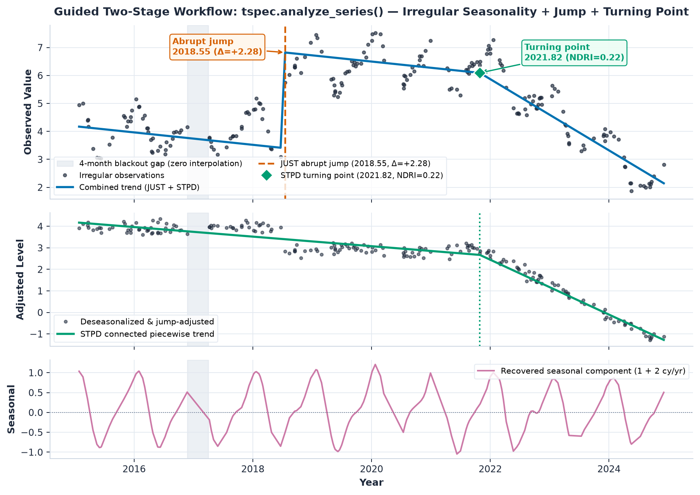
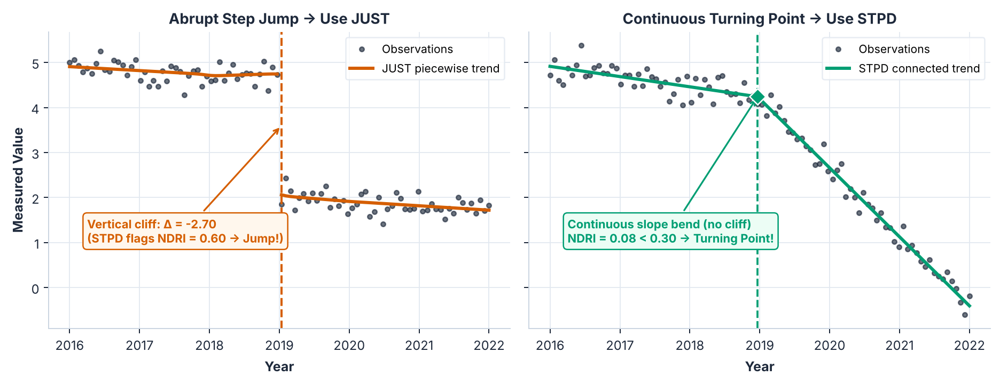
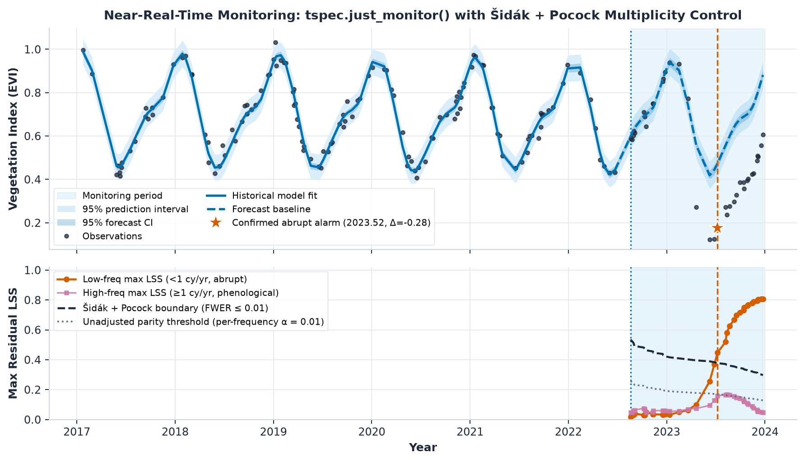
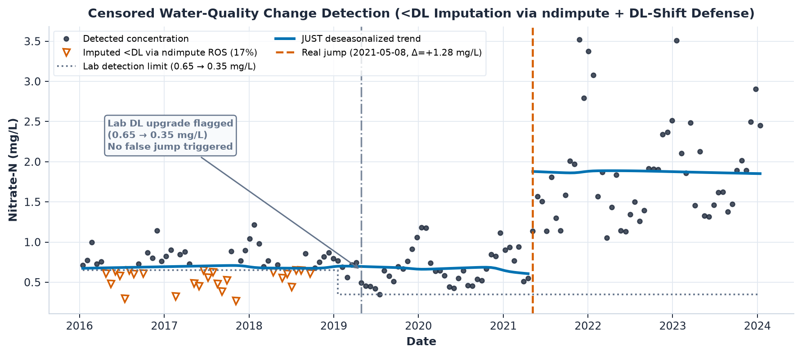

<p align="center">
  <picture>
    <source media="(prefers-color-scheme: dark)" srcset="docs/assets/tspec-logo-dark.png">
    <source media="(prefers-color-scheme: light)" srcset="docs/assets/tspec-logo.png">
    
  </picture>
</p>

<p align="center">
  <strong>Unevenly sampled time-series change detection, turning points, near-real-time monitoring, and spectral decomposition — with built-in censored-data support via <a href="https://github.com/LukeAFullard/ndimpute"><code>ndimpute</code></a>.</strong>
</p>

<p align="center">
  <a href="https://github.com/LukeAFullard/tspec/actions/workflows/ci.yml"></a>
  <a href="https://lukeafullard.github.io/tspec/"></a>
  
  <a href="LICENSE"></a>
</p>

---

`tspec` is a clean-room, numerically stable Python implementation of:

- **LSSA & ALLSSA** — Weighted Least-Squares Spectral Analysis and iterative Anti-Leakage LSSA (Ghaderpour & Pagiatakis, 2017; Ghaderpour et al., 2018)
- **JUST** — *Jumps Upon Spectrum and Trend* abrupt jump detection (`just_jumps`) and trend/seasonal/remainder decomposition (`just_decompose`) (Ghaderpour & Vujadinovic, 2020a; Ghaderpour, 2021)
- **JUSTmonitor (v1.1)** — Near-Real-Time (NRT) abrupt & phenological disturbance monitoring (`just_monitor`) with Šidák, Pocock, O'Brien–Fleming, and $k$-consecutive repeated-testing controls (Ghaderpour & Vujadinovic, 2020b)
- **STPD & TPTR** — *Sequential Turning Point Detection* (`detect_turning_points` / `stpd`) with RMSE-NDRI jump discrimination and connected piecewise linear trend fitting (`fit_piecewise_trend`) (Ghaderpour et al., 2024)
- **Censored Time-Series Workflows** — First-class handling of `<LOD`, `>UL`, mixed, and `[L, R]` interval observations via [`ndimpute`](https://github.com/LukeAFullard/ndimpute) with automated temporal-order protection, lab detection-limit shift warnings, and multi-draw stability reporting.
- **Robust Estimation & Non-Parametric Segment Slopes** — Outlier-resistant convex **Huber IRLS** (`robust="huber"`) and **Huber-started Tukey-biweight MM-type** estimation (`robust="mm"`; not a high-breakdown S-started MM) with Schrader–Hettmansperger robust $F$-tests, exact continuous **$L_1$ / Huber** hinge-splines (`fit_piecewise_trend(..., mode="l1" | "huber")`), and per-segment **Theil–Sen / Akritas–Theil–Sen** slopes with distribution-free CIs and Mann–Kendall $p$-values (`analyze_series(..., slope_estimator="sen")`).
- **Analytical Pointwise Confidence & Prediction Intervals** — Pointwise CIs (`ci_level=0.95`) on `just_decompose` trend (bias-corrected local-quadratic band) & seasonal components, connected `stpd` / `fit_piecewise_trend` curves (exact $O(n)$ sequential TPTR variance and joint/Huber hinge-spline covariance), `analyze_series` segment slopes (Rubin-pooled multiple imputation for censored segments; autocorrelation-corrected Mann–Kendall/Sen), and `just_monitor` mean forecast CIs + out-of-sample prediction intervals, rendered as shaded ribbons in `.plot(show_ci=True)`. Bands are conditional on detected breakpoints and selected frequencies (see *Interpreting Results*).

All algorithms work natively on **irregular, gappy timestamps with zero interpolation**.

---

## Guided Two-Stage Workflow (`analyze_series`)

Real environmental and geophysical records rarely have just one type of change. `tspec.analyze_series()` runs the recommended **JUST → STPD** workflow automatically on raw, gappy records: it separates seasonality and abrupt step-changes first, then searches the adjusted residual trend for smooth continuous turning points.



```python
import numpy as np
import tspec

# 10-year irregular record with a 4-month blackout gap, seasonality,
# an abrupt jump at 2018.5, and a smooth slope bend at 2021.8
rng = np.random.default_rng(42)
t = np.sort(rng.uniform(2015.0, 2025.0, size=220))
t = t[~((t > 2016.9) & (t < 2017.25))]  # 4-month blackout (zero interpolation!)
trend = np.where(t < 2018.5, 4.0, 6.4) + np.where(t > 2021.8, -1.4 * (t - 2021.8), 0.0)
y = trend + 0.85 * np.cos(2 * np.pi * t) + 0.30 * np.sin(4 * np.pi * t) + rng.normal(0.0, 0.16, size=t.size)

result = tspec.analyze_series(t, y)

print(result.summary())   # Structured technical table
print(result.explain())   # Plain-English interpretation & diagnostic caveats
df = result.to_dataframe()
fig, axes = result.plot()
```

---

## Which Method Should I Use?



| Your Question | Best Function | Why |
| :--- | :--- | :--- |
| *"Did a fire, spill, flood, or sensor swap cause a sudden step-change in a seasonal, gappy record?"* | `just_jumps()` + `just_decompose()` | Separates seasonality and piecewise linear trends simultaneously without filling gaps. |
| *"Is my landslide, aquifer, or concentration trend gradually accelerating or slowing down (no sudden cliff)?"* | `detect_turning_points()` (`stpd`) | Fits connected bent lines and checks **NDRI** ("the jump alarm bell") to reject disguised sudden jumps. |
| *"I have a stable historical baseline and want to catch a new disturbance as incoming observations arrive."* | `just_monitor()` | Forecasts the historical model and runs sequential LSSA with built-in repeated-testing control (Šidák + Pocock / O'Brien–Fleming / consecutive-$k$). |
| *"My series has seasonality, maybe a sudden jump, AND maybe a smooth trend bend later — where do I start?"* | `analyze_series()` | Runs the guided two-stage JUST → STPD workflow automatically with scale-free defaults. |
| *"My lab data contains `<0.05`, `>10`, or `[L, R]` censored values."* | Pass strings or `censor_status` + `CensoredConfig` to any function above | Imputes via `ndimpute` without `DL/2` bias and warns if a lab detection-limit upgrade mimics a jump. |
| *"My record has extreme spikes or heavy-tailed noise, and I want robust / Theil–Sen / Akritas–Theil–Sen segment slopes."* | Add `robust="huber"` or `robust="mm"` (and `slope_estimator="sen"` / `"l1"` / `"huber"` in `analyze_series()`) | Neutralizes isolated spikes without masking real jumps and reports exact per-segment Theil–Sen / ATS slopes, 95% CIs, and Mann–Kendall $p$-values. |
| *"I only want one overall monotonic up/down trend (no breakpoints)."* | Mann–Kendall / Sen's slope (`MannKS` or `analyze_series(..., detect_jumps=False, detect_turning_points=False, slope_estimator="sen")`) | Simpler and higher power when you don't need to locate breakpoints. |

---

## Near-Real-Time Disturbance Monitoring (`just_monitor`, v1.1)

Scanning 35 frequencies on every incoming observation without multiplicity control inflates cumulative false alarms rapidly (about 70% over 24 steps at $\alpha = 0.05$ in unadjusted parity mode). `tspec.just_monitor()` defaults to **Šidák multi-frequency + Pocock sequential alpha-spending**: with a planned `horizon` the familywise false-alarm rate is bounded by $\alpha$ (0.1–0.3% at $\alpha = 0.05$ in simulation, i.e. conservative), and without `horizon` an open-ended spending sequence keeps the bound for any monitoring length without using future data. Lan–DeMets-shaped **O'Brien–Fleming** spending, **`consecutive_k`** (which does *not* bound the familywise rate), and `parity_mode=True` for exact parity with Ghaderpour & Vujadinovic (2020b) are also available.



```python
from tspec import just_monitor

res = just_monitor(
    t,
    evi,
    start=2022.5,                  # Index or timestamp / decimal year
    season="allssa",               # Historical trend + anti-leakage seasonal model
    alpha=0.01,
    freq_correction="sidak",       # Per-step adjustment across scanned frequencies
    sequential_control="pocock",   # Or "obrien_fleming", "consecutive_k", "none"
    horizon=24,                    # Planned number of monitoring steps, fixed in advance
)
print(res.summary())
print(res.explain())
fig, axes = res.plot()
```

---

## First-Class Censored Environmental Data (`<DL`, `>UL`, `[L, R]`)

Environmental monitoring records routinely contain left-censored non-detects (`"<0.65"`) and historical lab method upgrades where detection limits drop mid-record. `tspec` integrates [`ndimpute`](https://github.com/LukeAFullard/ndimpute) directly, protects against ROS quantile temporal trend injection, down-weights imputed points optionally, and automatically flags lab detection-limit upgrades so analytical changes are never mistaken for environmental jumps.



```python
from tspec import CensoredConfig, just_jumps, just_decompose

cfg = CensoredConfig(
    method="ros",              # Robust ROS via ndimpute (avoids DL/2 bias)
    dist="lognormal",
    impute_type="stochastic",  # Time-order safe (prevents ROS quantile trend artifact)
    detect_dl_shifts=True,     # Flags lab detection-limit upgrades automatically
    recensor_check=True,       # Tests whether coinciding jumps vanish at common DL
    random_state=42,
)

# Pass "<0.65" strings directly (or numeric arrays + censor_status)
jumps = just_jumps(dates, nitrate_strings, season="ols", mag_th=0.8, jump_alpha=0.01, censoring=cfg)
decomp = just_decompose(dates, nitrate_strings, jump_indices=[j.index for j in jumps.jumps], season="ols", censoring=cfg)
print(jumps.explain())
```

---

## Installation

```bash
# Standard install (includes numpy, scipy, ndimpute & pandas)
pip install tspec

# With diagnostic plotting support (matplotlib)
pip install "tspec[plot]"
```

### Lite Installation (`numpy` + `scipy` only)
`ndimpute`, `pandas`, and `matplotlib` are imported strictly lazily. If you only need the core numerical spectral / JUST / STPD / monitoring engine:

```bash
pip install numpy scipy
pip install --no-deps tspec
```

---

## Verification & Performance

`tspec` was independently audited (`audit/AUDIT_REPORT.md`; reproducible scripts in `audit/`). Highlights:

- **Numerical core:** weighted least squares, the least-squares spectrum, Beta critical values, Theil–Sen/Mann–Kendall and the O(n) TPTR variance match `statsmodels`, `astropy`, `scipy` and `pymannkendall` (or brute force) to about 1e-14.
- **Calibration of the default procedures** (Monte Carlo, ≥ 300–1000 replicates):
  - `just_jumps()` false-jump probability at `jump_alpha=0.05`: 3–5% (raw screening p-values: 70–100%).
  - `stpd()` false turning-point probability at `alpha=0.01`: 0.2–0.6% (raw screening p-values: up to 2.2%), while detection of a single turning point rises (e.g. 0% → 52% at n=150, σ=1; 32% → 82% at n=500, σ=0.6).
  - `allssa()` spurious-cycle probability at `alpha=0.01`: 0–0.5% with Monte Carlo significance (published per-frequency rule: 18–25%).
  - `just_decompose()` trend-band coverage: ~95% for linear, jump and smoothly curved trends.
  - Censored OLS segment slopes (50% censoring): bias ≈ 0 and ~96% coverage with time-conditional imputation + Rubin pooling.
  - Mann–Kendall Type-I error under AR(1) ρ = 0.5: ≈ 5–7% with the default `mk_correction="ar1"` (uncorrected: ~25%).
  - `just_monitor()` prediction-interval coverage: ~95%.
- **Known limitations:** bands from `stpd`/`analyze_series` are conditional on the detected structure and under-cover (about 83–92%); detection p-values on censored data condition on one imputation; `robust="mm"` and `mode="l1"` are not high-breakdown estimators.
- **Upstream parity:** `parity_mode=True` reproduces Ghaderpour's LSWAVE reference implementations (see `validation/reports/parity_report.md`).
- **Tests:** `pytest` unit, property-based (Hypothesis), documentation and calibration regression tests.

---

## Documentation

Full practitioner guides, zero-math concepts, parameter cheat sheet, domain tutorials (water quality, satellite NDVI wildfire, ground subsidence, near-real-time monitoring, combined workflow), and mathematical/API references live in [`docs/`](docs/) (built with MkDocs Material):

```bash
pip install -e ".[docs]"
mkdocs serve
```

---

## License & Citation

Released under the **MIT License**. Written as a strict clean-room implementation directly from the peer-reviewed literature (see [`CITATION.cff`](CITATION.cff) for full BibTeX and DOI records for Ghaderpour et al., 2017–2024; Lan & DeMets, 1983; Huber, 1981; Schrader & Hettmansperger, 1980; Yohai, 1987; Sen, 1968; Akritas et al., 1995; Gilbert, 1987; Helsel, 2012; Turnbull, 1976; and `ndimpute`).