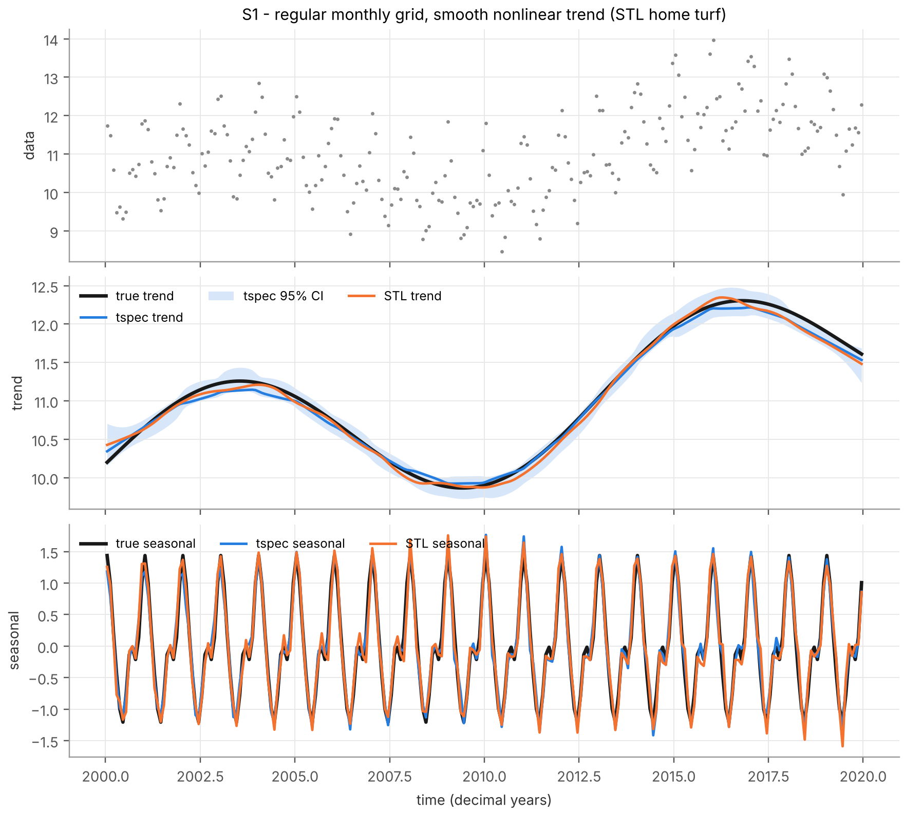
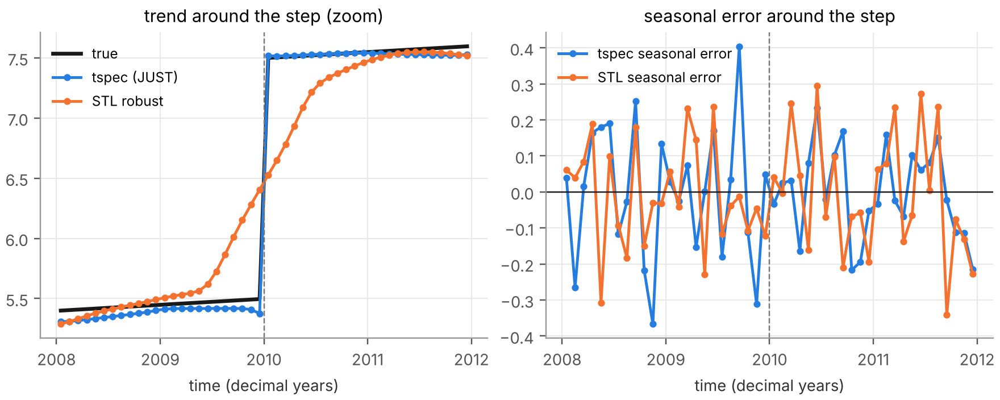
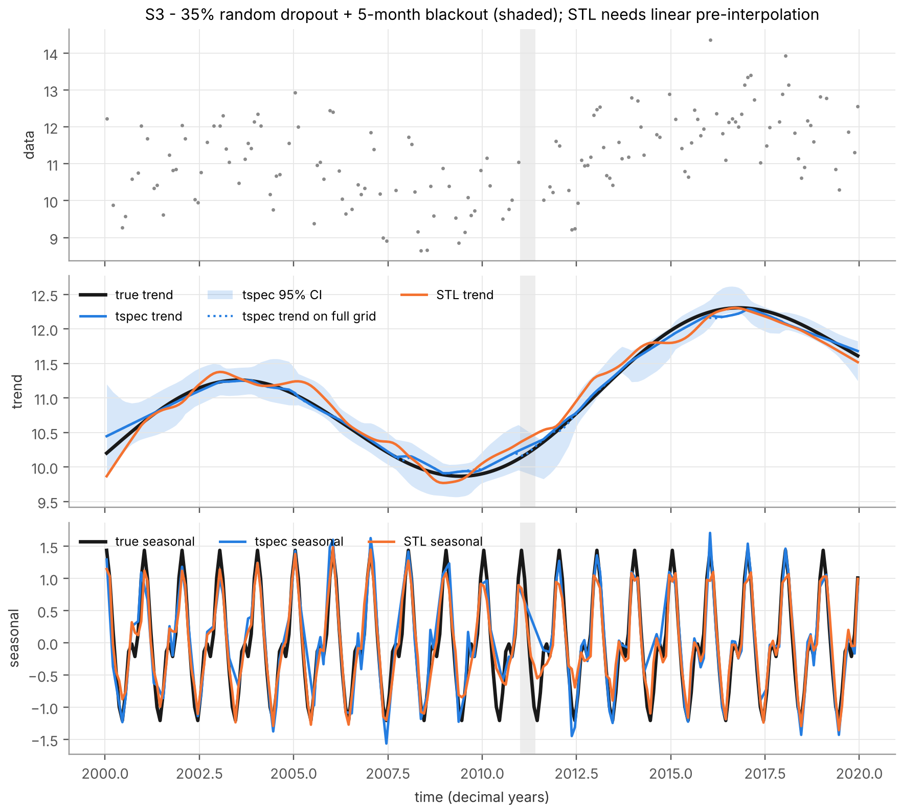
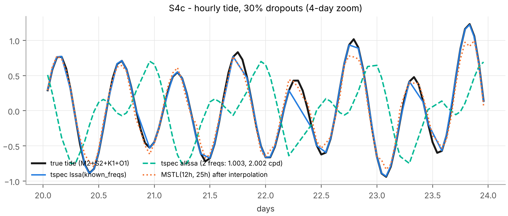
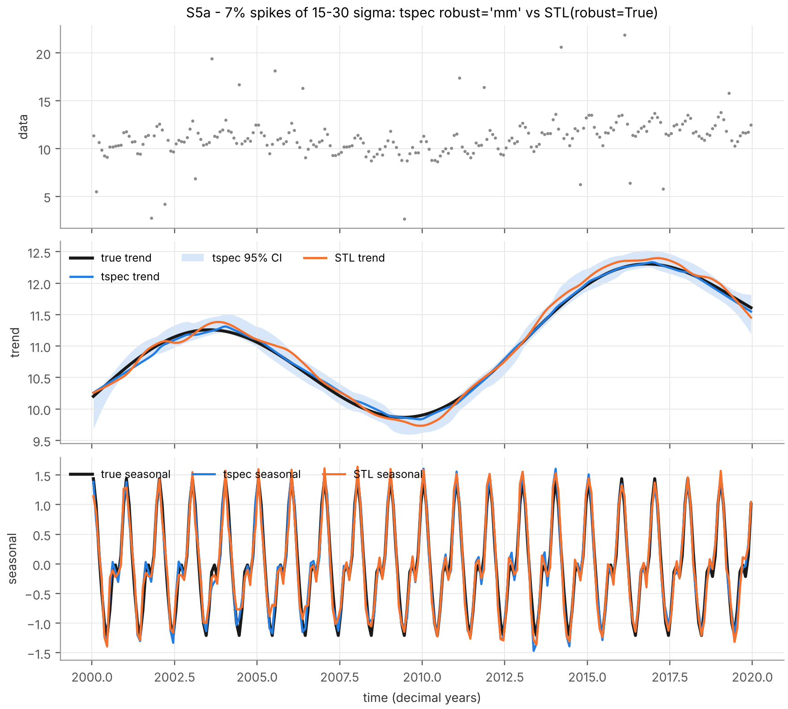
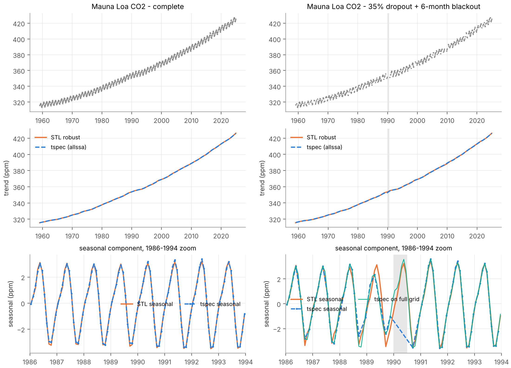
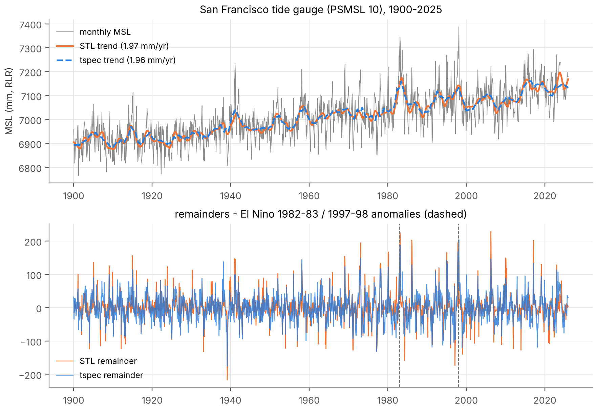
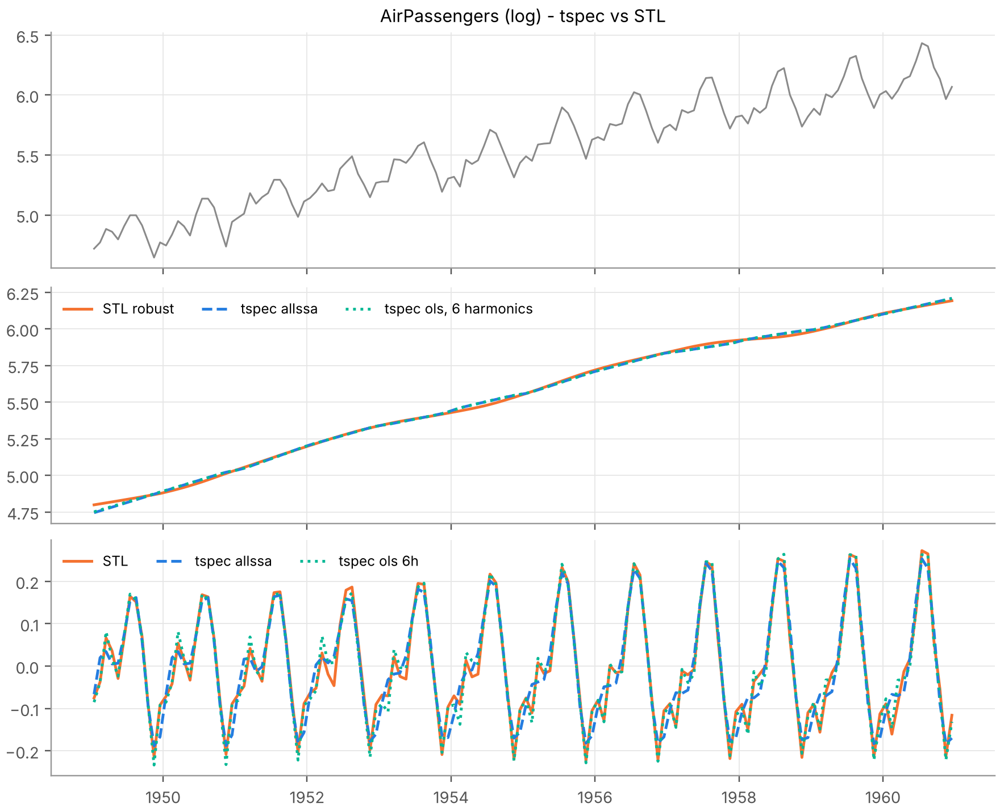

# Independent Adversarial Scientific & Software Readiness Audit — `tspec` 0.1.0

**Audit date:** 2026-11-28 · **Target:** `LukeAFullard/tspec` `main` @ `73a9eb3` · **Auditor stance:** every claim guilty until independently reproduced.

All probes are new code written for this audit (`audit/independent_2026_11/`); the existing tests, reports and audit files were *not* used as evidence. No file under `src/tspec/` was modified.

**Environment:** Python 3.13.18 · tspec 0.1.0 · numpy 2.5.3 · scipy 1.18.1 · statsmodels 0.15.0 · ndimpute 0.1.1 · pandas 3.0.5 · matplotlib 3.11.2 · ruptures 1.1.10 · `OMP_NUM_THREADS=1 MPLBACKEND=Agg` · 4 cores (Monte Carlo replicates parallelised across processes, each single-threaded).

Existing suite for reference: `pytest` → 181 passed, 1 skipped (`pymannkendall` absent), 209 s.

---

## 0. Executive summary & verdict

**Verdict: CONDITIONAL-GO** for peer-reviewed use of a *defined subset* of workflows; **NO-GO** for unqualified use of the automatic change-point detectors (`just_jumps`, `stpd`, `analyze_series`) on real environmental records without the mitigations listed in §5.

What is genuinely excellent:

* The core linear algebra is exact. LSSA spectra, coefficients and covariances agree with `statsmodels` OLS/WLS/GLS and `scipy.signal.lombscargle` to **1e-15** (1D and full 2D SPD weights), stay correct under `t + 1e7`, `y + 1e9` and `y·10^{±12}`, and the exact Beta(1, ν/2) per-frequency null is uniform (KS p = 0.10 and 0.31, including heteroscedastic weights).
* Family-wise peak FAPs are calibrated: `lssa(peak_fap="montecarlo")` 5.3% [4.4, 6.4] and `"sidak"` 5.05% [4.4, 5.8] at nominal 5%. ALLSSA's default Monte Carlo acceptance gives 0.5% spurious cycles at α = 0.01 (published rule: 17%).
* `just_decompose` bias-corrected trend bands hold **94–95%** coverage in linear, curved, gapped and known-break regimes.
* `just_monitor` is **strictly causal**: perturbing every future value (and censoring flags) changed no earlier step's statistic, critical value or decision in any of six configurations (max |Δ| = 0.0).
* All stochastic paths are bit-reproducible with fixed seeds, the global NumPy RNG is never touched, optional dependencies are truly lazy (everything except `.plot()`/`.to_dataframe()` works with NumPy+SciPy only), and memory is O(n) for 1D weights.
* Censored-data handling is sound: Akritas–Theil–Sen slope CIs cover 95.2–95.5% at 30–50% censoring with one or two detection limits (DL/2 substitution: 57–87%), and the trend-aware Tobit decomposition is unbiased (trend bias −0.004 vs −0.072 for DL/2 + STL, CI coverage 95.2%). The Mann–Kendall/Sen default `mk_correction="ar1"` holds 3.8–6.0% Type-I error up to AR(1) ρ = 0.8.
* **Head-to-head vs STL** (§4): `tspec` matches or beats STL on STL's home turf (trend RMSE 0.072 vs 0.078–0.086, with calibrated 95% bands STL cannot provide). It wins clearly on step jumps (1-month vs 11–13-month smearing; jump magnitude error +0.02 vs −1.84), random gaps (trend RMSE in the blackout 0.098 vs 0.154), non-integer periods (periodic RMSE 0.095 vs 0.53 for STL, 0.125 for MSTL), extreme outliers (`robust="mm"`: seasonal RMSE 0.174 vs 0.273) and censoring. It loses to STL on AirPassengers' evolving seasonal shape, and with its *default* ALLSSA seasonal model inside a real CO₂ blackout. With `season="ols"` and 4-year duration windows it beats STL there too.

What blocks unqualified publication use (details in §2):

| ID | Severity | Finding |
|---|---|---|
| AUD-01 | **Critical** | Datetime inputs are converted to *calendar* decimal years (365- vs 366-day years) → non-uniform time axis. A noiseless M2 tide has a best normalized LSS of **0.25** (should be 1.00). Silent. |
| AUD-02 | **Critical** | Under mild AR(1) noise the `just_jumps` false-jump family-wise rate is **34%** (ρ = 0.3) and **95%** (ρ = 0.6) at nominal 5%, and the autocorrelation warning fired on only 5 of 26 false-positive series. STPD reaches 27.5% at ρ = 0.5. The **default** `analyze_series` OLS segment-slope test rejects 24% (ρ = 0.5) and 49% (ρ = 0.8) at nominal 5%. |
| AUD-03 | **Critical** | STPD's NDRI "jump alarm bell" does not separate steps from bends: a pure 4σ step with *no* slope change is reported as a continuous **turning point in 69–76%** of series (flagged as a jump in only 19%). Through `analyze_series` (JUST → STPD) a 4σ step is reported as a turning point instead of a jump in **59%** of series. |
| AUD-04 | **Major** | `just_jumps` power at default window size is very low and undisclosed: a 2σ step on 240 points is found in **6%** of series (4σ: 50%), while a whole-record MC-calibrated sup-F test finds it in **100%** (1σ: 82% vs 0.5%). |
| AUD-05 | **Major** | ALLSSA can select at most **one frequency per unit band** [k−½, k+½) (and the default grid starts at 0.5 cy/unit). 1.00 + 1.37 cy/yr, K1+O1 or M2+S2 cannot be resolved; an 11.2-yr cycle is silently ignored; the integer-spaced default coarse grid finds a 2.37 cy/yr cycle in only 37.5% of series (100% with a dense grid). |
| AUD-06 | **Major** | High-SNR continuous bends are rejected as jumps (noise σ ≤ 1e-3 on a ±0.5/yr hinge: 0 turning points, flagged as jump). |
| AUD-07 | **Major** | Heavy tails: default `just_jumps` FWER 15% under t₃; `robust="mm"` still 10.7% under t₂. Non-robust `just_monitor` with 6 historical spikes: 15.7% false alarms (robust: 0.7%). |
| AUD-08 | **Major** | Bands after detection under-cover outside the simulated design: STPD with unequal density 89% (80% near the TP) or 4× heteroscedasticity 84% (69–74% near the TP), even with correct weights. On the README hero example, `analyze_series` reaches 90% (not the documented 95–98%). |
| AUD-17 | **Major** | A real step produces "ghost" jumps exactly one window step (±0.96 yr) away: 0.17 false jumps per series with a 6.7σ step vs 0.05 without it. |
| AUD-09…16 | Minor / Info | Zero-variance spurious jumps; 4-observation monitoring history accepted for numeric time; `consecutive_k` slightly liberal (7.3% at H = 24); memory constant; sparse-record default failure; `ols_mi` CIs at 90.5–93% under 30–50% censoring; `hamed_rao` 24–29% Type-I at ρ = 0.8; docs drift. |

---

## 0b. Remediation status (batches 1–4, same branch)

| ID | Status | Change | Verified effect |
|---|---|---|---|
| AUD-01 | **Fixed** | `_time.py`: datetimes map to a uniform axis, `2000 + (t − 2000-01-01)/365.2425 d` | Noiseless M2 tide on datetimes: LSS 0.25 → **1.000**; step ratio across a leap year 1.00274 → 1.00000 |
| AUD-03 | **Mitigated** | `stpd.py`: new default `jump_test="step"`. Nested discontinuous-vs-*continuous*-hinge F-test (knot optimized between samples, Bonferroni over splits, `step_alpha=0.05`) plus step share ≥ 0.25; TPs within `tp_th` of any step flag dropped; `analyze_series().explain()` warns about steps JUST missed | TP reported at a pure step: 4σ 68.5% → **29%**, 6σ 63% → **18%**, 4σ uneven density 56.5% → 36.5%. Through `analyze_series`: 4σ 59% → **38%** (seasonal) and 23% → **14%** (no seasonality); 6σ 24% → 17% and 2% → 1%. Bends: recall unchanged (46–100%), wrongly flagged 0.5–1.5% (NDRI gate: 1.5–58.5%); null FPR unchanged (0–1%) |
| AUD-06 | **Fixed** | same | Noiseless and σ = 1e-3 hinges: 0 → 1 TP (at 9.94), no jump flag |
| AUD-09 | **Fixed** | `just.py`: zero-variance guard relative to the window's total sum of squares | Perfect line: 1 spurious jump → 0; 2 segments → 1; noiseless steps (also at 1e-13 scale) still detected |
| AUD-10 | **Fixed** | `monitor.py`: seasonal history needs ~one cycle and ≥ model size + 5 points for numeric time too | `start=5` → `InsufficientDataError` |
| AUD-02 | **Fixed** (batch 2) for `just_jumps`, `stpd`, `analyze_series`; open for `just_decompose`, `just_monitor`, `lssa`/`allssa` | New `_serial.py` and `serial_correlation="ar1"` (default). Jump-robust trimmed difference estimator of ρ, pre-test plus one-SE margin; AR(1)/OU Monte Carlo nulls; F/κ² for analytical references; exact sandwich VIF for OLS segment slopes and the trend band | False jumps at nominal 5%: 34% / 95% / 100% → **4.3% / 4.0% / 7.0%** (ρ = 0.3 / 0.6 / 0.8). STPD false TPs at nominal 1%: 28% / 88% → **0.7% / 3.0%** (ρ = 0.5 / 0.8). OLS slope Type-I at 5%: 22–50% → **1.3–8.7%**. White-noise power: 4σ jump 51% → 46%, bend 43% → 38% |
| AUD-04 | **Fixed in `analyze_series`** (batch 3); opt-in for standalone `just_jumps` | `window_scales` (multiples of the base window, one Holm family); `analyze_series` default `(1, 2, 4)` with `step_alpha=0.05` | Pipeline: 2σ step found 0% → **54.5%**, 4σ 9.5% → **100%**; false jumps 0–2% (line, curved, AR(1)); runtime ~3× |
| AUD-17 | **Mitigated** (batch 3) | Root cause: in a 3-cycle window a step one seasonal period from the split is nearly indistinguishable from ramp + seasonal sawtooth. Conditional re-test against stronger accepted jumps (`known_jumps`); multi-scale windows resolve the alias | Ghosts in the S2 design: 7 → 1 per 60 series with `window_scales=(1, 2, 4)`; single-scale aliasing disclosed |
| AUD-18 *(new, batch 3)* | **Fixed for the step test**; standalone default disclosed | Found while testing AUD-04: the 2-df JUST jump test reports smooth curvature as "jumps" (9-yr cycle, amplitude 3σ / 6σ: **37% / 89%** false jumps at default settings, ~100% in longer windows). `step_pvalue` now uses a quadratic term and fixed harmonics in both models (ALLSSA-selected harmonics had biased it to 11%); new `NOT_A_VERTICAL_STEP` warning | Step test under curvature: 0–2% false jumps; pipeline 1–2% |
| AUD-03 (update) | Largely resolved by batch 3 | Multi-scale JUST stage catches steps before STPD | Pipeline: 4σ step misreported as TP 59% → 38% (batch 2) → **0.5%** (batch 3) |
| AUD-05 | **Fixed** (batch 4) | `allssa(search="rayleigh")` default: oversampled grid from 1.5/T, refinement within ±1/T, only frequencies within 1/T re-fitted; `"integer"` = published | 1.00+1.37 cy/yr 0% → **100%**; 11.2-yr cycle 0% → **100%**; 2.37 cy/yr 37.5% → **100%**; blind tides 2/4 → **4/4**; null rate unchanged (0/80) |
| AUD-02 (rest) | `just_decompose` **fixed** (batch 4); `just_monitor`, `lssa`/`allssa` open (disclosed) | `just_decompose(serial_correlation="ar1")`: trend band × κ, seasonal band × AR(1) spectral factor | Trend-band coverage at ρ = 0.5 / 0.8: 73% / 44% → **97% / 95%**; seasonal 89% / 86% → 98% / 91% |
| AUD-11 | **Fixed** (batch 4) | ≥ 1 999 draws, one-sided 80% lower confidence bound on the α-quantile | see validation `p17_out.txt` |
| AUD-12 | **Fixed** (batch 4) | Frequency chunk adapts to n (~8 MB per work matrix) | n = 32 000: 443 MB → **49 MB** |
| AUD-13 | **Fixed** (batch 4) | Default OLS harmonics reduced to fit the smallest window (`HARMONICS_REDUCED`) | 50%-missing and 70%-gap records now run (jump still found) |
| AUD-14 | **Fixed** (docs) | Runtime claims re-measured; "lite" NumPy + SciPy install already documented in README | — |
| AUD-15 | **Mitigated** (batch 4) | `HEAVY_CENSORING_OLS_MI` caution for segments > 40% censored; ATS recommended | — |
| AUD-16 | **Fixed** (docs) | `hamed_rao` Type-I under AR(1) documented (15–29%) | — |
| AUD-07, 08 | Under re-measurement | see §0c | — |

Batch-3 evidence: `audit/independent_2026_11/p15_batch3_scales.py` (`p15_out.txt`), `p10_batch3_results.json`, `p11_batch3_results.json`; tests in `tests/test_jump_scales_and_ghosts.py`.

Batch-2 evidence: `audit/independent_2026_11/p14_batch2_serial.py` (`p14_final_ar1_out.txt`, `p14_none_out.txt`), `p11_post_batch2_results.json` (README example: jump and TP still found in 100% of 100 seeds, exact events 95–97%, band coverage 92%), regression tests in `tests/test_serial_correlation.py`. Full suite: 201 passed, 1 skipped. Known residual: on very precise records with structure the smooth global fit cannot follow, misfit can inflate ρ̂ (disclosed in `limitations.md` §3).

Evidence: `audit/independent_2026_11/p13_batch1_stpd.py` (`p13_final_out.txt`), `p10_post_out.txt`, `repro_post_batch1_out.txt`. New regression tests are in `tests/test_independent_audit_2026_11.py` and `tests/test_time_adapter.py`. The full suite passes: 192 passed, 1 skipped. AUD-03 is *mitigated* rather than fixed: small steps (≲ 4σ) can still be mistaken for bends, because the per-window step test has limited power. That residual is disclosed in `limitations.md` §7, and improving JUST's power (AUD-04) is the main lever.

## 1. Methodology

| Probe | Script | What it tests (independently) |
|---|---|---|
| P1 | `p1_spectral.py`, `p1b_mcfap.py` | LSS vs `statsmodels` OLS/WLS/GLS nested-model variance reduction; vs `scipy.signal.lombscargle(floating_mean=True)`; coefficients/covariance; offsets & scales; KS test of Beta null (3 000 reps); peak-FAP calibration (Šidák 4 000 reps, MC 2 000 reps); ALLSSA null FPR & non-integer recovery |
| P2 | `p2_just.py`, `p2b_power_baseline.py` | `just_jumps` FWER (white, long record, AR(1), t₃, t₂, bend-only), power & magnitude recovery vs a whole-record sup-F baseline; `just_decompose` trend/seasonal CI coverage under 5 regimes |
| P3 | `p3_datetime_leap.py` | datetime → decimal-year uniformity (tides, weekly cycle) |
| P4 | `p4_stpd.py` | STPD null FPR (white, AR(1), t₃, t₂, uneven density, heteroscedastic), bend power, step-vs-bend NDRI discrimination (`rmse`/`l2`), bootstrap band coverage |
| P5 | `p5_monitor.py` | `just_monitor` causality by future perturbation (+ censoring), sequential FWER (Pocock/OBF/consecutive-k/none, H = 24/120, open-ended, irregular, spikes, `robust="mm"`), power & delay |
| P6 | `p6_trend_censor.py` | Sen/MK and OLS Type-I under AR(1) (`ar1`, `hamed_rao`, `none`), slope CI coverage; censored slope bias/coverage (`ols_mi`, `ats`) vs DL/2 and uncensored oracle, one and two DLs |
| P7 | `p7_edge.py` | 55 adversarial inputs, invariances, parameter validation, reproducibility of every stochastic path, global-RNG hygiene, memory/time scaling |
| P8 | `p8_imports.sh` | fresh venv with NumPy+SciPy only |
| P9, P10, P11 | `p9_pipeline_combos.py`, `p10_pipeline_step.py`, `p11_readme_hero.py` | 64-way `analyze_series` feature composition; pure step through the full pipeline; README hero example over 100 seeds |
| P6b, P12 | `p6b_censor.py`, `p12_followups.py` | censored-slope re-run on 600 fresh seeds; ALLSSA coarse-grid blindness, ghost jumps, CO₂ blackout variants |
| Bench | `validation/bench_stl_headtohead.py` | Tier 2e: 8 known-solution scenarios × 60 replicates + 4 real datasets vs STL/MSTL/ruptures (§4) |
| Repro | `repro_confirmed_bugs.py` | < 1-minute minimal reproducers for AUD-01, -02, -05, -06, -09, -10 (output: `repro_out.txt`) |

Rates are reported with Wilson 95% intervals where relevant. Raw outputs: `audit/independent_2026_11/*_results.json`, `*_out.txt`.

---

## 2. Confirmed bugs and statistical deficiencies

Each item: severity · reproducer · root cause · recommended fix. Line numbers refer to `73a9eb3`.

### AUD-01 — Critical — Non-uniform time axis for datetime inputs

* **Reproducer** (`repro_confirmed_bugs.py`, `p3_datetime_leap.py`): hourly `datetime64` record 2023-01-01 → 2025-01-01, `y = cos(2π·hours/12.4206)` with no noise. Best normalized LSS over a fine grid around M2: **0.250**; the same series with numeric hours gives **1.000**. A 7-day cycle on daily datetimes over 10 years reaches only 0.962. The decimal-year step ratio across the 2023/2024 boundary is 1.00274 (= 366/365).
* **Root cause:** `src/tspec/_time.py:54-70` (`_datetime64_to_decimal_year`) divides elapsed time by *that calendar year's* length. Each leap year is compressed by 0.27%, so any frequency that is not an integer number of cycles per calendar year loses phase coherence. Annual harmonics are unaffected (0.99999), which is why existing tests did not catch it.
* **Impact:** every function given datetimes: LSSA/ALLSSA periodograms at non-annual frequencies (tides, diurnal/weekly cycles, ENSO-band peaks), JUST/STPD slopes (per-"year" units vary by 0.27%), `just_monitor` forecasts. Silent: no warning.
* **Fix:** use a uniform scale, e.g. `1970 + (t − 1970-01-01) / 365.2425 d` (or Julian 365.25 d), and document the unit. Keep the calendar mapping only for display. Add a regression test with a non-annual sinusoid on datetime input.

### AUD-02 — Critical (disclosed in principle, magnitude undisclosed) — Serial correlation destroys JUST/STPD error control

* **Reproducer** (`p2_just.py`, `p4_stpd.py`, `repro_confirmed_bugs.py` AUD-06): 240 irregular points over 20 years, seasonal + linear trend, AR(1) noise in observation order, `just_jumps(season="ols")`, 300 replicates.

  | Noise | `just_jumps` FWER (nominal 5%) | STPD any-TP rate (nominal 1%) |
  |---|---|---|
  | white | 5.7% [3.6, 8.9] | 0.0% [0, 3.7] |
  | AR(1) ρ = 0.3 | **34.3%** [29.2, 39.9] | — |
  | AR(1) ρ = 0.5 | — | **27.5%** [21.8, 34.1] |
  | AR(1) ρ = 0.6 | **94.7%** [91.5, 96.7] | — |

  In the reproducer, only **5 of 26** false-positive series carried the `STRONG_AUTOCORRELATION` warning.

  The same weakness reaches the default segment-slope inference of `analyze_series` (`slope_estimator="ols"`, `mk_correction="ar1"`, monthly AR(1) noise, no trend, 400 reps, `p6_trend_censor.py`):

  | Estimator / correction | ρ = 0 | ρ = 0.5 | ρ = 0.8 |
  |---|---|---|---|
  | `ols` (default) — p < 0.05 | 4.8–6.3% | **23.8–24.0%** | **48.5–49.5%** |
  | `sen` + `ar1` | 3.8–5.5% | 4.5–6.0% | 5.8–6.0% |
  | `sen` + `hamed_rao` | 8.5–9.5% | 15.5–16.8% | 24.3–29.0% |
  | `sen` + `none` | 5.3–6.0% | 23.5–24.8% | 47.8–48.5% |

  `mk_correction` affects only the Mann–Kendall/Sen path. A user who keeps the default `slope_estimator="ols"` gets an uncorrected OLS test despite `mk_correction="ar1"` being the default.
* **Root cause:** nested F-tests and their Monte Carlo nulls (`just.py:776-935`, `_nested_jump_ftests` at `just.py:943`; `stpd.py:458`, `stpd.py:975-1035`) simulate i.i.d. Gaussian errors. `limitations.md` §3 says these tests "assume independent residuals unless you supply a full inverse-covariance weight matrix", but it gives no magnitudes. Users therefore cannot tell that ρ = 0.3, which is ordinary for monthly environmental data, makes most reported jumps false.
* **Fix:** (a) estimate the residual AR(1) (or ARMA) parameter from the null model of each window, or globally, and simulate the Monte Carlo null under it (a parametric bootstrap, as already done for MK); or pre-whiten with the estimated correlation (feasible GLS). (b) Give OLS segment slopes a Newey–West/AR(1)-adjusted standard error by default, or make `slope_estimator="sen"` the default. (c) At minimum, escalate the warning when ρ̂ > 0.2 on the *window residuals*, report it per jump, and put the tables above into `limitations.md`.

### AUD-03 — Critical — NDRI does not distinguish a step from a bend (STPD and `analyze_series`)

* **Reproducer** (`p4_stpd.py` cases `step2.0_*`; `p10_pipeline_step.py`): `y = 0.5 t + 2.0·1[t ≥ 10] + N(0, 0.5²)`, i.e. a 4σ vertical step and *no* change of slope.

  | Call | TP reported near the step | Flagged as jump (NDRI) |
  |---|---|---|
  | `stpd(ndri_mode="rmse")` (default) | **68.5%** (any TP 76%) | 19% |
  | `stpd(ndri_mode="l2")` | 74.5% | 22% |
  | `stpd`, 3× denser first half | 56.5% (any TP 90%) | 9% |
  | `analyze_series` (JUST → STPD), with seasonality | **59% TP instead of a jump** (jump reported in 28%) | — |

  Bands conditional on these false TPs cover the true step function only 45–63% of the time (15–32% near the step).
* **Root cause:** `stpd.py:1376-1377` defines NDRI = |RMSE₁ − RMSE₂| / (RMSE₁ + RMSE₂), the left/right asymmetry of the *connected* fit's residuals. A step fitted by a connected hinge produces roughly symmetric residuals on both sides of the knot, so NDRI stays below `ndri_th = 0.3` and the hinge is accepted (`stpd.py:1903`). The README ("checks NDRI ('the jump alarm bell') to reject disguised sudden jumps") and the validation summary ("100% NDRI jump separation") overstate what it does. The pipeline cannot rescue it because JUST's power at default settings is low (AUD-04).
* **Fix:** replace or augment NDRI with a nested test of "discontinuous 2-piece" vs "continuous hinge" (the `step_pvalue` that JUST already computes, `just.py` § `step_pvalue`) inside each STPD window, and reject TPs whose step test is significant. In `analyze_series`, run that step test at every accepted TP and re-route to the jump branch. Re-run the README/validation claims.

### AUD-04 — Major — Low, undisclosed power of `just_jumps` at default window size

* **Reproducer** (`p2b_power_baseline.py`, 200 reps; σ = 0.5, n = 240 over 20 years, OLS seasonal):

  | Step (σ units) | default `size=36` | `size=72` | `size=120` | whole-record sup-F, MC-calibrated |
  |---|---|---|---|---|
  | 0 (null) | 0.0% | 0.5% | 1.0% | 5.5% |
  | 1σ | **0.5%** | 3.5% | 19% | **82.5%** |
  | 2σ | **6%** | 45.5% | 88.5% | 100% |
  | 3σ | 25% | 92% | 99.5% | 100% |
  | 4σ | 50% | 100% | 100% | 100% |

  Reported magnitudes of borderline detections suffer a winner's curse: for a true 2σ (1.0) step, the mean reported magnitude among detections is 1.24 (RMSE 0.99). For a 1σ step (only 4 of 300 detected) it is ≈ 1.7.
* **Root cause:** inherent to the windowed design. Each 36-observation window fits a 12-parameter model (two intercepts, two slopes, four harmonics), a max-over-splits correction and a Holm correction across ~20 candidate windows. Power does not grow with record length. `limitations.md` §2 discloses the analogous STPD issue but says nothing about JUST, and `validation-summary.md` reports "SNR = 3 recall = 77.5%" for a design that is not the default regime tested here.
* **Fix:** document the power curve; offer a whole-record or multi-scale screening step (e.g. a sup-F/CUSUM pre-screen calibrated by Monte Carlo, or windows growing with record length); report the winner's-curse caveat for magnitudes of borderline jumps.

### AUD-05 — Major — ALLSSA: one frequency per unit band, and an invisible 0.5 lower bound

* **Reproducer** (`repro_confirmed_bugs.py`; `p1_spectral.py`; benchmark S4c): signal 1.0·cos(2π·1.37t) + 0.8·sin(2π·1.00t), noise σ = 0.2, n = 300 → `allssa(decimal=2)` selects `[1.37]` only. Over 50 replicates at lower SNR, 1.37 is always found (frequency SD 0.004) but 1.00 is *never* found alongside it. Tides in cycles/day: K1/O1 both round to 1 and M2/S2 both round to 2, so only 2 of 4 constituents can be selected (S4c: tidal RMSE 0.30 vs 0.006 with `known_freqs`). With the default grid, a 2-amplitude 11.2-yr cycle in 60 years of monthly data is ignored (selected `[1.0]`). A custom grid finds `[0.09, 1.0]`. No warning is emitted.
* **Coarse-grid blindness** (`p12_followups.py`): the default coarse grid evaluates only integer frequencies (1, 2, …, ⌈rate/2⌉ − 1). With 20 years of monthly data, a 0.7-amplitude 2.37 cy/yr component leaves the LSS at the integer grid points at ≤ 0.0036, so `allssa()` finds it in only **37.5%** of replicates, against **100%** with a 0.05-spaced `omega`.
* **Root cause:** `spectral.py:440-443` removes any previously selected frequency that rounds to the same integer centre before refining, so the final set has at most one frequency per [k − ½, k + ½). `_allssa_search_grid` (`spectral.py:183-223`) and `_default_allssa_omega` (`spectral.py:169`) start the search at max(step, 1 − 0.5). The coarse step is 1 cycle/unit, far wider than the Rayleigh resolution 1/T. This is inherited from the published algorithm, and `docs/reference/math.md` §2 describes the mechanism. The *consequence* is stated nowhere, and it is not obvious from the mechanism.
* **Fix:** use a default coarse grid oversampled relative to 1/T (e.g. step 1/(4T)); allow several frequencies per band (refine around the peak with a ±1/T Rayleigh window instead of ±0.5 integer bins, excluding a Rayleigh neighbourhood of frequencies already selected); extend the default grid below 0.5 or warn when significant power sits at the grid floor; document all three limits.

### AUD-06 — Major — High-SNR bends are rejected as jumps

* **Reproducer:** noiseless or σ = 1e-3 hinge `0.5t − max(t − 10, 0)` → `stpd` returns no turning point and flags a "jump" at 10.31. σ = 0.01 finds the TP (9.94) and still flags a jump. σ = 0.1 is correct.
* **Root cause:** NDRI (`stpd.py:1376-1377`) is a scale-free ratio of residual RMSEs. When noise → 0, the residuals are dominated by the knot-placement error between samples, which sits on one side of the knot, so NDRI → 1. Relevant to precise geodetic series (GNSS/InSAR in mm).
* **Fix:** floor the residual scale (e.g. compare the RMSE difference to its sampling SE, or require a significant step test as in AUD-03); treat SNR > 10³ as a special case.

### AUD-07 — Major — Heavy tails and outliers in the default (non-robust) paths

* `just_jumps(season="ols")` FWER: t₃ **15%** [11.4, 19.5]; `robust="mm"`: t₃ 6.7% [4.4, 10.1], t₂ **10.7%** [7.7, 14.7] (claimed Bonferroni-conservative).
* `just_monitor` (Pocock, H = 24) with 6 historical 25σ spikes: **15.7%** false alarms vs 0.3% clean. `robust="mm"` restores 0.7%. Monitoring-period spikes with `mm`: 0.3% (Pocock), 2.0% (`consecutive_k`).
* STPD is conservative under t₂/t₃ (0–0.5%).
* **Status:** `limitations.md` §6 says to use robust options, but the defaults are non-robust and t₂ remains liberal even with `mm`. **Fix:** recommend `robust="mm"` as the documented default for environmental data; calibrate the robust jump test with a robust-residual bootstrap rather than Bonferroni.

### AUD-08 — Major — STPD band coverage degrades with unequal density or heteroscedasticity

| Design (bend detected correctly) | Band coverage (all points) | Near TP (±1 yr) |
|---|---|---|
| uniform, homoscedastic (`bootstrap`) | 94.5% | 92.7% |
| 3× denser first half (`conditional`) | 89.5% | 79.7% |
| 4× variance step, unweighted | 83.9% | 73.8% |
| 4× variance step, **correct weights** | 83.9% | 69.0% |

`limitations.md` §1 claims 94–97% (`bootstrap`) and 83–95% (`conditional`). Weighting also does not restore bend power under heteroscedasticity: 6% recall weighted vs 46% homoscedastic. Unweighted, 26.5% of series flag a spurious jump.

**`analyze_series` on its own README hero example** (`p11_readme_hero.py`, 100 seeds, defaults): the jump and the TP are found in 100% of seeds, and 92% (count windows) / 94% (duration windows) have no extra event. The extra events are mostly a spurious TP at the edge of the 2016.9–2017.25 blackout (5%). Pointwise band coverage of the true trend is **90.4% / 89.5%**, and 90.9% / 90.2% even when the events are exactly right, against the documented 95–98%. The 64-combination composition fuzz (`p9_pipeline_combos.py`: `offset`/`segment` × `count`/`duration` × `robust` none/`mm` × `ols`/`sen` × censoring × band method) raised **no exceptions**. 60/64 combinations recovered exactly the true events; the 4 failures added the same gap-edge TP. On that single realisation, censoring (20%) doubled the trend RMSE (0.098 vs 0.043).

**Fix:** add these regimes to the limitations table; use a wild bootstrap with heteroscedastic (residual-scaled) multipliers for the TP-location uncertainty; down-weight or forbid TP candidates whose knot sits at a sampling gap edge.

### AUD-09 — Minor — Zero-variance data produce "significant" jumps

`just_jumps(t, 3 + 0.2t, season="none")` reports a jump of magnitude −6e-17 with p = 6.7e-10, and `analyze_series` splits the perfect line into two segments. **Root cause:** no zero-residual guard in the F-test path; default `mag_th = 0` (`just.py:1642`). **Fix:** when RSS₁ ≤ ε·‖y‖², set the F-statistic to 0 or NaN and require |mag| above a numerical tolerance.

### AUD-10 — Minor — `just_monitor` accepts a 4-observation history for numeric time

`just_monitor(t, y, start=5)` on numeric decimal years fits trend + ALLSSA seasonality on 5 points and raises a false alarm at t = 1.93 (true break at 10). The minimum-history rule (`monitor.py:969-974`) only scales with the sampling rate for *datetime* input. **Fix:** require n_history ≥ n_params + 5 and ≥ one seasonal cycle for any `season != "none"`.

### AUD-11 — Minor — `consecutive_k` slightly liberal

Null false-alarm rates: H = 24: **7.3%** [4.9, 10.9]; H = 120: 5.7% [3.6, 8.9]; irregular: 4.3%. Pooled over 900 runs: 5.8%. The documented range is 4–6%. The likely cause is Monte Carlo error in α* (n_mc = 999, ⌊α(B+1)⌋ = 50 order statistics) plus the future-gap resampling approximation. **Fix:** use n_mc ≥ 4 999 for the α* calibration, or report its Monte Carlo SE.

### AUD-12 — Minor — Memory constant of `compute_lss_vectorized`

Peak memory is linear in n but large: 443 MB at n = 32 000 × 300 frequencies, so n ≈ 10⁶ would need ~14 GB. The cause is a fixed `chunk_size=512` frequencies with five dense n × chunk matrices (`_linalg.py:398-497`). **Fix:** choose the chunk size from n (target ≈ 64 MB).

### AUD-13 — Minor — Default model too large for sparse records

With fewer than ~4.3 samples per year (50% NaN on 10/yr data, or a 70% gap), the default OLS seasonal model (4 harmonics + 2-piece line = 12 parameters) no longer fits a 3M window, and `just_jumps`/`just_decompose` raise `InsufficientDataError`. The error message names the parameter count but not the remedy (`omega=[1]` or `size=`). **Fix:** auto-reduce harmonics to fit the window degrees of freedom, with a warning.

### AUD-14 — Info — Documentation drift

* `limitations.md` §7 runtime claims (≈5 s for `just_jumps` at n = 200) are pessimistic: measured 0.3–0.8 s (n = 120–240, default `season="allssa"`).
* `pyproject.toml` lists `pandas` and `ndimpute` as hard dependencies even though the code imports them lazily (verified in P8). Declaring them as extras would allow genuinely minimal installs.
* The module names in the audit brief (`lssa.py`, `allssa.py`, `decompose.py`, `piecewise.py`, `censoring.py`, `trend.py`) do not exist. The implementation lives in `spectral.py`, `just.py`, `stpd.py`, `censored.py`, `_cenreg.py`, `_robust.py` and `pipeline.py`.
* `validation-summary.md` headline rates (e.g. "100% NDRI jump separation", "SNR = 3 recall 77.5%") hold only for the specific designs simulated there and are contradicted by AUD-03/AUD-04 under other, equally plausible designs.

### AUD-15 — Minor — `ols_mi` (Rubin-pooled) slope CIs mildly under-cover at heavy censoring

`p6b_censor.py` (600 fresh seeds; n = 120, slope 0.1/yr, σ = 0.4) gives the slope CI coverage below. The uncensored OLS oracle covers 95.7% on the same seeds.

| Censoring | `ols_mi` | `ats` (Akritas–Theil–Sen) | DL/2 + OLS |
|---|---|---|---|
| 30%, one DL | 93.3% (bias −0.002) | **95.3%** (bias −0.0003) | 81.7% (bias +0.017) |
| 30%, DL drops ×0.6 mid-record | 92.8% | **95.3%** | 73.7% (bias +0.021) |
| 50%, one DL | **90.5%** | **95.2%** | 87.0% |
| 50%, two DLs | 91.3% | **95.5%** | 56.7% (bias +0.027) |

A likely cause is that the imputation model conditions on the estimated seasonal part and on its own fitted censored-regression parameters (`pipeline.py:510-597`). **Fix:** propagate seasonal uncertainty, increase `m` beyond the default 20 for > 40% censoring, or recommend `slope_estimator="sen"` (ATS) for heavily censored records.

### AUD-16 — Minor — `hamed_rao` understated in docs

`limitations.md` §3 says `hamed_rao` was "liberal (7–10%) even for independent data". It is **15–17% at ρ = 0.5 and 24–29% at ρ = 0.8**, i.e. it barely corrects AR(1) at all. Worth stating explicitly or deprecating.

### AUD-17 — Major — Ghost jumps one window-step from a real jump

* **Reproducer** (`p12_followups.py`; benchmark S2): monthly series with one true +2.0 step (σ = 0.3, 6.7σ), `just_jumps(season="ols")`, 60 seeds. There are 10 false jumps (0.17/series). **9 of the 10** sit at −0.96, +0.96, +1.04, +1.12 or +1.29 yr from the true step, one window-step (M = 12 observations) away. Without the step, the same seeds give 0.05/series.
* **Root cause:** windows that contain the true step near their edge cannot model it (fewer than `min_seg` points on one side), so the misfit is absorbed by a spurious split elsewhere in the window. These candidates are > `jump_th = 0.75` from the true jump, so the greedy merge (`just.py:1365-1373`) keeps them. Each is then tested inside its own window, which still contains the unmodelled true step, so its p-value is not a valid null p-value.
* **Fix:** test candidates conditionally on stronger accepted jumps (forward selection: add accepted jumps as known `jump_indices` in neighbouring windows and re-test), or set the default `jump_th` to at least one window step.

---

## 3. Documented limitations & edge-case caveats — disclosure status

| Topic | Independent result | Disclosed in `limitations.md`? |
|---|---|---|
| CI after detection conditional on detected TPs | `just_decompose` near-break coverage drops to **40%** when the jump is not supplied (`break_unknown`), 94% when supplied | Yes (§1), for STPD/pipeline; *not* explicitly for `just_decompose` |
| STPD power not growing with record length | bend ±0.5/yr, σ = 0.5, n = 200: 46% recall | Yes (§2) |
| JUST power not growing with record length | AUD-04 | **No** |
| Serial correlation | AUD-02 | Partially (no magnitudes; trend tests only quantified) |
| Gaussian-null Monte Carlo calibrations | AUD-07 | Yes (§6) |
| ALLSSA one-per-band / 0.5 floor | AUD-05 | **No** |
| Calendar decimal years | AUD-01 | **No** |
| NDRI step/bend discrimination | AUD-03, AUD-06 | **No** (README and validation summary claim the opposite) |
| Heteroscedastic bands | AUD-08 | Partially (power only, not coverage) |
| Pocock very conservative | 0.33% at α = 0.05 (H = 24 and 120; open-ended 0.33%) | Yes (§5), confirmed |
| `consecutive_k` without horizon uncalibrated | 2.7% at 24 steps (happens to be ≤ α here) | Yes (§5) |
| Robust MM not high-breakdown | t₂ FWER 10.7% | Yes (§6) |

---

## 4. Benchmark & STL head-to-head (Tier 2e)

Full tables and figures: [`validation/reports/stl_headtohead_report.md`](../validation/reports/stl_headtohead_report.md) (generated by `validation/bench_stl_headtohead.py`, 60 replicates per synthetic scenario). The headline numbers are reproduced in §4.1.

### 4.1 Headline metrics (60 replicates; RMSE against exact truth unless stated)

| Scenario | Metric | `tspec` | STL (robust) | STL (non-robust) / other |
|---|---|---|---|---|
| S1 regular grid, smooth trend | trend RMSE · seasonal RMSE | **0.072** · **0.139** (`ols`) | 0.086 · 0.167 | 0.078 · 0.149 |
| | trend / seasonal 95% CI coverage | **95.2% / 95.6%** | — | — |
| S2 +2.0 step (σ = 0.3) | trend RMSE ±1 yr of step | **0.095** | 0.501 | 0.430 |
| | 10–90% rise time | **1.0 month** (0 when detected) | 13.0 months | 11.1 months |
| | jump magnitude error | **+0.020** (recall 97%) | −1.87 | −1.84 |
| | seasonal RMSE ±1 yr | **0.144** | 0.184 | 0.211 |
| S3 35% dropout + 5-month blackout | trend RMSE (observed / in gap) | **0.097 / 0.098** | 0.128 / 0.154 (linear fill) | 0.131 / 0.155 (spline fill) |
| | trend CI coverage (observed / in gap) | **94.9% / 94.3%** | — | — |
| S4a 1.0 + 2.37 cy/yr | total periodic RMSE | **0.095** (windowed ALLSSA) | 0.529 | MSTL(5, 12): 0.125 |
| S4b growing amplitude | seasonal RMSE · CI coverage | **0.115** · 95.6% | 0.137 | 0.122 |
| S4c tides M2+S2+K1+O1, 30% dropouts | tidal RMSE | **0.0083** (`known_freqs`); 0.325 (blind ALLSSA, 2/4 found — AUD-05) | — | MSTL(12h, 25h): 0.119 |
| S5a 7% spikes of 15–30σ | trend · seasonal RMSE | **0.090 · 0.174** (`mm`); 0.327 · 0.847 (non-robust) | 0.118 · 0.273 | 0.460 · 0.906 |
| S5b 30% left-censored | trend RMSE · bias · CI cov | **0.063 · −0.004 · 95.2%** | DL/2: 0.117 · −0.072 | DL: 0.108 · +0.069; uncensored oracle 0.088 |
| R1 Mauna Loa CO₂, complete | agreement with STL | trend 0.12 ppm, seasonal 0.17 ppm RMSE | — | — |
| R1 CO₂ gapped (in blackout, vs own complete) | trend · seasonal RMSE | default `allssa` 0.378 · 0.496 (worse); `ols` + 4-yr windows **0.054 · 0.066** | 0.152 · 0.146 | — |
| R2 AirPassengers (log) | remainder SD | `allssa` 0.049; `ols` 6 harmonics 0.031 | **0.026** | — |
| R3 SF tide gauge 1900–2025 | secular rate (mm/yr) | 1.96 (trend), Sen 1.95 [1.81, 2.09] | 1.97 | NOAA ≈ 2 |
| R4 Nile (no seasonality) | change year | **1899** (p = 0.02) | n/a | `ruptures` Binseg/Pelt: 1901 |

Runtime per fit (single thread): `just_decompose` 0.02–0.18 s and `just_jumps` + decompose 0.23 s, vs STL 0.003–0.034 s. `tspec` is 5–80× slower than STL but well under a second for all scenarios.

### 4.2 Figures

| | |
|---|---|
|  |  |
| S1: regular grid (STL home turf) | S2: STL smears a step over ~1 year; JUST keeps it sharp |
|  |  |
| S3: native gaps vs interpolate-then-STL | S4c: tides; `known_freqs` exact, blind ALLSSA limited to one constituent per band |
|  |  |
| S5a: 7% extreme spikes | R1: Mauna Loa CO₂, complete vs gapped |
|  |  |
| R3: San Francisco tide gauge | R2: AirPassengers |

### 4.3 Reading the comparison fairly

* STL is a smoother with no inference; `tspec` gives calibrated pointwise bands (94–96% in every synthetic scenario where the model is correctly specified), which STL cannot.
* STL wins where seasonality changes *shape* quickly (AirPassengers) and is 5–80× faster. `tspec`'s default per-window ALLSSA seasonal model is noisier than fixed OLS harmonics on regular data (S1 seasonal RMSE 0.212 vs 0.139) and fragile across long real blackouts (R1). Prefer `season="ols"` with an explicit `omega` when the harmonic content is known.
* `tspec`'s advantages on steps (S2) depend on JUST *detecting* the step (AUD-04). For steps below ~4σ at default window sizes, it will usually not, and the decomposition then smears like STL (`break_unknown`: 40% CI coverage near the break).

---

## 5. Final scientific-readiness verdict

**Overall: CONDITIONAL-GO.** The numerical core is publication-grade; several automatic detection defaults are not.

**Publication-ready today, with the stated settings:**

1. **`lssa` / `allssa` spectral analysis on numeric time axes.** Exact weighted/GLS spectra, exact Beta per-frequency p-values, calibrated Šidák/Monte Carlo peak FAPs, default Monte Carlo ALLSSA acceptance. Conditions: pass numeric time (not datetimes) until AUD-01 is fixed; supply a dense `omega` (step ≤ 1/(4T)) and down to the lowest frequency of interest; do not rely on blind ALLSSA to resolve two components closer than one cycle/unit (AUD-05). Use `lssa(known_freqs=...)` for tidal or other known-constituent work.
2. **`just_decompose` with known (or independently established) jump indices.** Trend bands 94–95% across linear, curved, gapped and break regimes; seasonal 95–96%; beats STL on gaps, steps, outliers (`robust="mm"`) and censoring.
3. **Mann–Kendall / Sen / Akritas–Theil–Sen trend inference** (`analyze_series(..., detect_jumps=False, detect_turning_points=False, slope_estimator="sen")`, default `mk_correction="ar1"`). Type-I error 3.8–6.0% up to ρ = 0.8; ATS CIs 95% under 30–50% censoring and DL shifts.
4. **`just_monitor` with Pocock/OBF**, in a strictly causal set-up (verified). It is conservative (0.3%). Use `robust="mm"` whenever the history may contain outliers. Require ≥ 1–2 seasonal cycles of history yourself (AUD-10).
5. **Censored-data decomposition** (trend-aware Tobit) for left-censoring with one or several DLs.

**Usable only with explicit caveats or mitigations:**

* **`just_jumps`**: report the residual autocorrelation (ρ̂) and only claim jumps when ρ̂ ≲ 0.1 or after pre-whitening (AUD-02). Use `robust="mm"` for heavy tails (AUD-07). Increase `size` (e.g. 6–10 seasonal cycles) for power (AUD-04). Treat jumps ≈ one window-step from a stronger jump as suspect (AUD-17). Treat magnitudes of borderline jumps as inflated.
* **`analyze_series`**: use `slope_estimator="sen"` (not the default `"ols"`) for segment p-values on autocorrelated data (AUD-02). Read bands as ~90% rather than 95% intervals (AUD-08).
* **`consecutive_k` monitoring**: ≈ 6–7% real false-alarm rate at nominal 5% (AUD-11).

**Not ready for publication-critical use until fixed:**

* **`stpd` / `detect_turning_points` turning-point claims, and TP outputs of `analyze_series`.** A pure step is reported as a smooth turning point in 59–76% of series (AUD-03), very precise bends are rejected as jumps (AUD-06), and autocorrelation inflates the false-TP rate to 27.5% (AUD-02). A TP should not be published without an independent step-vs-bend test and an autocorrelation check.
* **Any analysis passing `datetime` inputs that depends on non-annual frequencies or exact time scaling** (AUD-01).

**Minimum fix list for a GO:** AUD-01 (uniform time axis), AUD-03 (step-vs-bend test in STPD/pipeline), AUD-02 (autocorrelation-aware calibration or at least a prominent per-result guard plus documented magnitudes), and documentation of AUD-04/05/08/17. Each fix should add the corresponding reproducer from `audit/independent_2026_11/repro_confirmed_bugs.py` as a regression test.

---

## Appendix A — Verified-correct items (passed)

* LSS vs `statsmodels` OLS / WLS (1D weights) / GLS (2D SPD) and `scipy.signal.lombscargle`: max |Δ| ≤ 2.3e-15; coefficients 1.8e-15; covariance rel. 1.5e-15.
* Shift/scale invariance: `t + 1e7`: 1.1e-9; `y + 1e9`: 1.7e-9; `y·1e±12`: 7.5e-16; `just_jumps` locations identical under `y + 1e9`, `y·1e±12`, `t + 1e7`; `just_decompose` trend under `y + 1e9`: 3e-7.
* Beta(1, ν/2) per-frequency null: rejection 4.5%/0.9% (homoscedastic) and 4.7%/0.9% (heteroscedastic + weights) at 5%/1%.
* Peak FAP: Šidák 5.05% [4.4, 5.8], Monte Carlo 5.3% [4.4, 6.4]; regular grid 3.5%, narrow band 3.7%, t₃ 3.4% (conservative).
* ALLSSA null spurious-cycle rate (α = 0.01): Monte Carlo 0.5%, Šidák 0.0%, per-frequency 17% (as documented, ~20%).
* `just_jumps` FWER, white noise: 5.3% (allssa), 5.7% (ols), 3.0% (n = 720, 60 years); bend-only false jumps 5.7%, reduced to 1.3% with `step_alpha=0.05` (step/bend separation works *inside JUST*).
* `just_decompose` trend CI coverage: linear 94.6%, curved 94.2%, gapped 94.9%, known break 94.6% (94.5% within ±0.75 yr); seasonal CI 95.0–95.6%.
* STPD null FPR: white 0%, t₃ 0%, t₂ 0.5%, uneven density 0%, heteroscedastic ≤ 1%; band coverage after correct detection 94.5–96%.
* `just_monitor`: zero look-ahead (data, censoring, robust, ALLSSA, moving window); Pocock/OBF 0.33%; power for a 3.3σ drop 91% (Pocock) / 98% (`consecutive_k`), median delay 6 / 4 steps.
* Input validation: unsorted/duplicate/NaN-t/Inf-y, negative or mis-sized weights, `alpha > 1`, `ci_level=95`, negative ω, bad window sizes, unknown `*_kwargs`, `horizon=0`, > 80% censoring: all raise clear errors. Time zones: tz-aware pandas index ≡ UTC-naive (Δ = 0).
* Reproducibility: `just_jumps` MC, STPD bootstrap, pipeline bootstrap, censored MI, `consecutive_k` calibration, LSSA MC: identical twice. `random_state=None` varies. Global `np.random` state untouched.
* Memory/time: O(n) for 1D weights (`lssa` 27.7 → 110.8 → 443 MB for n = 2k → 8k → 32k; `just_jumps` 1.1 → 9.7 MB, 2.1 → 40 s for n = 1k → 16k).
* Minimal environment (NumPy + SciPy only): every analysis function, including censored strings via the built-in Tobit, works; `.plot()`/`.to_dataframe()` raise clear `ImportError`s; no heavy module is imported.
