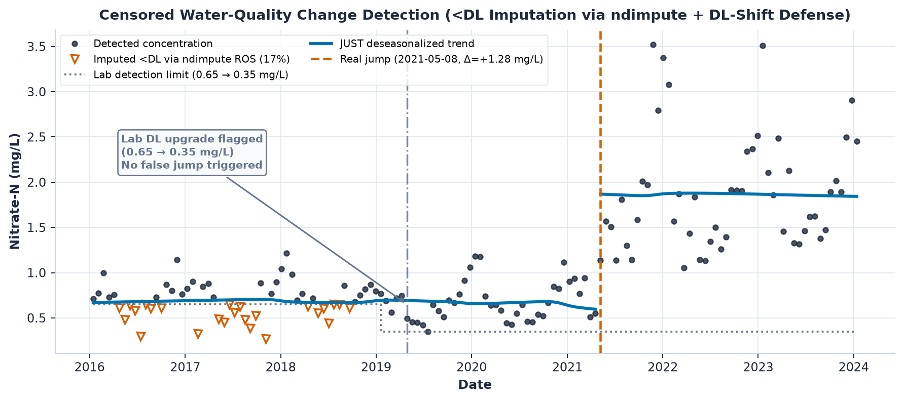

# Working with Censored Lab Data (`<DL` / `>UL`)

Environmental and analytical time series frequently contain **censored values** — measurements below a laboratory Limit of Detection (e.g., `"<0.05"` mg/L), above an upper reporting limit (`">100"`), or known only to lie within an interval (`[0.2, 0.5]`).

`tspec` integrates [`ndimpute`](https://github.com/LukeAFullard/ndimpute) directly into `just_jumps()`, `just_decompose()`, `just_monitor()`, `detect_turning_points()`, and `analyze_series()` while adding time-series-specific safeguards.



---

## Why Replacing `<DL` with `DL/2` Fails

Substituting half the detection limit (`DL/2`) is still common in spreadsheets, yet it causes three severe distortions (Helsel, 2012):

1. **Destroys variance:** Assigning the exact same constant to every non-detect makes the data look artificially smooth, shrinking standard errors and producing falsely tiny $p$-values.
2. **Biases trends & jump magnitudes:** Especially on right-skewed (lognormal) water-quality data, `DL/2` shifts the lower tail upward or downward relative to the true conditional expectation.
3. **Turns lab upgrades into fake jumps:** When a lab upgrades from `<0.10` to `<0.02`, `DL/2` drops mechanically from `0.05` to `0.01` even if river concentrations never budged!

---

## Supported Input Formats

You can pass censored data in any of three idiomatic forms:

```python
from tspec import CensoredConfig, analyze_series

# 1. Mixed strings & floats (auto-detected!)
y_strings = ["<0.05", 0.12, "<0.05", 0.34, None, ">10.0"]
res = analyze_series(dates, y_strings)

# 2. Numeric array + boolean/integer/LWPTrends status array
#    status: True/1 = left-censored (default), or -1=left, 0=obs, 1=right, or 'lt'/'gt'/'not'
res = analyze_series(dates, values, censor_status=is_left_censored)

# 3. Interval bounds: (N, 2) array of [lower, upper]
res = analyze_series(
    dates,
    bounds_nx2,
    censoring=CensoredConfig(method="parametric", censoring_type="interval"),
)
```

---

## Five Built-In Statistical Safeguards

### 1. Eliminating the ROS Quantile Temporal-Trend Artifact
In standard Robust ROS (`NADA::ros` and `ndimpute`'s default `impute_type="quantile"`), plotting positions are assigned using a **stable sort** on values. On a chronologically ordered time series, all non-detects tied at a detection limit $L$ are ranked $1, 2, \dots, C$ **from earliest timestamp to latest timestamp** — deterministically injecting a fake upward trend!

`tspec` protects you automatically:
- Defaults to **`impute_type="stochastic"`** (seeded with `random_state=0`), which preserves residual spread and has zero temporal rank correlation.
- If you explicitly request `impute_type="quantile"`, `tspec` **randomly permutes tied detection-limit groups** before calling `ndimpute` and maps them back afterward, preserving exact NADA marginal quantiles with zero artificial slope.

### 2. Imputation Scopes for Non-Stationary Series
Because `ndimpute` fits a single marginal distribution, a huge regime jump (e.g., 60% `<DL` before a factory opens, 5% `<DL` afterward) can distort global imputations. Choose from three explicit scopes:

- `scope="global"` *(default)*: Lowest variance; best when censoring is $<30\%$ and regimes are comparable. Automatically emits `NONSTATIONARY_CENSORING_PATTERN` if censoring differs by $>30\%$ between halves of the record.
- `scope="windowed"`: Re-fits `ndimpute` locally inside each sliding JUST/STPD window (falling back to global when a window has $<5$ detects or $>80\%$ censoring).
- `scope="seasonal_stratified"`: Imputes separately by calendar quarter so summer baseflow non-detects aren't distorted by winter stormflow peaks.

### 3. Laboratory Detection-Limit Shift Defense
With `detect_dl_shifts=True` (default), `tspec` scans for both explicit step changes in active censoring limits AND implicit DL upgrades (where censoring at $L_{\text{old}}$ stops and uncensored detections appear below $L_{\text{old}}$):

- Any jump or turning point near a detected DL shift is marked `coincides_with_dl_shift = True` with a prominent `DL_SHIFT_COINCIDENCE` warning in `.explain()` and a dotted vertical marker in `.plot()`.
- Set **`recensor_check=True`** to run Helsel's common-limit recensoring verification: temporarily recensors everything below $L_{\max}$ in the jump window and re-tests whether the jump survives. If it disappears, `dl_artifact_likely = True` is flagged explicitly.

### 4. Breakpoint Stability Across Imputation Uncertainty
Single imputations condition on fitted parameters $\hat\theta$ (see `ndimpute`'s statistical documentation). To measure whether a detected jump or turning point is robust rather than an artifact of one random tail draw:

- `analyze_series()` automatically runs **`n_stability_draws=20`** stochastic draws and reports `stability_rate` (e.g., *"Stable in 19/20 draws"*).
- For full parameter-uncertainty propagation (proper resampling of $\hat\theta$ as well as tail draws), pass **`CensoredConfig(n_stability_draws=50, stability_mode="bootstrap")`**.

### 5. Tiered Censoring Guardrails
- **0–20% censored:** Informational provenance note.
- **20–50% censored:** `MODERATE_CENSORING` caution recommending `n_stability_draws >= 20`.
- **50–80% censored:** `HEAVY_CENSORING` warning (results depend strongly on distributional shape).
- **>80% censored or <5 detects:** Blocked with `CensoringError` by default; pass `allow_heavy_censoring=True` only for exploratory inspection.
- Every sliding window's local censoring fraction is recorded (`window_censored_fraction`), flagging any breakpoint backed by a >50% censored window.
