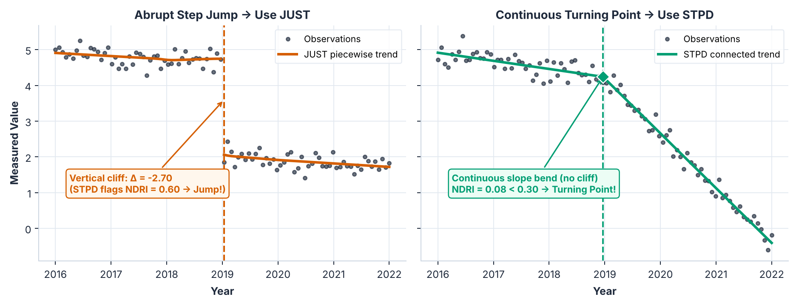
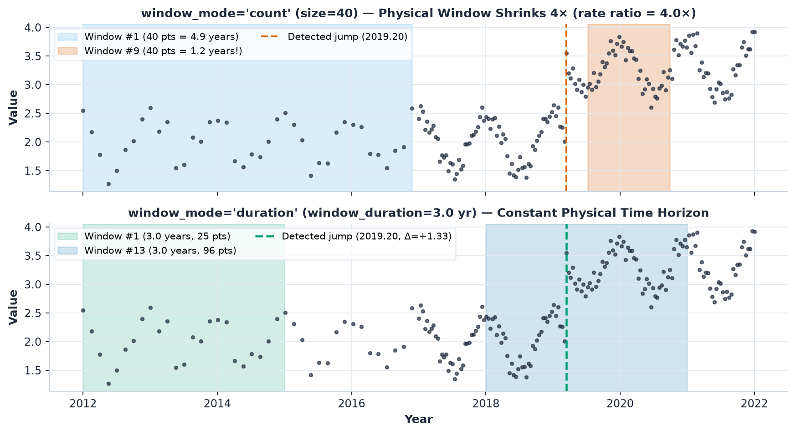
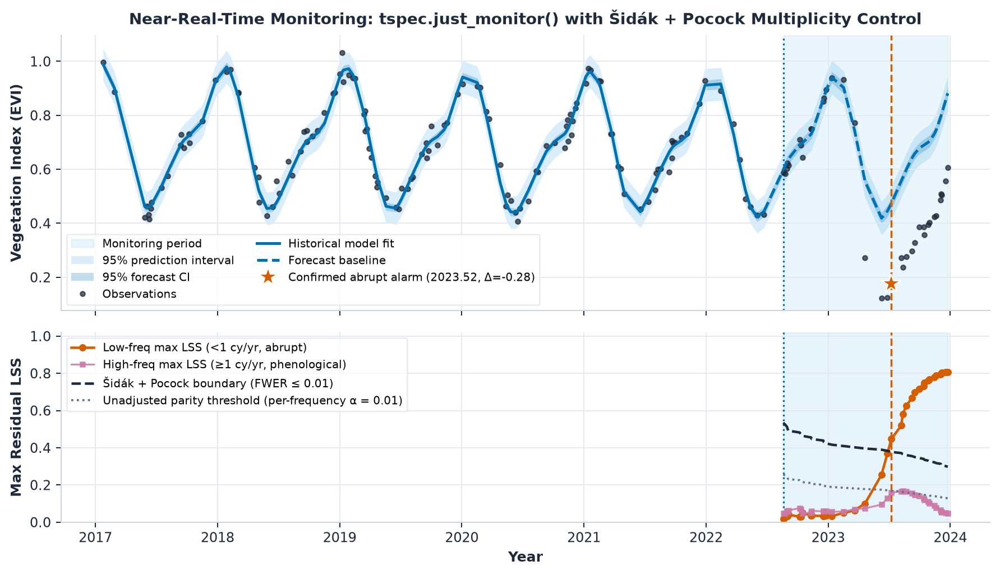

# Core Concepts (Zero Math First)

Every concept below starts in plain English. Expand the collapsible **Mathematical details** panel underneath any section if you want the exact formulas.

---

## 1. Abrupt Jumps (JUST) vs. Smooth Turning Points (STPD)

- An **abrupt jump** is a sudden vertical step (and possibly a new slope afterward): think of a wildfire burning a forest canopy, a chemical spill, or swapping a field sensor for a newly calibrated one. The line *breaks* vertically. **JUST** is built for this.
- A **continuous turning point** is a smooth change in speed with **no sudden vertical cliff**: think of a slow-moving landslide accelerating after a wet winter, or river nitrate concentrations leveling off and slowly declining after agricultural reforms. The line *bends* without breaking. **STPD** is built for this.



??? note "Mathematical details: 2-piece discontinuous vs. connected models"
    - **JUST** fits a 4-parameter discontinuous 2-piece linear trend inside each window:
      $$T(t) = \begin{cases} b_1 + a_1 t, & t < t_j \\ b_2 + a_2 t, & t \ge t_j \end{cases}$$
      with step magnitude $\Delta = (b_2 - b_1) + (a_2 - a_1) t_j$ and slope change $\Delta a = a_2 - a_1$.
    - **STPD** enforces continuity $b_2 + a_2 t_\tau = b_1 + a_1 t_\tau$ (3 free parameters) using asymmetric forward-and-backward sequential OLS.

---

## 2. Why JUST Uses Straight Local Trend Lines (and Why That's a Strength)

Non-statisticians sometimes worry that a straight line is "too simple" for curved environmental data. In JUST, straight lines are fitted **inside sliding windows** *at the same time* as seasonal waves:

- Because the seasonal wave is removed simultaneously, a straight line over a 3-year window cannot accidentally swallow a winter/summer cycle.
- When `just_decompose()` blends those overlapping 3-year straight lines with Gaussian weights, the combined trend naturally captures gentle long-term curvature while keeping sharp discontinuities crisp at detected jump dates.

---

## 3. NDRI: The "Jump-Detector Alarm Bell"

What happens if you feed a series containing a sudden vertical jump into **STPD** (which expects smooth bends)?

Because STPD forces the two lines to stay connected, a vertical cliff forces one side of the fit to absorb huge errors while the other side fits relatively tightly. **NDRI** (*Normalized Difference Residual Index*) measures how lop-sided the residuals are between the left and right sides of the bend:

- **`NDRI ≈ 0` (below 0.30):** Residuals look evenly balanced on both sides → **genuine smooth turning point**.
- **`NDRI → 1` (above 0.30):** One side's errors blow up compared to the other → **alarm bell!** STPD rejects the candidate as a turning point and records it in `result.flagged_jumps`, telling you in `.explain()` to run `just_jumps()` or `analyze_series()`.

??? note "Mathematical details: `ndri_mode='rmse'` vs. `ndri_mode='l2'`"
    Ghaderpour et al. (2024) define $\text{NDRI}_{L_2} = \frac{|\|r_1\|_P - \|r_2\|_P|}{\|r_1\|_P + \|r_2\|_P}$. On unevenly sampled series where $n_1 \neq n_2$, the side with more points naturally accumulates a larger raw $L_2$ norm even under identical noise variance. `tspec` therefore defaults to the whitened, density-invariant RMSE form:
    $$\text{NDRI}_{\text{RMSE}} = \frac{|\text{RMSE}_1 - \text{RMSE}_2|}{\text{RMSE}_1 + \text{RMSE}_2}, \qquad \text{RMSE}_k = \frac{\|r_k\|_P}{\sqrt{n_k}},$$
    while storing both `ndri_rmse` and `ndri_l2` on every turning point (`parity_mode=True` selects `l2`). When inverse-variance weights $w_i = 1/\sigma_i^2$ are supplied on heteroscedastic records, $\|r_k\|_P = \sqrt{\sum w_i r_i^2}$ prevents a variance shift from masquerading as a vertical jump.

---

## 4. Why You Should NOT Interpolate Gaps First

Traditional time-series tools (FFT, classical STL, BFAST) require evenly spaced points, tempting practitioners to linearly interpolate missing months before analysis. That creates three serious problems:

1. **Fake precision:** Interpolated points carry zero new information yet inflate sample size $n$, artificially shrinking $p$-values and causing false detections.
2. **Smeared jumps:** Linearly interpolating across a gap that spans a sudden disturbance turns a sharp cliff into a fake ramp, fooling change-point detectors.
3. **Spectral distortion:** Regularizing irregular timestamps introduces artificial high-frequency attenuation and aliasing.

`tspec` evaluates cosines, sines, and piecewise trends directly at the **exact observed timestamps** $t_i$ and drops `NaN`s transparently without filling a single gap.

---

## 5. Count Windows (`window_mode="count"`) vs. Duration Windows (`window_mode="duration"`)

Suppose a 10-year water-quality program sampled **monthly** for years 1–5 (12 samples/yr) and then installed an automated logger sampling **weekly** for years 6–10 (52 samples/yr):

- With **`window_mode="count"`** (default, matches Ghaderpour's papers), every sliding window grabs a fixed *number of points* (e.g., 36 observations). During the monthly era, 36 points = **3 full years** (great for estimating annual seasonality). During the weekly era, 36 points = **8 months** (less than one full year — too short to separate seasonality from trend!).
- With **`window_mode="duration"`** (`window_duration=3.0, step_duration=1.0`), every sliding window spans **3 calendar years**, whether it holds 36 monthly samples or 156 weekly samples.



```python
import numpy as np
import tspec

# Monthly for first 5 years, weekly for last 5 years, jump at year 6.0
rng = np.random.default_rng(7)
t = np.concatenate([np.linspace(0.0, 5.0, 60), np.linspace(5.02, 10.0, 260)])
y = np.where(t < 6.0, 2.0, 3.8) + 0.6 * np.sin(2 * np.pi * t) + rng.normal(0.0, 0.12, t.size)

# Count mode automatically warns you when sampling rate shifts > 2x:
res_count = tspec.just_jumps(t, y, season="ols", jump_alpha=0.01, mag_th=0.0, dir_th=0.0)
print([w.code for w in res_count.diagnostics.warnings])  # includes 'VARIABLE_SAMPLING_RATE'

# Duration mode keeps every window exactly 3.0 years wide:
res_dur = tspec.just_jumps(
    t, y, window_mode="duration", window_duration=3.0, step_duration=1.0,
    season="ols", jump_alpha=0.01, mag_th=0.0, dir_th=0.0,
)
print(res_dur.explain())
```

**Rule of thumb:** Keep the default `window_mode="count"` when sampling density is roughly steady over time. Switch to `window_mode="duration"` whenever `tspec` emits a `VARIABLE_SAMPLING_RATE` hint or you know your sampling frequency changed substantially.

---

## 6. Near-Real-Time Monitoring & Why Repeated Testing Needs Guardrails

When monitoring incoming observations one by one (`just_monitor()`), you are **peeking repeatedly** at the data — and at *35 candidate frequencies* every single time a new point arrives. If you test at an unadjusted $\alpha = 0.05$ on every new observation, even completely normal white noise will eventually trigger a false alarm (**72.5%** of stable series falsely trigger over 25 monitoring steps!).

`tspec` solves this out of the box with three complementary layers:

1. **Per-step frequency correction (`freq_correction="sidak"`):** adjusts for scanning all 35 frequencies simultaneously at each step.
2. **Across-time sequential control (`sequential_control`):**
   - `"pocock"` *(default)*: with a planned `horizon`, distributes your $\alpha$ budget evenly (Šidák) across the planned steps; without `horizon`, uses open-ended spending $\alpha_d \propto 1/((d+1)\ln^2(d+1))$ so the bound holds for any monitoring length without peeking at future data (familywise false-alarm probability $\le \alpha$ under well-specified historical dynamics and Gaussian independent noise).
   - `"obrien_fleming"`: spends very little $\alpha$ early and saves statistical power for later monitoring steps.
   - `"consecutive_k"` *(e.g. `k=2`)*: requires two consecutive exceedances before sounding the alarm, which suppresses isolated glitches. With a planned `horizon`, the per-step level is calibrated by Monte Carlo so that the familywise false-alarm probability over the horizon is about $\alpha$, and detection is faster than Pocock spending. Without `horizon` it does **not** bound the familywise rate, which grows with the monitoring length.
3. **Out-of-sample predictive covariance (`account_for_forecast_uncertainty=True`):** propagates finite-sample historical trend and seasonal parameter uncertainty into the monitoring window weights so extrapolating beyond a short historical baseline does not trigger spurious drift alarms.



---

## 7. Robust Estimation Against Outliers & Heavy Tails (`robust="huber" | "mm"`, `slope_estimator="sen" | "l1" | "huber"`)

Real environmental and geophysical records often contain isolated sensor glitches, stormflow turbidity spikes, or heavy-tailed errors. Under plain OLS, even a handful of extreme spikes can bias segment slopes, distort seasonal fits, or trigger false jumps. `tspec` addresses this with a **two-layer robust architecture** requiring zero extra dependencies:

1. **Outlier-resistant Phase 1 detection & decomposition (`robust="huber"` or `robust="mm"`):**
   - **`robust="huber"`**: convex **Huber IRLS** ($k = 1.345$, 95% Gaussian efficiency, monotone $\psi$) + **Schrader–Hettmansperger (1980) robust nested $F$-tests**. Ideal for heavy-tailed noise (e.g., Student-$t_3$/$t_5$) and moderate outliers.
   - **`robust="mm"`**: **MM-type Tukey-biweight estimation** (Huber-started, not Yohai's high-breakdown S-started MM; breakdown is design-dependent) — initializes from convex Huber IRLS (so genuine sustained jumps are never masked) and refines with Tukey's bisquare weight ($c = 4.685$, 95% Gaussian efficiency, **zero influence** for extreme $>4.685\sigma$ isolated spikes). Recommended when records contain extreme isolated spikes (e.g., $10\sigma$–$50\sigma$ sensor glitches) and discontinuous jump detection is enabled.
   - **No jump masking & NDRI preserved:** Both modes evaluate candidate splits on a shared window scale, keep incoming monitoring observations in `just_monitor` at full weight `1.0`, and preserve STPD's asymmetric forward/backward geometry so its NDRI jump-vs-turning-point alarm stays sharp.
2. **Robust Phase 2 segment slopes & continuous piecewise fits:**
   - `fit_piecewise_trend(..., mode="l1")` fits an exact globally optimal continuous **$L_1$ (LAD) hinge-spline** via sparse HiGHS linear programming (design-dependent breakdown — robust to isolated vertical outliers, not 50% — and strictly continuous at every turning point). `mode="huber"` fits a continuous Huber hinge-spline.
   - `analyze_series(..., robust="mm", slope_estimator="sen")` computes per-segment **Theil–Sen** slopes, intercepts, distribution-free 95% confidence intervals, and Mann–Kendall $p$-values on `result.segments` (and `result.segments_to_dataframe()`). When a segment contains left- or right-censored data (`<DL` / `>UL`), `tspec` automatically switches to **Akritas–Theil–Sen (ATS)**!

```python
import numpy as np
import tspec

rng = np.random.default_rng(11)
t = np.linspace(2016.0, 2024.0, 160)
y = (
    1.0 + 0.6 * (t - 2016.0) - 1.4 * np.maximum(0.0, t - 2020.0)
    + 0.7 * np.sin(2 * np.pi * t) + rng.normal(0.0, 0.15, t.size)
)
y[[18, 55, 110, 145]] += np.array([9.0, -10.0, 11.0, -9.0])  # isolated 60-sigma spikes

res = tspec.analyze_series(
    t, y,
    robust="mm",            # Huber-init MM-biweight for extreme isolated spikes
    slope_estimator="sen",  # Theil-Sen (or Akritas-Theil-Sen when censored)
)
print(res.summary())
```
