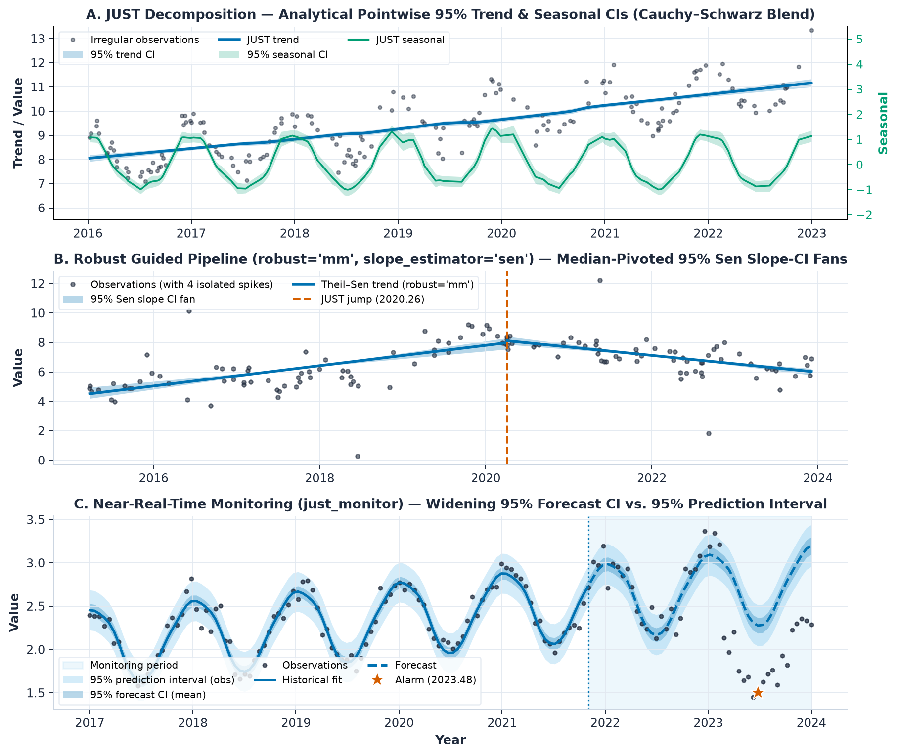

# Interpreting Results, Plots & Warnings

Every result returned by `tspec` (`LssaResult`, `AllssaResult`, `JustJumpResult`, `JustDecomposeResult`, `MonitorResult`, `StpdResult`, `PiecewiseTrendResult`, `PipelineResult`) shares four uniform methods:

- **`.explain()`** — Plain-English narrative written for domain scientists and reports. Start here!
- **`.summary()`** — Compact technical table of indices, timestamps, magnitudes/slopes, $p$-values, NDRI, and red-noise diagnostics.
- **`.to_dataframe()`** — Tidy `pandas.DataFrame` ready for downstream export or batch aggregation.
- **`.plot()`** — Diagnostic Matplotlib figure using colorblind-safe Okabe–Ito colors and distinct markers for censored observations.

---

## Understanding Screening $p$-Values & Repeated Testing

!!! important "Screening vs. Fixed-Date $p$-Values"
    Inside a sliding window, JUST and STPD search across many candidate split indices and select the index $j^*$ that minimizes the residual sum of squares *before* computing `jump_pvalue` (JUST) or Student-$t$ `pval` (STPD). Because $j^*$ was chosen by looking at the data, raw window $p$-values are **screening statistics** — they are optimistically small compared to testing a single pre-specified date!

How `tspec` handles this transparently:
- In **`analyze_series()`**, Stage 1 enables **`bonferroni_window=True`** by default (multiplying raw window $p$-values by the number of tested interior splits) AND applies the 1-df **`step_pvalue`** test comparing the best discontinuous jump against the best continuous hinge — suppressing post-selection noise while cleanly handing smooth bends to STPD.
- In **`just_jumps()`**, `bonferroni_window=False` and `jump_alpha=None` by default for exact parity with Ghaderpour (2020), while always computing and storing both `jump_pvalue` and `step_pvalue` on every `JumpEvent`.

---

## Reading Diagnostic Warnings

| Warning Code | Severity | What It Means & What To Do |
| :--- | :--- | :--- |
| `DL_SHIFT_COINCIDENCE` | Warning | A jump, turning point, or NRT alarm landed right next to a laboratory detection-limit change. Re-run with `CensoredConfig(recensor_check=True)` and check lab metadata! |
| `DL_ARTIFACT_LIKELY` | Warning | The detected jump vanished once data were recensored to a common detection limit — almost certainly a lab artifact, not an environmental shift. |
| `STRONG_AUTOCORRELATION` | Warning | Residual lag-1 or continuous-time OU correlation $\ge 0.60$. Nominal $p$-values are unreliable; tighten `alpha` or supply correlated inverse-covariance `weights = C_f^{-1}`. |
| `MODERATE_AUTOCORRELATION` | Caution | Residual autocorrelation $\in [0.30, 0.60)$. False-positive rates are modestly elevated; consider `alpha=0.005`. |
| `HIGH_NDRI_JUMP_CANDIDATE` | Caution | STPD rejected a strong candidate because residuals were lop-sided (`NDRI >= ndri_th`). Run `just_jumps()` or `analyze_series()` to check for an abrupt vertical jump. |
| `HORIZON_EXCEEDED` | Warning | `just_monitor()` ran past its planned `horizon` under Pocock or O'Brien–Fleming spending; familywise Type I error control is no longer guaranteed past `horizon`. Increase `horizon` or switch to `sequential_control="consecutive_k"`. |
| `LONG_MONITORING_HORIZON` | Caution | The monitoring span exceeds the stable historical span, so extrapolated trend uncertainty grows quadratically. Keep `account_for_forecast_uncertainty=True` (default) or re-baseline periodically. |
| `UNADJUSTED_REPEATED_TESTING` | Warning | Multiplicity controls (`freq_correction`, `sequential_control`) are disabled in `just_monitor()` outside `parity_mode=True`. |
| `PENDING_CONFIRMATION` | Info | Under `sequential_control="consecutive_k"`, the latest observation exceeded the threshold but has not yet reached `consecutive_k` consecutive hits. |
| `THRESHOLD_SCALE_MISMATCH` | Caution | Default `mag_th=0.05` (NDVI scale) looks too small or too large for your data's IQR. Set a domain-meaningful `mag_th` or enable `jump_alpha=0.05`. |
| `VARIABLE_SAMPLING_RATE` | Caution | Sampling density shifts $> 2\times$ across the series under `window_mode="count"`. Try `window_mode="duration"`. |
| `NONSTATIONARY_CENSORING_PATTERN` | Caution | Censoring fraction shifts by $> 30\%$ between halves under `scope="global"`. Consider `CensoredConfig(scope="windowed")`. |
| `HEAVY_CENSORING` / `WINDOW_HEAVY_CENSORING` | Warning | Over 50% of the series (or supporting window) is censored. Enable `n_stability_draws=20` (or `stability_mode="bootstrap"`) and treat estimates cautiously. |
| `SPARSE_WINDOW_SKIPPED` | Info | One or more duration windows (or evaluation gaps) held too few observations and were safely skipped. |

---

## Confidence & Prediction Intervals (with Examples)

Every trend, seasonal, and forecast estimator in `tspec` computes fast analytical pointwise confidence intervals controlled by `ci_level` (default `0.95`) and renders them automatically as semi-transparent shaded ribbons in `.plot()` (toggle with `show_ci=False`):



| Function / Mode | Output Fields | Interval Formula |
| :--- | :--- | :--- |
| `just_decompose()` | `trend_ci_low/high`, `seasonal_ci_low/high` (plus `*_reg_ci_*` for `eval_times`) | Exact within-window Student-$t$ half-widths (accounting for zero-mean seasonal centering), combined across overlapping Gaussian windows via the conservative **Cauchy–Schwarz half-width blend**. |
| `fit_piecewise_trend()` & `detect_turning_points()` | `trend_ci_low/high` on `PiecewiseTrendResult` | Exact $O(n)$ disjoint-support variance recursion for `mode="sequential"` (TPTR); exact $\mathbf{d}_i^T \widehat{\text{Cov}}\,\mathbf{d}_i$ for `mode="joint"` / `"huber"`; `None` for `mode="l1"`. |
| `analyze_series()` | `trend_ci_low/high`, `decomposition.seasonal_ci_low/high`, and per-segment `slope_ci_low/high` | Exact analytical ribbons for `"ols"` and `"huber"`; **median-pivoted Sen/ATS slope-CI fans** (`MannKS` / Helsel convention) for `"sen"`; `None` for `"l1"`. |
| `just_monitor()` | `forecast_ci_low/high` **and** `forecast_pi_low/high` | Inner band: mean forecast uncertainty (widens quadratically as forecast extrapolates past `start`). Outer band: out-of-sample observation **prediction interval** adding $\hat{\sigma}_{\text{his}}^2 / w_i$. |

!!! note "Statistical Interpretation & Caveats"
    - **Conditional pointwise bands:** Analytical intervals are **conditional on the detected breakpoints and selected seasonal frequencies** (post-selection breakpoint-location uncertainty is not folded into the analytical band). For heavily censored records, pair with `CensoredConfig(n_stability_draws=20)` to assess breakpoint stability.
    - **Autocorrelation:** Standard intervals assume independent residuals unless you supply an inverse-covariance weight matrix `weights = C_f^{-1}`. If `tspec` emits `MODERATE_AUTOCORRELATION` or `STRONG_AUTOCORRELATION`, analytical bands are optimistic (too narrow).
    - **Why `mode="l1"` returns `None`:** Exact linear-programming $L_1$ (LAD) regression has no closed-form finite-sample covariance without density estimation or resampling. Rather than showing misleading parametric error bars, `tspec` returns `None`—use `slope_estimator="sen"` or `"huber"` when you want robust CIs.

### Example 1: JUST Decomposition Trend & Seasonal 95% CIs

```python
import numpy as np
import tspec

rng = np.random.default_rng(42)
t = np.sort(rng.uniform(2016.0, 2023.0, size=170))
y = 8.0 + 0.45 * (t - 2016.0) + 1.1 * np.cos(2 * np.pi * t) + rng.normal(0.0, 0.35, t.size)

dec = tspec.just_decompose(t, y, season="ols", ci_level=0.95)
df = dec.to_dataframe()  # includes trend_ci_low/high & seasonal_ci_low/high
assert {"trend_ci_low", "trend_ci_high", "seasonal_ci_low", "seasonal_ci_high"} <= set(df.columns)

fig, axes = dec.plot(show_ci=True)  # shaded 95% ribbons on trend & seasonal panels
```

### Example 2: Robust Pipeline with Theil–Sen Slope-CI Fans (`robust="mm"`, `slope_estimator="sen"`)

```python
t_b = np.sort(rng.uniform(2015.0, 2024.0, size=190))
tr_b = np.where(t_b < 2019.2, 5.0 + 0.2 * (t_b - 2015.0), 8.2 - 0.55 * (t_b - 2019.2))
y_b = tr_b + 0.65 * np.cos(2 * np.pi * t_b) + rng.normal(0.0, 0.28, t_b.size)
y_b[[22, 65, 130, 165]] += np.array([5.5, -4.8, 5.2, -5.0])  # isolated spikes

pipe = tspec.analyze_series(
    t_b,
    y_b,
    robust="mm",
    slope_estimator="sen",
    ci_level=0.95,
    just_kwargs={"season": "ols", "jump_alpha": 0.01},
    decompose_kwargs={"season": "ols"},
)
for seg in pipe.segments:
    print(f"Seg {seg.segment_index}: slope={seg.slope:+.3f} 95% CI=[{seg.slope_ci_low:+.3f}, {seg.slope_ci_high:+.3f}]")

fig, axes = pipe.plot(show_ci=True)  # plots Sen slope-CI fans & seasonal 95% CI
```

### Example 3: Near-Real-Time Monitoring Forecast CI vs. Prediction Interval

```python
t_c = np.linspace(2017.0, 2024.0, 150)
y_c = 2.0 + 0.12 * (t_c - 2017.0) + 0.45 * np.cos(2 * np.pi * t_c) + rng.normal(0.0, 0.14, t_c.size)
y_c = np.where(t_c >= 2023.15, y_c - 0.85, y_c)

mon = tspec.just_monitor(t_c, y_c, start=2021.8, season="ols", ci_level=0.95, stop_on_first=False)
assert np.all(mon.forecast_pi_low < mon.forecast_ci_low)
assert np.all(mon.forecast_ci_high < mon.forecast_pi_high)

fig, axes = mon.plot(show_ci=True)  # inner forecast CI cone + outer observation PI
```

---

## Visual Legend for `.plot()`

- **Solid dark dots (`●`):** Measured (uncensored) observations.
- **Hollow downward orange triangles (`▽`):** Imputed left-censored observations (`<DL`).
- **Hollow upward purple triangles (`△`):** Imputed right-censored observations (`>UL`).
- **Hollow squares with whiskers (`□`):** Imputed interval-censored observations (`[L, R]`).
- **Semi-transparent shaded ribbons:** Pointwise confidence intervals (`ci_level=0.95` by default; toggle with `show_ci=False`). On `plot_monitor()`, the darker inner ribbon is the mean forecast CI and the lighter outer ribbon is the observation prediction interval.
- **Vertical dashed orange lines:** JUST abrupt jumps (with `Δ` magnitude badge and `(DL shift!)` flag if coinciding).
- **Vertical dotted gray lines:** Detected laboratory detection-limit shifts.
- **Green diamonds (`◆`):** STPD continuous turning points (with `Δslope` and `NDRI` badges).
