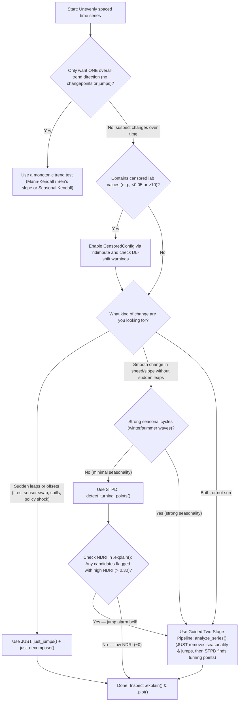

# Which Method Should I Use?

Choosing the right method takes 30 seconds once you answer three plain-English questions about your data:

1. Are you looking for **one overall trend**, or **changes in behavior over time**?
2. Do changes look like **sudden cliffs/jumps**, or **smooth bends in speed**?
3. Does your data have **seasonal waves** (winter/summer cycles) or **censored lab values** (`<0.05`)?

## Decision Flowchart

## Plain-English Method Comparison

| Your Question / Scenario | Best Tool | Why (Zero Jargon) |
| :--- | :--- | :--- |
| *"Did a wildfire, flood, spill, or sensor swap cause a sudden drop or jump — even though my series has summer/winter waves and missing months?"* | **`just_jumps()` + `just_decompose()`** | Fits local straight trend lines and seasonal cycles simultaneously **without filling gaps**, so abrupt offsets stand out clearly. |
| *"Is my landslide, ground subsidence, or groundwater trend gradually accelerating or slowing down — with no sudden cliff and minimal seasonality?"* | **`detect_turning_points()` (`stpd`)** | Fits connected straight lines that bend smoothly at a turning point, and uses **NDRI** to make sure it isn't fooled by a hidden sudden jump. |
| *"My river or satellite record has seasonal cycles, maybe a sudden disturbance, AND maybe a later change in recovery rate — where should I start?"* | **`analyze_series()`** | Runs the recommended two-stage sequence automatically: JUST extracts seasonality and vertical jumps first, then STPD finds smooth trend bends. |
| *"My water-quality data has `<0.05` lab non-detects or `>100` upper limits."* | **Any function above + `CensoredConfig`** | Delegates to `ndimpute` for unbiased censored imputation (avoiding `DL/2` bias) and automatically warns if a lab detection-limit upgrade looks like a fake jump. |
| *"I just want to know whether concentrations went up or down overall over 10 years, without locating breakpoints."* | **Mann–Kendall / Sen's slope** *(external, e.g., `pymannkendall`)* | Simpler, nonparametric, and higher statistical power when you do not need to detect change dates or separate jumps from bends. |
