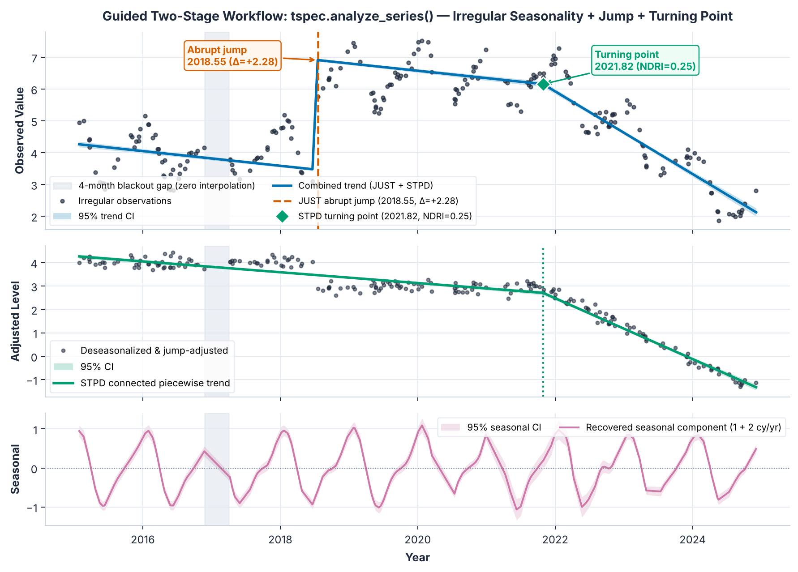

<p align="center">
  
</p>

# tspec

**Unevenly sampled time-series change detection, turning points, near-real-time monitoring, and spectral decomposition — with first-class censored-data support via [`ndimpute`](https://github.com/LukeAFullard/ndimpute).**

Real-world environmental, hydrological, remote-sensing, and geotechnical time series are rarely neat, evenly spaced spreadsheets. They have missing months, changing sampling schedules, strong seasonal waves, sudden disturbances, gradual shifts in trend speed, and laboratory non-detects like `<0.05 mg/L`.

`tspec` handles all of these natively **without interpolating gaps**:

- **JUST** (*Jumps Upon Spectrum and Trend*) finds abrupt jumps (`just_jumps`) and separates trend, seasonality, and remainder (`just_decompose`) on irregular records.
- **JUSTmonitor (v1.1)** detects abrupt and phenological disturbances in near-real time (`just_monitor`) with Šidák, Pocock, O'Brien–Fleming, and consecutive-$k$ repeated-testing controls.
- **STPD** (*Sequential Turning Point Detection*) finds smooth, continuous changes in trend rate (`detect_turning_points`) and uses **NDRI** to distinguish true bends from disguised jumps.
- **`analyze_series()`** chains JUST and STPD together automatically in the recommended two-stage workflow.
- **Built-in `ndimpute` integration** handles `<LOD`, `>UL`, mixed, and `[L, R]` censored data safely — with automated detection-limit upgrade warnings and multi-draw stability checks.
- **Robust estimation against spikes & heavy tails** via convex **Huber IRLS** (`robust="huber"`) and **Huber-started Tukey-biweight MM-type** estimation (`robust="mm"`; not a high-breakdown S-started MM), exact continuous **$L_1$ / Huber** hinge-splines (`fit_piecewise_trend(..., mode="l1" | "huber")`), and per-segment **Theil–Sen / Akritas–Theil–Sen** slopes with distribution-free CIs and Mann–Kendall $p$-values (`analyze_series(..., slope_estimator="sen")`).



## Installation

=== "Standard (Recommended)"

    ```bash
    pip install tspec
    ```
    Includes `numpy`, `scipy`, `ndimpute`, and `pandas`.

=== "With Plots"

    ```bash
    pip install "tspec[plot]"
    ```
    Adds `matplotlib` for `.plot()` diagnostic figures.

=== "Lite (No ndimpute / pandas)"

    ```bash
    pip install numpy scipy
    pip install --no-deps tspec
    ```
    Core `lssa`, `allssa`, `just_jumps`, `just_decompose`, `just_monitor`, and `detect_turning_points` work with zero `pandas` or `ndimpute` imports.

## 5-Line Quickstart

```python
import numpy as np
import tspec

rng = np.random.default_rng(42)
t = np.sort(rng.uniform(2016.0, 2024.0, size=180))
trend = np.where(t < 2019.5, 4.0, 6.5) + np.where(t > 2022.0, -1.5 * (t - 2022.0), 0.0)
y = trend + 0.8 * np.cos(2 * np.pi * t) + rng.normal(0.0, 0.15, size=t.size)

result = tspec.analyze_series(t, y)
print(result.explain())
```

## Where to Go Next

- **Not sure which method to pick?** Start with [Which Method Should I Use?](guide/which-method.md).
- **Monitoring incoming observations in real time?** Read the [Near-Real-Time Monitoring Tutorial](tutorials/near-real-time-monitoring.md).
- **Have `<0.05` lab non-detects?** Read [Censored Lab Data (`<DL` / `>UL`)](guide/censored-data.md).
- **Want runnable examples with figures?** Explore the [Domain Tutorials](tutorials/water-quality-censored.md).
- **Looking for exact equations?** See the [Mathematical Reference](reference/math.md).
