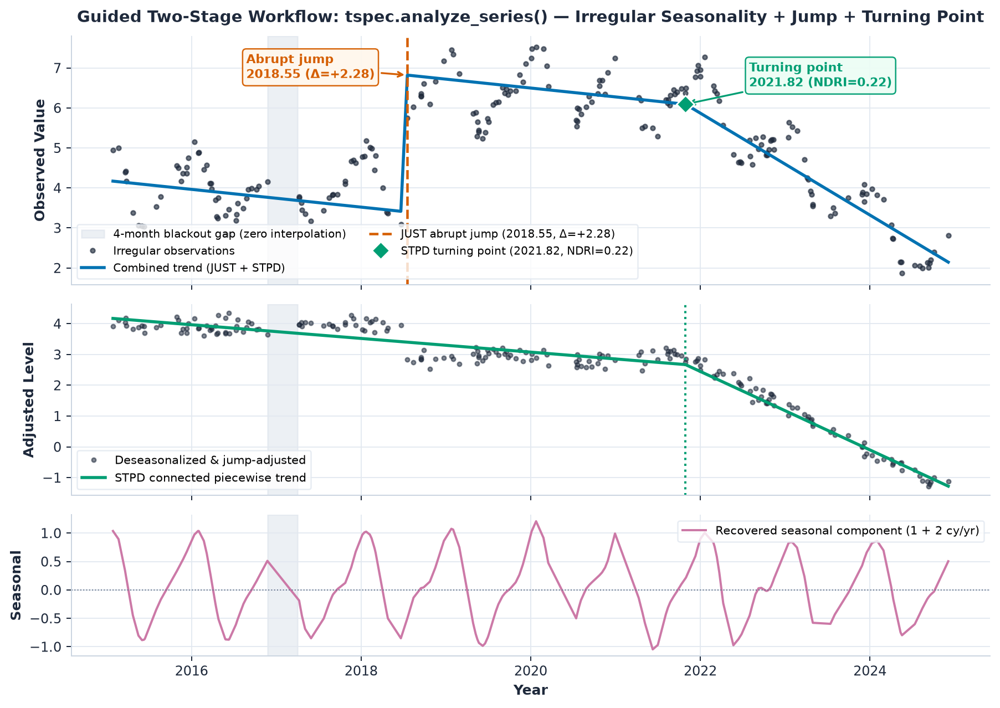

# Tutorial: Combined Two-Stage Workflow (`analyze_series`)

Real multi-decade records frequently contain **all four challenges at once**:
1. Uneven sampling and multi-month gaps
2. Strong annual and semi-annual seasonality
3. An abrupt step jump (e.g., dam construction, wildfire, instrument swap)
4. A later smooth turning point (e.g., gradual ecosystem or hydrological turnaround)

Following Ghaderpour et al. (2024), `analyze_series()` automates the recommended two-stage workflow:
- **Stage 1 (JUST):** Isolates statistically significant abrupt vertical jumps (`step_alpha` + `bonferroni_window=True`) and extracts seasonal harmonics (`just_decompose`).
- **Stage 2 (STPD):** Removes seasonality and vertical step offsets, then detects continuous turning points on the adjusted series.



```python
import numpy as np
import tspec

rng = np.random.default_rng(2026)
t = np.sort(rng.uniform(2014.0, 2024.0, size=200))
t = t[~((t > 2016.2) & (t < 2016.45))]  # 3-month blackout gap

# Abrupt jump at 2017.5 (+2.5) + smooth turning point at 2021.0 (slope 0 -> -1.5/yr)
trend = np.where(t < 2017.5, 4.0, 6.5) + np.where(t > 2021.0, -1.5 * (t - 2021.0), 0.0)
seasonal = 0.8 * np.cos(2 * np.pi * t) + 0.35 * np.sin(2 * np.pi * 2.0 * t)
y = trend + seasonal + rng.normal(0.0, 0.15, size=t.size)

res = tspec.analyze_series(
    t,
    y,
    just_kwargs={"jump_alpha": 0.01},
    stpd_kwargs={"size": 80, "step": 15, "margin": 12, "alpha": 0.01},
)

print(res.explain())
print("\n--- Technical Summary ---")
print(res.summary())

df = res.to_dataframe()
print(df.head())
```

### Offset Adjustment vs. Inter-Jump Segmentation
- **`jump_adjustment="offset"`** *(default)* subtracts only the estimated vertical step discontinuities from the deseasonalized series and runs STPD across the full timeline.
- **`jump_adjustment="segment"`** splits the deseasonalized record at each detected JUST jump and runs STPD independently inside each inter-jump epoch (useful when epochs have very different noise variances or dynamics).
