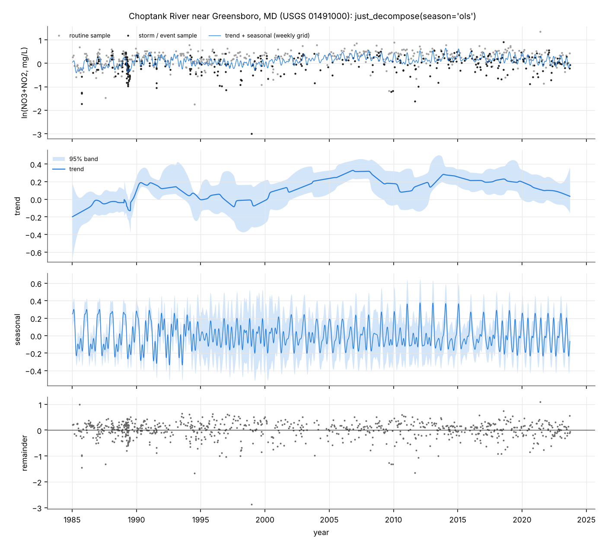
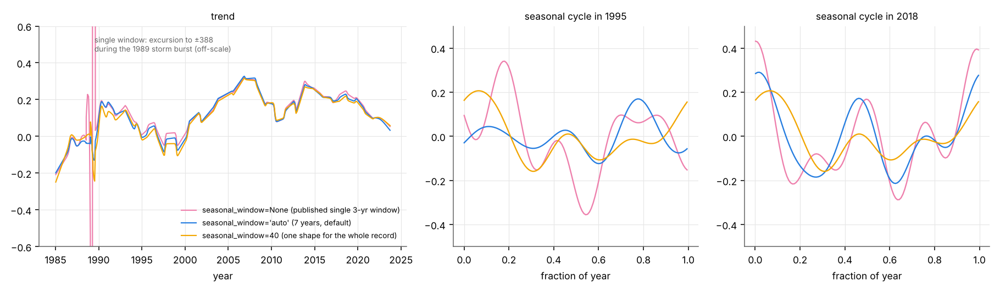
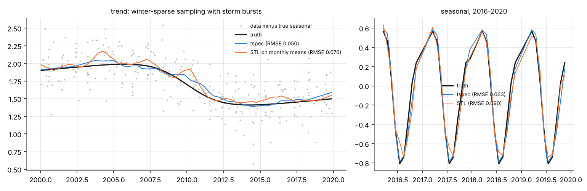

# Tutorial: Decomposing an Unevenly Sampled Water-Quality Record

This tutorial decomposes a real river nitrate record into **trend**, **seasonal** and **remainder** components, without interpolating it onto a regular grid first. The record has the problems typical of field data:

- 1 to 74 samples per year;
- storm sampling bursts (several samples within days);
- a non-detect;
- sparse early years.

**Data:** Choptank River near Greensboro, Maryland (USGS 01491000), dissolved nitrate + nitrite (mg/L as N), 1985–2023, 804 grab samples, from the Water Quality Portal. The cleaned file ships with the repository at `validation/data/choptank_01491000_nitrate.csv`; the download URL and cleaning steps are in `validation/data/README.md`. The figures are produced by `docs/scripts/tutorial_decomposition.py`.

## Step 1: Load the record

```python
import numpy as np
import pandas as pd
import tspec

d = pd.read_csv("validation/data/choptank_01491000_nitrate.csv", parse_dates=["date"])
d = d[d["date"] >= "1985-01-01"].reset_index(drop=True)

y = np.log(d["value"].to_numpy())          # concentrations are right-skewed: work in logs
status = np.where(d["censored"], -1, 0)    # -1 = left-censored (< detection limit)
```

Datetimes can be passed directly; they are mapped to a uniform decimal-year axis.

## Step 2: Decompose

```python
weekly = pd.date_range("1985-01-03", "2023-09-21", freq="7D").to_numpy()
res = tspec.just_decompose(
    d["date"].to_numpy(), y,
    season="ols",              # fixed annual harmonics 1-4 (recommended for decomposition)
    censor_status=status,      # the non-detect is imputed, not substituted
    eval_times=weekly,         # optional: components on a regular grid for plotting
)
print(res.summary())
```



What you get:

- `res.trend`, `res.seasonal` and `res.remainder` at the observation times; they add up to the data exactly.
- `res.trend_ci_low/high` and `res.seasonal_ci_low/high`: pointwise 95% bands. Where sampling is sparse the bands widen (late 1990s), instead of pretending to know.
- `res.trend_reg` and `res.seasonal_reg` (with bands) at `eval_times`. Passing `eval_times` does not change the values at the observations.

The remainder panel shows a feature of this record that no decomposition removes. Storm samples (black in the top panel) are often much lower than routine samples, because high flow dilutes nitrate. A decomposition in time alone cannot explain flow-driven variation; WRTDS adds discharge as a covariate for exactly this reason. If dilution events dominate your remainder, consider `robust="huber"`, or analyze routine samples separately.

## Step 3: Choose the seasonal window

The seasonal component is estimated in **7-year windows** by default (`seasonal_window="auto"`); the trend uses its own shorter windows (three years of data). Separating the two is what makes the decomposition work on irregular sampling. A seasonal cycle estimated from only three years of samples is noisy, especially when some months are barely sampled.



- `seasonal_window=None` gives the published single-window JUST decomposition. With storm-burst sampling it can fail badly. Here a window covering a few days of the 1989 storm sampling sent the trend to ±388; a few days of data cannot separate a trend from four seasonal harmonics. Avoid it for clustered sampling.
- `"auto"` (7 years) lets the seasonal shape change slowly over the decades. The 1995 and 2018 cycles above differ.
- A window as long as the record (`seasonal_window=40` here) assumes one fixed shape. That is the most precise choice if the shape really is stable, and the most biased if it is not.

## Step 4: Compare with STL on irregular sampling

STL needs a regular grid, so irregular data must first be binned or interpolated. On a synthetic record with known truth (winter-sparse monthly sampling plus storm bursts), `tspec` recovers the trend and the seasonal cycle more accurately than STL on monthly means:



## How well does this work? (validation summary)

Two pre-registered held-out validations compared `just_decompose` with STL (on interpolated and binned grids), WRTDS-style weighted regression and a global harmonics + LOWESS model. Their plans were committed before the runs. Full reports: `validation/reports/decomp_heldout_report.md`, `decomp_heldout_2_report.md`; figures in `validation/reports/figures_decomp_v2/`.

- **Irregular sampling, synthetic truth** (six sampling regimes including storm clusters, winter gaps and real USGS sampling dates): with the seasonal window, `tspec` had lower seasonal error than STL in 17 of 18 designs and lower remainder error in 18 of 18. It had no local blow-ups; the single window failed on up to 10% of observations with real sampling dates.
- **When the seasonal shape really is fixed**, the global harmonics + LOWESS model is more precise (1.3–2.4× lower seasonal error); `tspec` is better whenever the shape changes over time.
- **Real nitrate records** (Choptank, Conowingo), held-out prediction: `tspec`, STL, WRTDS-style and harmonics + LOWESS were all within one split-to-split standard deviation of each other; the global harmonic model was marginally best.

In short: `tspec` is a sound choice for decomposing irregular records, especially when you need uncertainty bands, censored values or jumps, or when the seasonal cycle evolves. It is not guaranteed to beat a well-chosen simple model on every record.

## Checklist

- Work in log units for concentrations.
- Use `season="ols"` and keep the default `seasonal_window="auto"`; lengthen it if you have reason to think the seasonal shape is stable.
- Pass non-detects with `censor_status` (or as `"<DL"` strings), never as DL/2.
- Read the bands: wide bands mark periods where the data cannot pin down the components.
- Check `res.diagnostics.warnings`, e.g. `SERIAL_CORRELATION_ADJUSTED` (bands widened for autocorrelation) and `UNCOVERED_OBSERVATIONS`.
