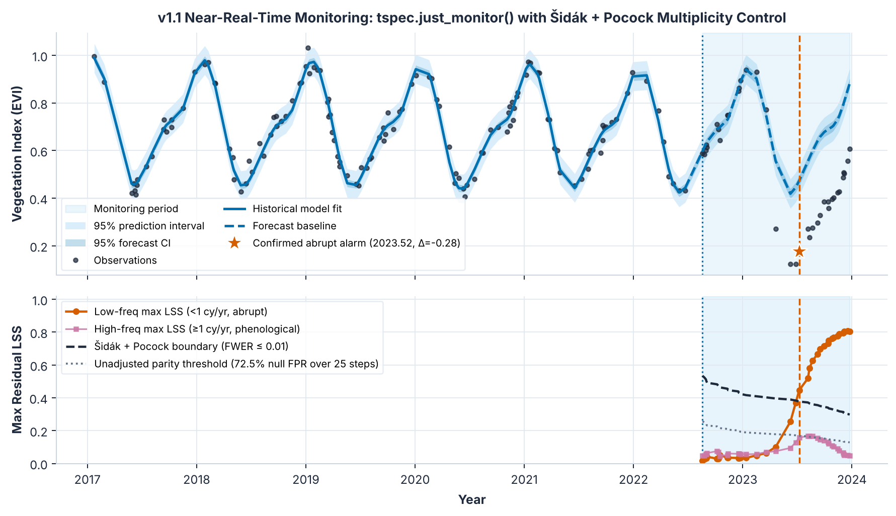

# Tutorial: Near-Real-Time Disturbance Monitoring (`just_monitor`, v1.1)

When new satellite images, water-quality samples, or sensor readings arrive continuously, you often want to **detect a disturbance as soon as it begins** rather than waiting years for a full retrospective record.

`tspec.just_monitor()` implements Near-Real-Time (NRT) least-squares spectral monitoring (Ghaderpour & Vujadinovic, 2020b) with **built-in multiplicity and sequential-peeking controls** so repeated testing across incoming observations does not drown you in false alarms.



## Step 1: Detect an Abrupt Disturbance on an Irregular Seasonal Record

You can pass either a 0-based integer index or a calendar timestamp / decimal year to `start` (and `history`):

```python
import numpy as np
from tspec import just_monitor

rng = np.random.default_rng(2025)
t = np.sort(rng.uniform(2017.0, 2024.0, size=165))
season = 0.22 * np.cos(2 * np.pi * t) + 0.08 * np.sin(4 * np.pi * t)
evi = 0.72 - 0.008 * (t - 2017.0) + season + rng.normal(0.0, 0.028, size=t.size)

# Abrupt canopy disturbance starting at 2023.25
evi = np.where(t >= 2023.25, evi - 0.30, evi)

res = just_monitor(
    t,
    evi,
    start=2022.5,                  # Start active monitoring in mid-2022
    season="ols",                  # Or "allssa" for non-integer harmonics
    alpha=0.01,
    freq_correction="sidak",       # Adjusts for scanning 35 frequencies per step
    sequential_control="pocock",   # Bounds familywise false alarms across all steps
)
print(res.summary())
print(res.explain())
```

## Step 2: Choosing the Right Repeated-Testing Strategy

Under pure white noise over about 24 monitoring steps ($\alpha = 0.05$), **unadjusted repeated testing (`parity_mode=True`) triggers false alarms in about 70% of stable series** (and about 98% over 96 steps). `tspec` provides these strategies:

| Strategy | Setting | Best For |
| :--- | :--- | :--- |
| **Šidák + Pocock** *(default)* | `freq_correction="sidak", sequential_control="pocock", horizon=24` | A planned monitoring horizon fixed in advance (e.g., 1–2 years of updates); uniform sensitivity across every step. Without `horizon`, open-ended spending keeps the familywise bound for any length but is strict at late steps. Familywise false-alarm rate ≤ α (0.1–0.6% at α = 0.05 in simulation, i.e. conservative). |
| **Šidák + O'Brien–Fleming** | `sequential_control="obrien_fleming", horizon=24` | Very strict protection against early false alarms; more power later in the horizon. |
| **Šidák + Consecutive-$k$** | `sequential_control="consecutive_k", consecutive_k=2` | Suppressing isolated single-sample glitches (sets `pending_confirmation=True` after a single exceedance). **Does not bound the familywise false-alarm rate**: about 3% over 24 steps but about 11% over 96 steps at α = 0.05, and it keeps growing with monitoring length. |
| **Upstream Parity** | `parity_mode=True` | Reproducing Ghaderpour & Vujadinovic (2020b) exactly (unadjusted per-step testing). |

```python
# Compare open-ended consecutive-2 confirmation vs. O'Brien-Fleming spending
res_obf = just_monitor(
    t, evi, start=2022.5, season="ols", alpha=0.01,
    sequential_control="obrien_fleming", horizon=60,
)
res_k2 = just_monitor(
    t, evi, start=2022.5, season="ols", alpha=0.01,
    sequential_control="consecutive_k", consecutive_k=2,
)
print("OBF alarm:", res_obf.disturbance_time_year, "type:", res_obf.disturbance_type)
print("Consecutive-2 alarm:", res_k2.disturbance_time_year, "type:", res_k2.disturbance_type)
```

## Step 3: Distinguishing Abrupt vs. Phenological (Intra-Annual) Disturbances

`just_monitor()` automatically classifies every alarm based on the dominant residual frequency:

- **`disturbance_type == "abrupt"`** (`type_code == 1`, dominant frequency $< 1.0$ cy/yr): a baseline drop/jump (wildfire, spill, clearcut, sensor failure). When $\ge 3$ post-alarm observations exist, `magnitude` and `direction` are estimated automatically.
- **`disturbance_type == "phenological"`** (`type_code == 2`, dominant frequency $\ge 1.0$ cy/yr): a change in intra-annual seasonal timing or amplitude (e.g., early snowmelt, crop rotation, or altered drought phenology) without a flat mean shift.

```python
# Phenological disturbance: new intra-annual oscillation without baseline drop
t_ph = np.linspace(2016.0, 2022.5, 160)
base_ph = 1.0 + 0.02 * (t_ph - 2016.0) + 0.25 * np.cos(2 * np.pi * t_ph)
y_ph = base_ph + np.where(t_ph >= 2021.2, 0.22 * np.sin(2 * np.pi * 3.0 * t_ph), 0.0)
y_ph += np.random.default_rng(7).normal(0.0, 0.03, size=t_ph.size)

res_ph = just_monitor(t_ph, y_ph, start=2021.0, season="ols", alpha=0.01)
print(res_ph.explain())
```

## Step 4: Inspecting the Step-by-Step Monitoring Trace & Plots

Every step is recorded in `res.steps` (and exportable via `res.to_dataframe()`), and `res.plot()` produces the two-panel diagnostic figure above (pass `stop_on_first=False` if you want to visualize the full post-alarm trajectory):

```python
df_steps = res.to_dataframe()
print(df_steps[["step", "time_year", "max_low_freq_spec", "critical_value", "exceeded"]].tail())
```
