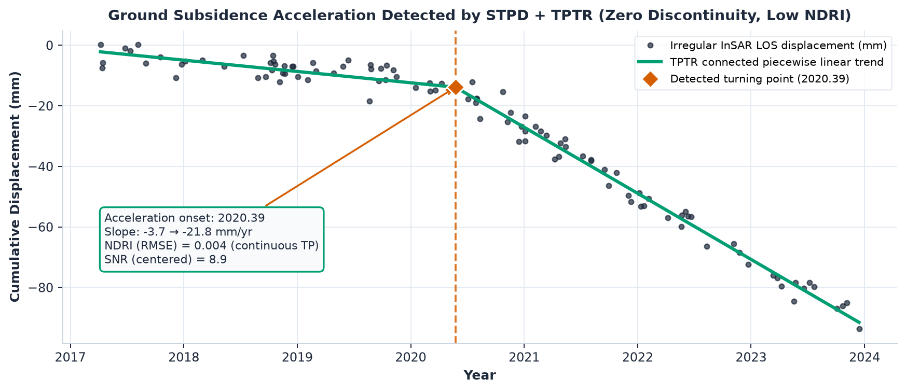

# Tutorial: Ground Subsidence Turning Points with STPD

Ground deformation and geotechnical monitoring records (e.g., InSAR, extensometers, piezometers) often shift smoothly from slow creep to rapid subsidence with **no sudden vertical offset**.



## Step 1: Detect Smooth Slope Acceleration with STPD

```python
import numpy as np
import tspec

rng = np.random.default_rng(99)
t = np.linspace(2015.0, 2022.0, 85)  # ~monthly over 7 years
# Two continuous turning points: 2017.5 (-1 -> -10 mm/yr) and 2020.0 (-10 -> -15 mm/yr)
disp_true = np.where(
    t <= 2017.5,
    -1.0 * (t - 2015.0),
    np.where(
        t <= 2020.0,
        -2.5 - 10.0 * (t - 2017.5),
        -27.5 - 15.0 * (t - 2020.0),
    ),
)
disp = disp_true + rng.normal(0.0, 1.2, size=t.size)

res = tspec.detect_turning_points(
    t,
    disp,
    size=48,      # 4-year sliding windows
    step=12,      # 1-year slide
    margin=8,
    alpha=0.01,
    ndri_th=0.30,
)
print(res.explain())
print(res.to_dataframe())
```

## Step 2: How NDRI Catches a Disguised Vertical Jump

Watch what happens when you feed a **sudden datum jump** (e.g., an earthquake or unwrapping error) into STPD instead of a smooth bend:

```python
disp_jump = np.where(t < 2018.5, -2.0 * (t - 2015.0), -25.0 - 2.0 * (t - 2015.0))
disp_jump += rng.normal(0.0, 1.0, size=t.size)

res_jump = tspec.detect_turning_points(t, disp_jump, size=60, step=12, margin=10)
print(res_jump.explain())
# STPD rejects the cliff due to high NDRI and flags it in `res_jump.flagged_jumps`,
# advising you to run `just_jumps()` or `analyze_series()`!
```

## Step 3: Sequential (TPTR) vs. Joint Global Piecewise Trend Refit

By default (`refit_mode="sequential"`), `detect_turning_points` matches Ghaderpour et al. (2024)'s chained forward/backward `TPTR` refit. Pass `refit_mode="joint"` (or call `fit_piecewise_trend(..., mode="joint")`) for the globally minimum-RSS continuous hinge spline across all turning points.
