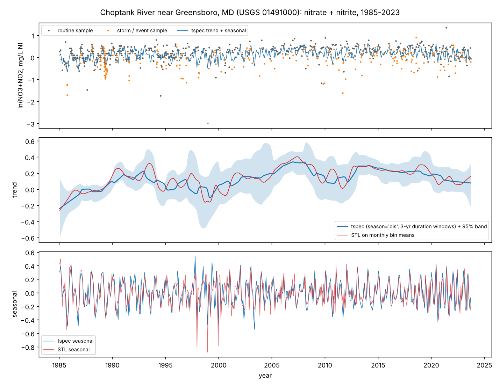
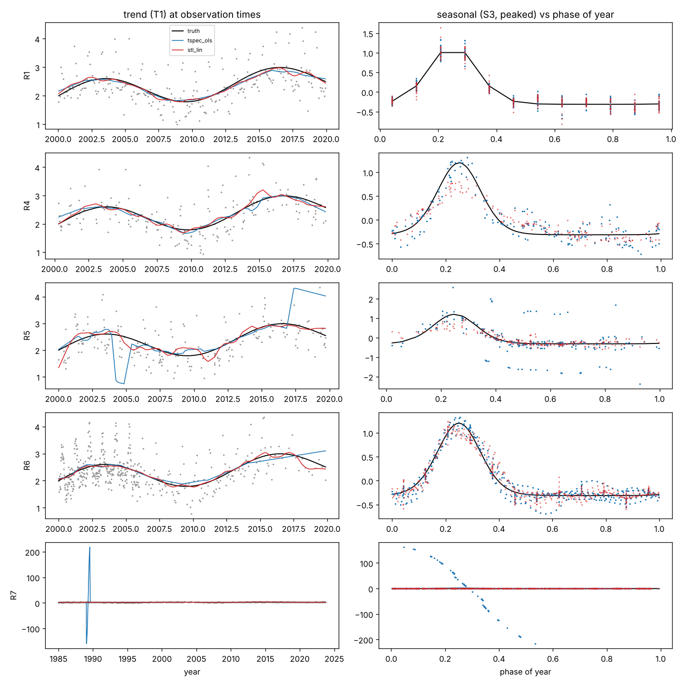

# Held-out decomposition validation: `just_decompose` vs STL

Pre-registered in [`validation/decomposition_heldout_plan.md`](../decomposition_heldout_plan.md) before any design was run. Generated by `validation/bench_decomp_heldout.py`. Code under test: commit `ab17b39` (`src/` clean: True). 100 replicates per cell, `OMP_NUM_THREADS=1`. Versions: tspec 0.1.0, numpy 2.5.3, scipy 1.18.1, statsmodels 0.15.0, pandas 3.0.5, python 3.13.18. Wall time 382 s.

RMSE values are replicate means at the observation times. `cov` is pointwise 95% band coverage of the truth (tspec only). Failures (exceptions) are counted, and excluded from the means.

## Deviations from the registered plan

Made while debugging the harness, before the registered run, with metric output suppressed (a 2-replicate smoke test of 8 cells and of the real-record code checked only for crashes):

1. The monthly evaluation grid is clipped to the data span (the plan's wording); unclipped, its first or last point could fall a few days outside the data, which `eval_times` rejects. STL still fits on the full monthly grid.
2. Primary (observation-time) metrics for `tspec` come from the registered call *without* `eval_times`; grid metrics come from a second call with `eval_times`. The harness first used one call with `eval_times` for both, but that changes the observation-time results (new finding **AUD-19b**, `audit/independent_2026_11/repro_aud19_eval_times.py`), so it would not have tested the registered call.
3. Real-record cross-validation: every method scores the same held-out points, the detected values inside the training span. `eval_times` returned NaN at some held-out times (AUD-19b); RMSE is computed over finite predictions, and the share of unpredicted points is reported.
4. The smoke test also exposed **AUD-19a** (OLS count windows over a storm-sampling burst are ill-conditioned). No code was changed in response; it appears in the R7 results below as it is.

## Registered hypotheses

| ID | Verdict | Summary |
|---|---|---|
| H1 regular data: tspec within 10% of STL | **PASS** | trend / seasonal RMSE ratio (best tspec vs `stl_lin`): T1S1 0.76 / 0.94; T1S2 0.79 / 0.94; T1S3 0.79 / 0.94 |
| H2 irregular: `tspec_ols` beats interpolate-then-STL on trend and seasonal | **FAIL** | 1 of 15 cells (need ≥ 12) |
| H3 irregular: tspec ≤ harmonics + LOWESS baseline (total signal) | **FAIL** | 6 of 18 cells (need ≥ 12) |
| H4 trend band 90–98%, white noise, S1, all regimes | **PASS** | R1 0.954, R2 0.956, R3 0.955, R4 0.961, R5 0.960, R6 0.970, R7 0.955 |
| H5 trend band 90–98% under OU noise | **PASS** | R1 0.944, R4 0.974, R7 0.959 |
| H6 misspecified correlation / heavy tails | DESCRIPTIVE | `tspec_ols` trend / seasonal coverage: R1 N3 0.619 / 0.966; R1 N4 0.963 / 0.959; R4 N3 0.846 / 0.952; R4 N4 0.962 / 0.957; R7 N3 0.678 / 0.944; R7 N4 0.957 / 0.959 |
| H7 `season='ols'` vs default ALLSSA, seasonal RMSE | DESCRIPTIVE | `ols` better in 15 of 21 core cells → docs will recommend `season='ols'` for decomposition |
| H8 steps | DESCRIPTIVE | see the step table below |

### H2 detail (`tspec_ols` vs the better of `stl_lin` / `stl_bin`)

| cell | tspec trend | STL trend | tspec seasonal | STL seasonal | win |
|---|---|---|---|---|---|
| R3_T1S1_N1 | 0.062 | 0.079 | 0.140 | 0.121 | no |
| R3_T1S2_N1 | 0.063 | 0.079 | 0.142 | 0.121 | no |
| R3_T1S3_N1 | 0.061 | 0.080 | 0.141 | 0.128 | no |
| R4_T1S1_N1 | 0.098 | 0.134 | 0.179 | 0.177 | no |
| R4_T1S2_N1 | 0.098 | 0.132 | 0.177 | 0.173 | no |
| R4_T1S3_N1 | 0.109 | 0.137 | 0.189 | 0.193 | yes |
| R5_T1S1_N1 | 0.741 | 0.211 | 0.768 | 0.232 | no |
| R5_T1S2_N1 | 0.688 | 0.210 | 0.713 | 0.230 | no |
| R5_T1S3_N1 | 0.610 | 0.152 | 0.640 | 0.193 | no |
| R6_T1S1_N1 | 0.088 | 0.058 | 0.107 | 0.098 | no |
| R6_T1S2_N1 | 0.089 | 0.057 | 0.109 | 0.095 | no |
| R6_T1S3_N1 | 0.088 | 0.059 | 0.111 | 0.108 | no |
| R7_T1S1_N1 | 18.520 | 0.073 | 18.520 | 0.108 | no |
| R7_T1S2_N1 | 20.566 | 0.074 | 20.566 | 0.110 | no |
| R7_T1S3_N1 | 18.928 | 0.076 | 18.930 | 0.128 | no |

### H3 detail (best of `tspec_ols` / `tspec_ols_dur` vs `harm_lowess`, total-signal RMSE)

| cell | tspec | harm_lowess | win |
|---|---|---|---|
| R2_T1S1_N1 | 0.183 | 0.101 | no |
| R2_T1S2_N1 | 0.184 | 0.216 | yes |
| R2_T1S3_N1 | 0.182 | 0.102 | no |
| R3_T1S1_N1 | 0.151 | 0.086 | no |
| R3_T1S2_N1 | 0.153 | 0.208 | yes |
| R3_T1S3_N1 | 0.152 | 0.085 | no |
| R4_T1S1_N1 | 0.177 | 0.097 | no |
| R4_T1S2_N1 | 0.174 | 0.203 | yes |
| R4_T1S3_N1 | 0.177 | 0.100 | no |
| R5_T1S1_N1 | 0.167 | 0.091 | no |
| R5_T1S2_N1 | 0.168 | 0.183 | yes |
| R5_T1S3_N1 | 0.170 | 0.097 | no |
| R6_T1S1_N1 | 0.137 | 0.071 | no |
| R6_T1S2_N1 | 0.140 | 0.153 | yes |
| R6_T1S3_N1 | 0.140 | 0.071 | no |
| R7_T1S1_N1 | 0.117 | 0.058 | no |
| R7_T1S2_N1 | 0.117 | 0.207 | yes |
| R7_T1S3_N1 | 0.118 | 0.062 | no |

## All cells: trend / seasonal / remainder RMSE at observation times

| cell | n | tspec_default | tspec_ols | tspec_ols_dur | stl_lin | stl_bin | stl_lin_robust | harm_lowess |
|---|---|---|---|---|---|---|---|---|
| R1_T1S1_N1 | 240 | 0.058 / 0.176 / 0.184 | 0.058 / 0.141 / 0.152 | 0.058 / 0.139 / 0.151 | 0.077 / 0.150 / 0.169 | 0.077 / 0.150 / 0.169 | 0.084 / 0.167 / 0.186 | 0.061 / 0.054 / 0.083 |
| R1_T1S2_N1 | 240 | 0.064 / 0.168 / 0.177 | 0.063 / 0.140 / 0.152 | 0.063 / 0.138 / 0.151 | 0.081 / 0.148 / 0.168 | 0.081 / 0.148 / 0.168 | 0.089 / 0.168 / 0.189 | 0.069 / 0.198 / 0.208 |
| R1_T1S3_N1 | 240 | 0.064 / 0.308 / 0.309 | 0.060 / 0.143 / 0.154 | 0.060 / 0.141 / 0.153 | 0.076 / 0.153 / 0.170 | 0.076 / 0.153 / 0.170 | 0.086 / 0.171 / 0.191 | 0.061 / 0.058 / 0.084 |
| R2_T1S1_N1 | 164 | 0.083 / 0.241 / 0.249 | 0.080 / 0.179 / 0.189 | 0.078 / 0.173 / 0.183 | 0.113 / 0.157 / 0.181 | 0.113 / 0.157 / 0.181 | 0.115 / 0.178 / 0.204 | 0.078 / 0.064 / 0.101 |
| R2_T1S2_N1 | 164 | 0.082 / 0.219 / 0.227 | 0.081 / 0.180 / 0.189 | 0.086 / 0.178 / 0.184 | 0.120 / 0.165 / 0.186 | 0.120 / 0.165 / 0.186 | 0.116 / 0.181 / 0.205 | 0.087 / 0.204 / 0.216 |
| R2_T1S3_N1 | 163 | 0.102 / 0.430 / 0.429 | 0.084 / 0.180 / 0.189 | 0.080 / 0.172 / 0.182 | 0.121 / 0.165 / 0.188 | 0.121 / 0.165 / 0.188 | 0.120 / 0.185 / 0.210 | 0.079 / 0.065 / 0.102 |
| R3_T1S1_N1 | 240 | 0.062 / 0.183 / 0.192 | 0.062 / 0.140 / 0.151 | 0.061 / 0.139 / 0.151 | 0.079 / 0.121 / 0.144 | 0.080 / 0.132 / 0.154 | 0.084 / 0.133 / 0.157 | 0.063 / 0.057 / 0.086 |
| R3_T1S2_N1 | 240 | 0.063 / 0.168 / 0.177 | 0.063 / 0.142 / 0.153 | 0.062 / 0.142 / 0.153 | 0.079 / 0.121 / 0.143 | 0.081 / 0.132 / 0.154 | 0.085 / 0.132 / 0.156 | 0.068 / 0.198 / 0.208 |
| R3_T1S3_N1 | 240 | 0.064 / 0.305 / 0.306 | 0.061 / 0.141 / 0.152 | 0.061 / 0.141 / 0.152 | 0.080 / 0.128 / 0.150 | 0.081 / 0.135 / 0.156 | 0.085 / 0.140 / 0.164 | 0.063 / 0.057 / 0.085 |
| R4_T1S1_N1 | 180 | 0.095 / 0.219 / 0.221 | 0.098 / 0.179 / 0.178 | 0.120 / 0.198 / 0.177 | 0.134 / 0.177 / 0.191 | 0.136 / 0.177 / 0.191 | 0.122 / 0.176 / 0.195 | 0.075 / 0.063 / 0.097 |
| R4_T1S2_N1 | 180 | 0.094 / 0.204 / 0.207 | 0.098 / 0.177 / 0.174 | 0.111 / 0.188 / 0.174 | 0.132 / 0.173 / 0.189 | 0.136 / 0.174 / 0.189 | 0.123 / 0.176 / 0.196 | 0.094 / 0.198 / 0.203 |
| R4_T1S3_N1 | 180 | 0.123 / 0.365 / 0.358 | 0.109 / 0.189 / 0.177 | 0.113 / 0.193 / 0.178 | 0.138 / 0.194 / 0.204 | 0.137 / 0.193 / 0.201 | 0.132 / 0.198 / 0.215 | 0.076 / 0.067 / 0.100 |
| R5_T1S1_N1 | 200 | 0.185 / 0.275 / 0.226 | 0.741 / 0.768 / 0.168 | 1.255 / 1.284 / 0.167 | 0.211 / 0.232 / 0.192 | 0.215 / 0.232 / 0.188 | 0.212 / 0.241 / 0.206 | 0.072 / 0.064 / 0.091 |
| R5_T1S2_N1 | 200 | 0.159 / 0.243 / 0.209 | 0.688 / 0.713 / 0.168 | 0.969 / 0.996 / 0.168 | 0.210 / 0.230 / 0.195 | 0.215 / 0.231 / 0.192 | 0.204 / 0.236 / 0.208 | 0.123 / 0.198 / 0.183 |
| R5_T1S3_N1 | 200 | 0.166 / 0.329 / 0.298 | 0.610 / 0.640 / 0.172 | 0.840 / 0.866 / 0.170 | 0.152 / 0.196 / 0.200 | 0.153 / 0.193 / 0.196 | 0.147 / 0.203 / 0.212 | 0.076 / 0.066 / 0.097 |
| R6_T1S1_N1 | 450 | 0.190 / 0.204 / 0.139 | 0.088 / 0.107 / 0.137 | — / — / — | 0.072 / 0.117 / 0.137 | 0.058 / 0.098 / 0.113 | 0.077 / 0.131 / 0.152 | 0.059 / 0.040 / 0.071 |
| R6_T1S2_N1 | 450 | 0.139 / 0.167 / 0.152 | 0.089 / 0.109 / 0.140 | — / — / — | 0.073 / 0.115 / 0.135 | 0.057 / 0.095 / 0.110 | 0.079 / 0.129 / 0.151 | 0.070 / 0.155 / 0.153 |
| R6_T1S3_N1 | 450 | 0.338 / 0.373 / 0.187 | 0.088 / 0.111 / 0.140 | — / — / — | 0.072 / 0.125 / 0.142 | 0.059 / 0.108 / 0.121 | 0.080 / 0.139 / 0.158 | 0.057 / 0.044 / 0.071 |
| R7_T1S1_N1 | 804 | 0.329 / 0.345 / 0.122 | 18.520 / 18.520 / 0.120 | 0.051 / 0.109 / 0.117 | 0.074 / 0.108 / 0.127 | 0.073 / 0.114 / 0.130 | 0.078 / 0.118 / 0.138 | 0.050 / 0.030 / 0.058 |
| R7_T1S2_N1 | 804 | 0.233 / 0.261 / 0.130 | 20.566 / 20.566 / 0.121 | 0.051 / 0.108 / 0.117 | 0.077 / 0.110 / 0.128 | 0.074 / 0.120 / 0.133 | 0.082 / 0.118 / 0.138 | 0.084 / 0.215 / 0.207 |
| R7_T1S3_N1 | 804 | 0.323 / 0.364 / 0.174 | 18.928 / 18.930 / 0.122 | 0.051 / 0.110 / 0.118 | 0.078 / 0.128 / 0.143 | 0.076 / 0.135 / 0.146 | 0.084 / 0.137 / 0.155 | 0.051 / 0.037 / 0.062 |
| R1_T1S1_N2 | 240 | 0.102 / 0.172 / 0.197 | 0.102 / 0.139 / 0.170 | 0.100 / 0.137 / 0.169 | 0.135 / 0.134 / 0.189 | 0.135 / 0.134 / 0.189 | 0.130 / 0.150 / 0.198 | 0.110 / 0.052 / 0.122 |
| R1_T1S1_N3 | 240 | 0.135 / 0.154 / 0.205 | 0.134 / 0.123 / 0.182 | 0.133 / 0.121 / 0.181 | 0.161 / 0.127 / 0.206 | 0.161 / 0.127 / 0.206 | 0.157 / 0.144 / 0.214 | 0.144 / 0.045 / 0.152 |
| R1_T1S1_N4 | 240 | 0.059 / 0.163 / 0.172 | 0.059 / 0.136 / 0.147 | 0.059 / 0.135 / 0.146 | 0.076 / 0.146 / 0.164 | 0.076 / 0.146 / 0.164 | 0.062 / 0.124 / 0.139 | 0.060 / 0.052 / 0.080 |
| R4_T1S1_N2 | 180 | 0.125 / 0.227 / 0.247 | 0.121 / 0.201 / 0.221 | 0.128 / 0.203 / 0.220 | 0.162 / 0.176 / 0.215 | 0.165 / 0.178 / 0.219 | 0.150 / 0.178 / 0.219 | 0.124 / 0.073 / 0.145 |
| R4_T1S1_N3 | 180 | 0.150 / 0.207 / 0.242 | 0.158 / 0.185 / 0.217 | 0.154 / 0.180 / 0.215 | 0.185 / 0.169 / 0.228 | 0.186 / 0.170 / 0.228 | 0.173 / 0.168 / 0.227 | 0.148 / 0.065 / 0.162 |
| R4_T1S1_N4 | 180 | 0.092 / 0.216 / 0.216 | 0.094 / 0.175 / 0.171 | 0.108 / 0.186 / 0.171 | 0.126 / 0.172 / 0.182 | 0.127 / 0.172 / 0.180 | 0.100 / 0.158 / 0.164 | 0.071 / 0.063 / 0.092 |
| R7_T1S1_N2 | 804 | 0.825 / 0.851 / 0.204 | 13.458 / 13.458 / 0.197 | 0.105 / 0.153 / 0.185 | 0.134 / 0.120 / 0.178 | 0.137 / 0.131 / 0.187 | 0.129 / 0.128 / 0.180 | 0.125 / 0.043 / 0.133 |
| R7_T1S1_N3 | 804 | 0.907 / 0.899 / 0.187 | 21.798 / 21.795 / 0.191 | 0.133 / 0.126 / 0.183 | 0.157 / 0.102 / 0.185 | 0.159 / 0.113 / 0.192 | 0.152 / 0.110 / 0.186 | 0.145 / 0.036 / 0.150 |
| R7_T1S1_N4 | 804 | 0.284 / 0.301 / 0.120 | 18.670 / 18.671 / 0.120 | 0.051 / 0.108 / 0.116 | 0.073 / 0.106 / 0.124 | 0.072 / 0.111 / 0.127 | 0.058 / 0.093 / 0.107 | 0.050 / 0.029 / 0.058 |
| R1_T2S1_N1 | 240 | 0.108 / 0.186 / 0.216 | 0.113 / 0.143 / 0.179 | 0.114 / 0.142 / 0.178 | 0.098 / 0.152 / 0.175 | 0.098 / 0.152 / 0.175 | 0.109 / 0.169 / 0.198 | 0.100 / 0.055 / 0.113 |
| R4_T2S1_N1 | 180 | 0.135 / 0.232 / 0.245 | 0.142 / 0.191 / 0.191 | 0.150 / 0.201 / 0.193 | 0.144 / 0.178 / 0.196 | 0.146 / 0.178 / 0.195 | 0.143 / 0.182 / 0.209 | 0.107 / 0.068 / 0.122 |
| R7_T2S1_N1 | 804 | 0.309 / 0.320 / 0.140 | 20.787 / 20.787 / 0.137 | 0.084 / 0.113 / 0.134 | 0.086 / 0.109 / 0.133 | 0.085 / 0.115 / 0.134 | 0.094 / 0.118 / 0.147 | 0.076 / 0.031 / 0.081 |

## Bands, leakage, gaps and runtime (`tspec_ols` unless noted)

Grid NaN share (`tspec_ols`, `eval_times` call): 

| cell | trend cov | seasonal cov | default trend cov | leak seas (tspec_ols / stl_lin) | leak trend (tspec_ols / stl_lin) | gap trend RMSE (tspec_ols / stl_lin / harm_lowess) | sec (tspec_ols / default / stl_lin) |
|---|---|---|---|---|---|---|---|
| R1_T1S1_N1 | 0.954 | 0.956 | 0.965 | 0.00 / -0.00 | 0.09 / 0.02 | — / — / — | 0.02 / 0.06 / 0.002 |
| R1_T1S2_N1 | 0.974 | 0.979 | 0.983 | 0.01 / 0.00 | 0.09 / 0.02 | — / — / — | 0.02 / 0.06 / 0.002 |
| R1_T1S3_N1 | 0.960 | 0.957 | 0.989 | 0.00 / -0.00 | 0.09 / 0.02 | — / — / — | 0.02 / 0.06 / 0.003 |
| R2_T1S1_N1 | 0.956 | 0.960 | 0.970 | -0.00 / 0.17 | 0.08 / 0.03 | 0.083 / 0.209 / 0.071 | 0.02 / 0.06 / 0.002 |
| R2_T1S2_N1 | 0.983 | 0.980 | 0.989 | 0.01 / 0.18 | 0.08 / 0.04 | 0.097 / 0.271 / 0.086 | 0.02 / 0.06 / 0.002 |
| R2_T1S3_N1 | 0.959 | 0.963 | 0.979 | 0.01 / 0.18 | 0.07 / 0.03 | 0.082 / 0.221 / 0.071 | 0.02 / 0.05 / 0.003 |
| R3_T1S1_N1 | 0.955 | 0.955 | 0.968 | 0.00 / 0.13 | 0.09 / 0.02 | — / — / — | 0.02 / 0.06 / 0.002 |
| R3_T1S2_N1 | 0.977 | 0.975 | 0.983 | 0.01 / 0.13 | 0.09 / 0.02 | — / — / — | 0.02 / 0.06 / 0.003 |
| R3_T1S3_N1 | 0.950 | 0.957 | 0.980 | 0.00 / 0.17 | 0.09 / 0.02 | — / — / — | 0.02 / 0.06 / 0.003 |
| R4_T1S1_N1 | 0.961 | 0.958 | 0.940 | -0.00 / 0.34 | 0.07 / 0.01 | 0.155 / 0.184 / 0.075 | 0.02 / 0.06 / 0.003 |
| R4_T1S2_N1 | 0.980 | 0.979 | 0.964 | -0.00 / 0.34 | 0.07 / 0.02 | 0.134 / 0.187 / 0.094 | 0.02 / 0.06 / 0.002 |
| R4_T1S3_N1 | 0.956 | 0.960 | 0.925 | 0.00 / 0.37 | 0.06 / 0.02 | 0.135 / 0.186 / 0.079 | 0.02 / 0.05 / 0.002 |
| R5_T1S1_N1 | 0.960 | 0.958 | 0.788 | -0.00 / 0.33 | 0.07 / 0.02 | 0.956 / 0.269 / 0.070 | 0.02 / 0.06 / 0.002 |
| R5_T1S2_N1 | 0.965 | 0.966 | 0.851 | -0.00 / 0.33 | 0.06 / 0.02 | 0.935 / 0.265 / 0.122 | 0.02 / 0.05 / 0.002 |
| R5_T1S3_N1 | 0.957 | 0.958 | 0.824 | -0.00 / 0.34 | 0.06 / 0.02 | 1.085 / 0.186 / 0.072 | 0.02 / 0.05 / 0.002 |
| R6_T1S1_N1 | 0.970 | 0.969 | 0.874 | 0.00 / 0.05 | 0.14 / 0.01 | — / — / — | 0.02 / 0.08 / 0.002 |
| R6_T1S2_N1 | 0.977 | 0.972 | 0.936 | 0.02 / 0.03 | 0.15 / 0.01 | — / — / — | 0.02 / 0.07 / 0.002 |
| R6_T1S3_N1 | 0.973 | 0.956 | 0.820 | 0.01 / 0.09 | 0.15 / 0.02 | — / — / — | 0.02 / 0.09 / 0.003 |
| R7_T1S1_N1 | 0.955 | 0.960 | 0.926 | 0.00 / 0.14 | 0.07 / 0.00 | 0.071 / 0.150 / 0.047 | 0.04 / 0.15 / 0.004 |
| R7_T1S2_N1 | 0.973 | 0.971 | 0.953 | 0.00 / 0.14 | 0.06 / -0.00 | 0.072 / 0.210 / 0.044 | 0.04 / 0.14 / 0.004 |
| R7_T1S3_N1 | 0.958 | 0.958 | 0.904 | 0.00 / 0.19 | 0.07 / -0.00 | 0.070 / 0.219 / 0.048 | 0.04 / 0.15 / 0.004 |
| R1_T1S1_N2 | 0.944 | 0.979 | 0.950 | -0.00 / 0.00 | 0.09 / 0.02 | — / — / — | 0.02 / 0.06 / 0.002 |
| R1_T1S1_N3 | 0.619 | 0.966 | 0.642 | 0.00 / 0.00 | 0.10 / 0.02 | — / — / — | 0.02 / 0.06 / 0.002 |
| R1_T1S1_N4 | 0.963 | 0.959 | 0.968 | -0.00 / 0.00 | 0.09 / 0.02 | — / — / — | 0.02 / 0.06 / 0.002 |
| R4_T1S1_N2 | 0.974 | 0.916 | 0.975 | 0.00 / 0.40 | 0.08 / 0.01 | 0.255 / 0.200 / 0.117 | 0.02 / 0.06 / 0.002 |
| R4_T1S1_N3 | 0.846 | 0.952 | 0.831 | -0.00 / 0.41 | 0.08 / 0.02 | 0.190 / 0.212 / 0.140 | 0.02 / 0.06 / 0.002 |
| R4_T1S1_N4 | 0.962 | 0.957 | 0.949 | 0.00 / 0.35 | 0.06 / 0.01 | 0.118 / 0.172 / 0.070 | 0.02 / 0.05 / 0.002 |
| R7_T1S1_N2 | 0.959 | 0.930 | 0.956 | 0.00 / 0.18 | 0.08 / -0.01 | 0.111 / 0.169 / 0.087 | 0.04 / 0.15 / 0.004 |
| R7_T1S1_N3 | 0.678 | 0.944 | 0.688 | 0.00 / 0.16 | 0.08 / -0.00 | 0.125 / 0.197 / 0.111 | 0.04 / 0.15 / 0.004 |
| R7_T1S1_N4 | 0.957 | 0.959 | 0.920 | 0.00 / 0.14 | 0.07 / -0.01 | 0.076 / 0.157 / 0.052 | 0.04 / 0.13 / 0.004 |
| R1_T2S1_N1 | 0.916 | 0.960 | 0.932 | 0.00 / -0.00 | 0.14 / 0.04 | — / — / — | 0.02 / 0.06 / 0.002 |
| R4_T2S1_N1 | 0.934 | 0.959 | 0.920 | 0.00 / 0.33 | 0.10 / 0.04 | 0.177 / 0.192 / 0.112 | 0.02 / 0.06 / 0.002 |
| R7_T2S1_N1 | 0.933 | 0.953 | 0.895 | 0.01 / 0.14 | 0.07 / 0.01 | 0.064 / 0.144 / 0.045 | 0.04 / 0.14 / 0.004 |

## H8: steps (trend RMSE within ±1 yr of the +0.9 step)

| cell | jump found | false jumps / series | tspec_jump | tspec_ols (no jump) | stl_lin | harm_lowess |
|---|---|---|---|---|---|---|
| R1_T2S1_N1 | 0.89 | 0.00 | 0.128 | 0.296 | 0.205 | 0.254 |
| R4_T2S1_N1 | 0.57 | 0.03 | 0.213 | 0.310 | 0.224 | 0.247 |
| R7_T2S1_N1 | 0.88 | 0.00 | 0.114 | 0.303 | 0.214 | 0.253 |

## Real record: Choptank River nitrate (USGS 01491000), ln(concentration), 1985–2023

Held-out prediction RMSE (20 random 80/20 splits; mean ± SD). Lower is better.

| method | all samples (n = 804) | routine samples only |
|---|---|---|
| `tspec_default` | 0.3721 ± 0.0317 | 0.3165 ± 0.0281 |
| `tspec_ols` | 1.0629 ± 1.4725 | 16.1486 ± 59.1442 (1.7% of held-out points unpredicted) |
| `tspec_ols_dur` | 0.4436 ± 0.0981 | 0.8869 ± 0.6640 (0.5% of held-out points unpredicted) |
| `stl_lin` | 0.3790 ± 0.0324 | 0.2951 ± 0.0283 |
| `stl_bin` | 0.3729 ± 0.0331 | 0.2924 ± 0.0287 |
| `stl_lin_robust` | 0.3828 ± 0.0315 | 0.2917 ± 0.0306 |
| `harm_lowess` | 0.3620 ± 0.0292 | 0.2796 ± 0.0303 |

Illustrative replicate per sampling regime (not part of the hypotheses):

