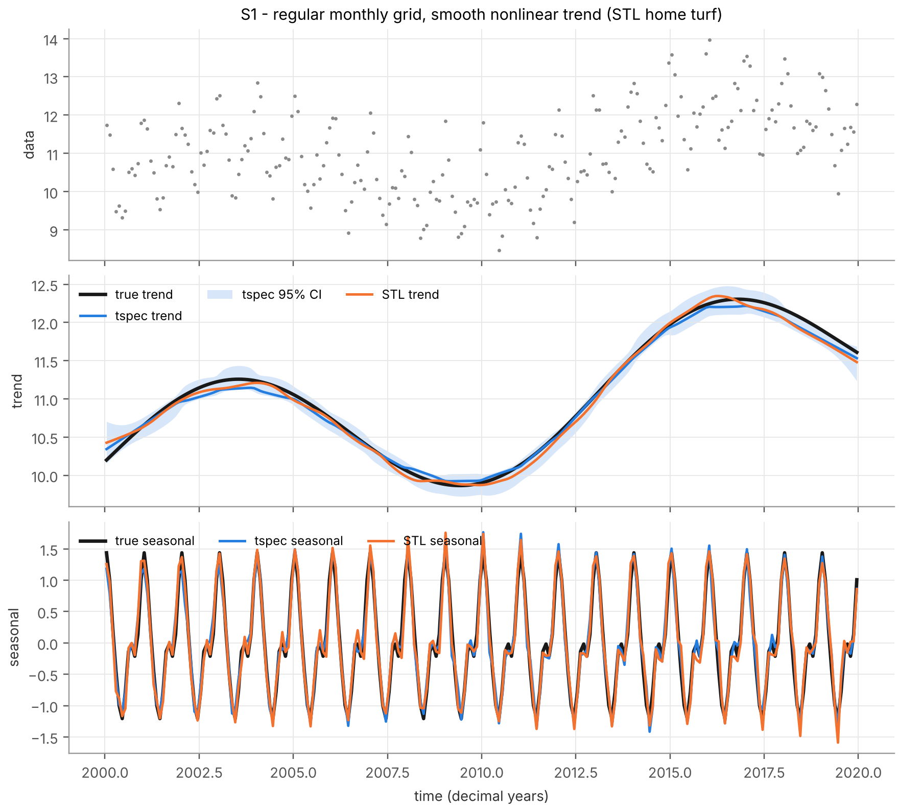
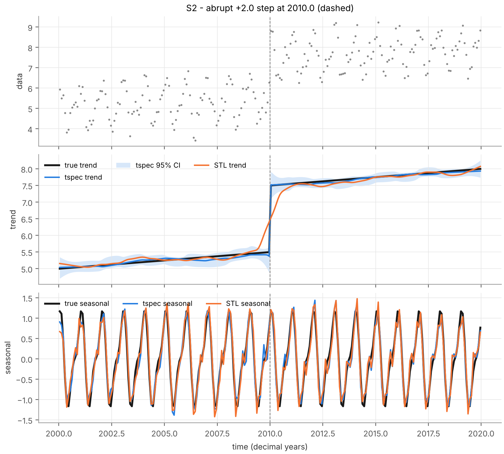
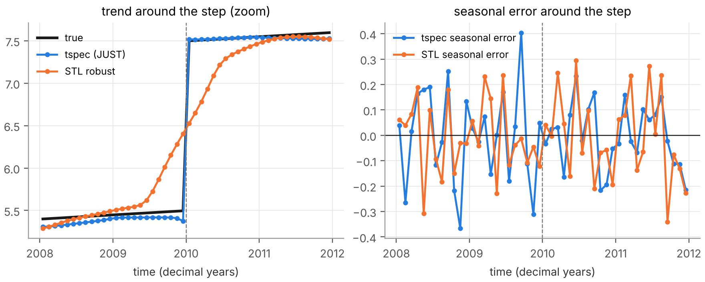
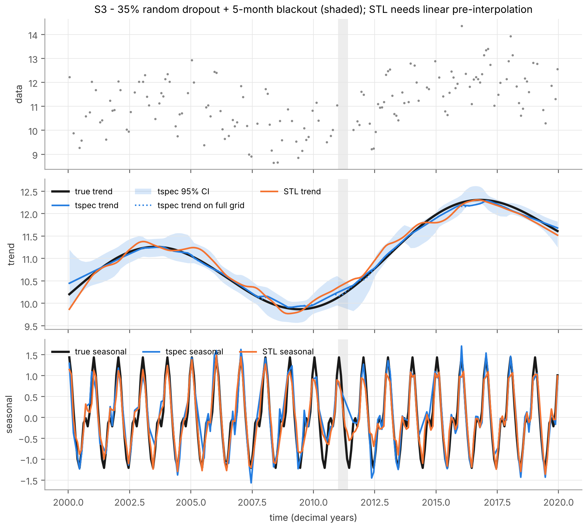
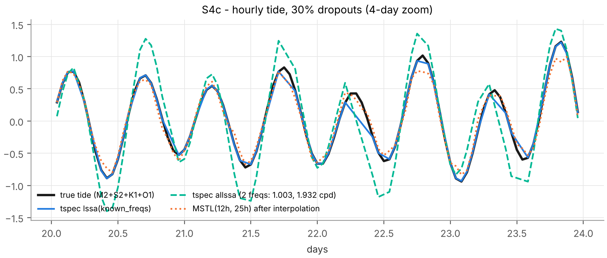
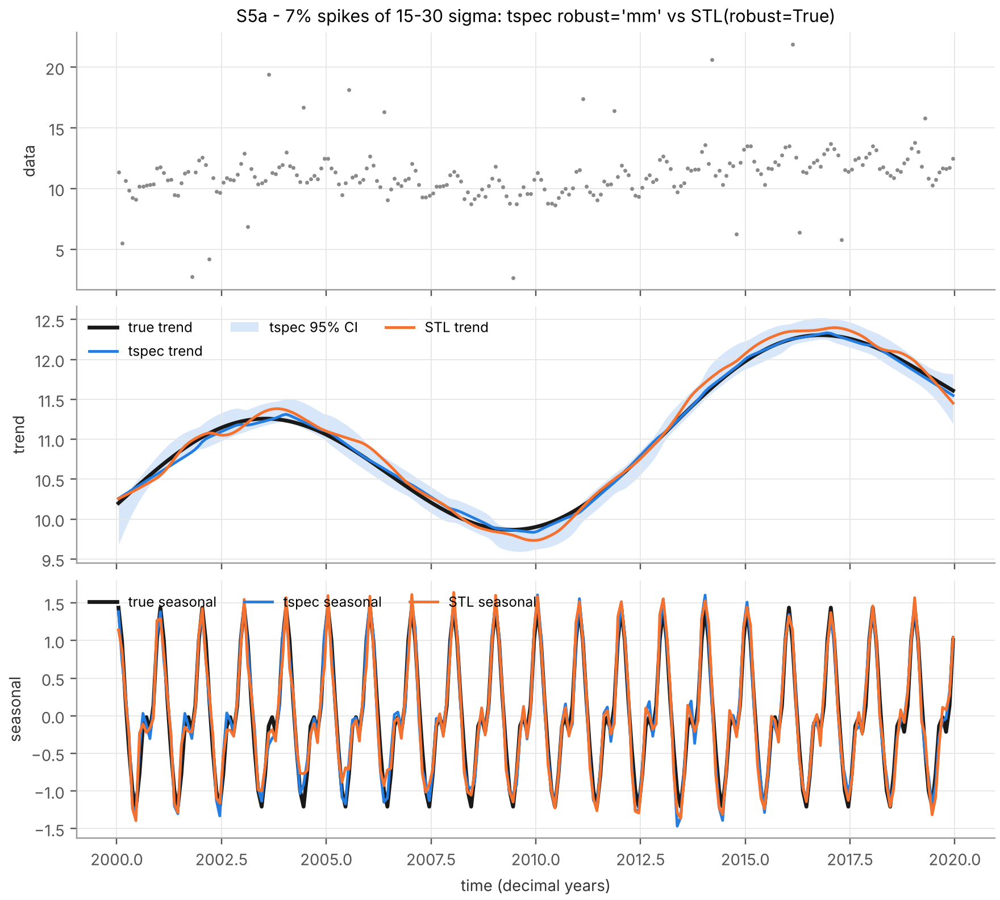
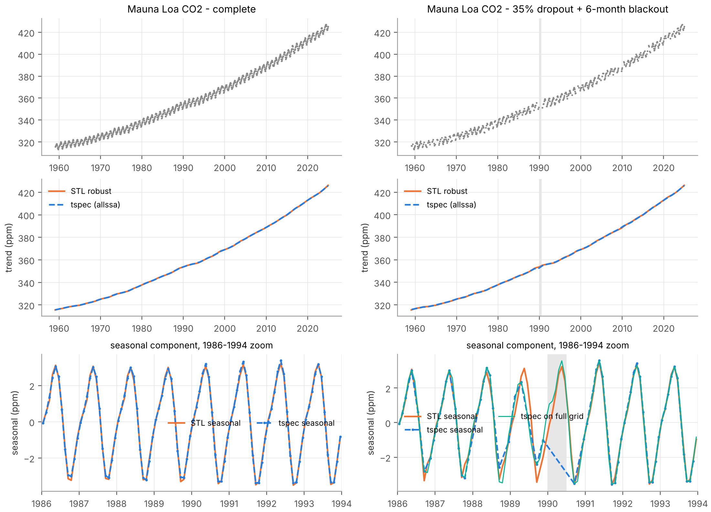
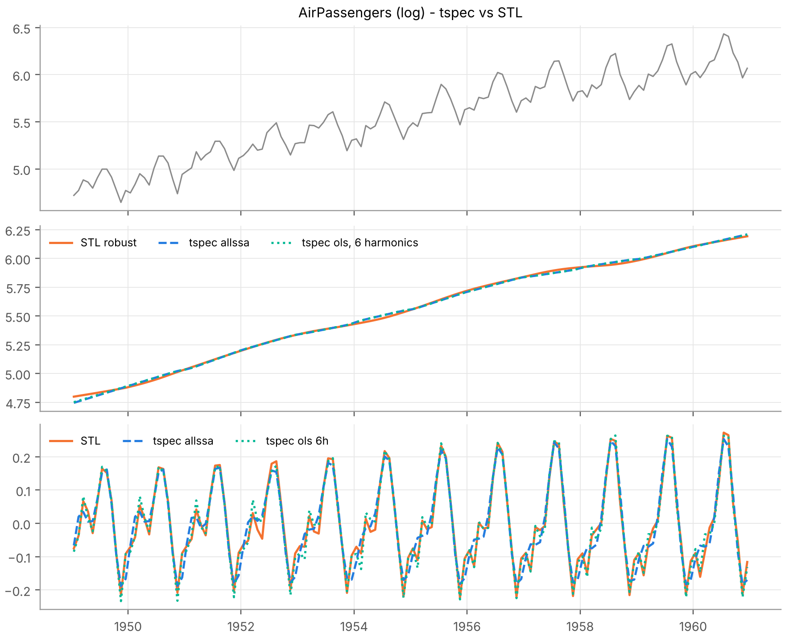
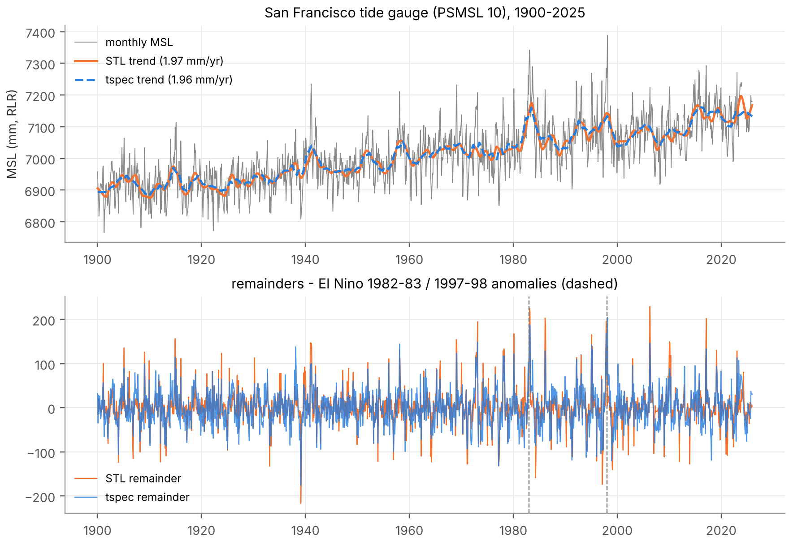

# Tier 2e — Known-solution & real-world head-to-head: `tspec` vs STL / MSTL

Generated by `validation/bench_stl_headtohead.py` (independent audit, 2026-11). `OMP_NUM_THREADS=1 MPLBACKEND=Agg`, 60 Monte Carlo replicates per synthetic scenario; metrics are replicate means. Versions: tspec 0.1.0, numpy 2.5.3, scipy 1.18.1, statsmodels 0.15.0, python 3.13.18, ndimpute 0.1.1.

All synthetic truths are exact analytic functions. RMSE is against the truth; `cov` is the fraction of time points whose pointwise 95% CI contains the truth (STL has no native CI: —). Runtime `sec` is wall-clock per fit, single thread.

## S1 — Regular monthly grid, smooth nonlinear trend + 3 harmonics (STL home turf)

| method | trend RMSE | trend_bc RMSE | seasonal RMSE | remainder vs true noise | trend CI cov | seasonal CI cov | sec |
|---|---|---|---|---|---|---|---|
| `tspec_ols` | 0.072 | 0.073 | 0.139 | 0.156 | 0.952 | 0.956 | 0.015 |
| `tspec_allssa` | 0.072 | 0.074 | 0.212 | 0.222 | 0.970 | 0.959 | 0.056 |
| `stl` | 0.078 | — | 0.149 | 0.167 | — | — | 0.002 |
| `stl_robust` | 0.086 | — | 0.167 | 0.188 | — | — | 0.014 |

## S2 — Abrupt +2.0 step between two months (noise σ = 0.3)

`tspec` = `just_jumps(season='ols')` → `just_decompose(jump_indices=...)`. Jump recall 0.97, false jumps per series 0.17, magnitude error +0.020, location error 0.00 months, trend CI coverage within ±1 yr of the step 0.952.

| method | trend RMSE | trend RMSE ±1 yr | seasonal RMSE ±1 yr | 10–90% rise (months) | jump-magnitude error | sec |
|---|---|---|---|---|---|---|
| `tspec` | 0.064 | 0.095 | 0.144 | 1.000 | 0.020 | 0.183 |
| `stl` | 0.155 | 0.430 | 0.211 | 11.100 | -1.836 | 0.002 |
| `stl_robust` | 0.180 | 0.501 | 0.184 | 13.000 | -1.868 | 0.015 |

## S3 — Irregular sampling: 35% random dropout + 5-month blackout (35% missing)

`tspec` runs natively on the observed timestamps (zero interpolation; `eval_times` = full monthly grid). STL requires a regular grid, so the gaps are first linearly or cubic-spline interpolated.

| method | trend RMSE (obs) | seasonal RMSE (obs) | trend RMSE in gap | trend bias in gap | seasonal RMSE (grid) | trend CI cov (obs) | trend CI cov (gap) | sec |
|---|---|---|---|---|---|---|---|---|
| `tspec` | 0.097 | 0.182 | 0.098 | 0.073 | 0.215 | 0.949 | 0.943 | 0.021 |
| `stl_linear` | 0.128 | 0.204 | 0.154 | -0.058 | 0.223 | — | — | 0.015 |
| `stl_spline` | 0.131 | 0.194 | 0.155 | 0.016 | 0.211 | — | — | 0.015 |

STL seasonal RMSE inside the blackout (linear fill): 0.240; (spline fill): 0.186.

## S4a — Non-integer period (2.37 cy/yr, 5.06 months) + annual cycle

| method | trend RMSE | total periodic RMSE | sec |
|---|---|---|---|
| `tspec_allssa_win` | 0.047 | 0.095 | 0.069 |
| `tspec_ols_fixed124` | 0.049 | 0.551 | 0.017 |
| `stl` | 0.065 | 0.529 | 0.015 |
| `mstl_5_12` | 0.069 | 0.125 | 0.009 |

Global `allssa(decimal=2)`: periodic RMSE 0.325; found 2.37 cy/yr in 37% and 1.0 cy/yr in 100% of replicates (0.03 s).

## S4b — Seasonal amplitude growing linearly 0.5 → 1.5 over 20 years

| method | trend RMSE | seasonal RMSE | seasonal CI cov | sec |
|---|---|---|---|---|
| `tspec_ols` | 0.044 | 0.115 | 0.956 | 0.016 |
| `tspec_allssa` | 0.045 | 0.128 | 0.956 | 0.058 |
| `stl` | 0.063 | 0.122 | — | 0.002 |
| `stl_robust` | 0.071 | 0.137 | — | 0.015 |

Baseline global fixed-amplitude harmonic fit (`lssa(known_freqs=[1,2])`): seasonal RMSE 0.215.

## S4c — Hourly tide gauge: M2 + S2 + K1 + O1, 30% random dropouts, 60 days (time unit = days)

| method | tidal-signal RMSE | constituents | sec |
|---|---|---|---|
| `tspec.lssa(known_freqs=[M2,S2,K1,O1])` (classical harmonic analysis, no interpolation) | 0.0083 | 4 (given) | 0.001 |
| `tspec.allssa(decimal=3)` (blind search) | 0.3254 | 2.0 found | 1.09 |
| `MSTL(periods=(12, 25))` after linear interpolation | 0.1190 | 2 integer periods | 0.08 |

Amplitude errors with `known_freqs`: M2 -0.0004, S2 -0.0010, K1 +0.0004, O1 -0.0007.

## S5a — 7% extreme spikes (15–30σ, random sign)

| method | trend RMSE | seasonal RMSE | remainder err (clean pts) | trend CI cov | sec |
|---|---|---|---|---|---|
| `tspec_none` | 0.327 | 0.847 | 0.780 | 0.975 | 0.017 |
| `tspec_huber` | 0.106 | 0.226 | 0.220 | 0.945 | 0.052 |
| `tspec_mm` | 0.090 | 0.174 | 0.184 | 0.938 | 0.079 |
| `stl` | 0.460 | 0.906 | 0.750 | — | 0.002 |
| `stl_robust` | 0.118 | 0.273 | 0.248 | — | 0.014 |

## S5b — 30% left-censored (<DL) observations

| method | trend RMSE | trend bias | seasonal RMSE | trend CI cov | sec |
|---|---|---|---|---|---|
| `tspec` | 0.063 | -0.004 | 0.154 | 0.952 | 0.019 |
| `tspec_dl2` | 0.089 | -0.063 | — | — | — |
| `stl_dl2` | 0.117 | -0.072 | 0.230 | — | 0.011 |
| `stl_dl` | 0.108 | 0.069 | 0.186 | — | 0.011 |
| `stl_uncensored_oracle` | 0.088 | — | — | — | — |

`tspec` = `just_decompose(censor_status=..., CensoredConfig(dist='normal'))` (trend-aware Tobit imputation); `*_dl2` = naive DL/2 substitution; `stl_dl` = substitute DL; oracle = STL on the uncensored values.

## R1 — Mauna Loa CO₂ (Cleveland et al., 1990), 1959–2024

No ground truth; we report agreement with STL on the complete record and each method's *self-consistency* when 35% of months plus a 6-month blackout (1990.0–1990.5) are removed (RMSE of the gapped decomposition vs the same method on complete data).

Complete: trend RMSE(tspec vs STL) = 0.123 ppm, seasonal RMSE = 0.171 ppm; remainder SD tspec 0.336 vs STL 0.265 ppm; seasonal peak-to-peak 1960 tspec 5.63 / STL 5.58, 2015 tspec 7.34 / STL 7.10 ppm.

| method | trend RMSE vs own complete | in blackout | seasonal RMSE vs own complete | in blackout |
|---|---|---|---|---|
| tspec default `season='allssa'` (native gaps) | 0.136 | 0.378 | 0.262 | 0.496 |
| STL robust (linear fill) | 0.133 | 0.152 | 0.359 | 0.146 |
| tspec `season='ols'` | 0.100 | 0.033 | 0.226 | 0.268 |
| tspec `season='ols'`, 4-yr duration windows | 0.055 | 0.054 | 0.170 | 0.066 |

The default ALLSSA-per-window seasonal model is the weakest `tspec` option across a long blackout on this record (windows straddling the gap select different harmonic sets); fixed OLS harmonics with calendar-duration windows beat linear-fill STL inside the gap.

## R2 — AirPassengers (log), Box & Jenkins Series G

trend RMSE(tspec allssa vs STL) = 0.0138, seasonal RMSE = 0.0356 (tspec OLS with 6 harmonics: 0.0146); remainder SD: tspec allssa 0.0485, tspec ols6 0.0314, STL 0.0264.

## R3 — San Francisco tide gauge (PSMSL 10), monthly MSL 1900–2025

1512 months, 9 missing (tspec: dropped; STL: linear fill). Secular rate from a straight line through the extracted trend: tspec 1.96 mm/yr, STL 1.97 mm/yr; `analyze_series(slope_estimator='sen')` Sen slope 1.95 mm/yr (95% CI 1.81–2.09, AR(1)-corrected MK p = 1.1e-78). NOAA CO-OPS publishes ≈2 mm/yr for station 9414290. Remainder means Dec–May of the 1982-83 / 1997-98 El Niños: tspec +104 / +91 mm; STL +104 / +62 mm.

## R4 — Nile at Aswan (known 1898/99 regime shift; no seasonality, STL not applicable)

`just_jumps(season='none', size=30, step=5)`: jumps at [1899.0] (magnitudes [-433], calibrated p ['0.02']); `ruptures` Binseg(1 bkp): 1901; Pelt(BIC-type penalty): [1901.0]. Known: 1898/1899 (Cobb 1978).

Total wall time 38 s.
